# Crown water-level enclosure (first PETG draft): assembly guide

2026-11-12. Board: `feather_water_level_tc2030` (XM125 radar on its underside) under the nRF54L15 feather. Model: Fusion `feather_water_level_enclosure_crown` v1 (all of stages 1-4). Parts, sizes and clearances are in `..\print_draft_2026-11-11\NOTES.md`. STLs are in `..\print_draft_2026-11-11\`.

Most pictures are from the Fusion model. In each "before" picture the part floats clear of its seat; the "fitted" picture shows it in place. **The black hardware (standoffs, screws, inserts) is one lump in the model and cannot be moved**, so it stays in place in the "before" pictures. Steps marked **PROVISIONAL** depend on something Brian has not decided yet, or on something the model does not show.

**Big picture:** the Crown is a flat box, radar window down. The sole carries the radar board (radar looks out through a 1.5 mm window) with the feather above it. The hood covers the boards. A hump (bonnet) on one end holds the battery. The Crown clips into a separate **dock** (ring + plate). The plate comes in several versions that fit different containers: A6 Pad, A2 Span, A5 Expander. Swap the plate, keep the Crown.

*The finished Crown, seen from above. Red = key button and light pipe. The hump with four screws is the battery bonnet.*

*Exploded, bottom to top: sole, radar board, feather, hood (key and light pipe under it), battery, bonnet.*

---

## 0. Know the parts (labelled pictures)

Names used in the steps below. Colours are only for the pictures (print everything in plain PETG, TPU ring in TPU). Labels were placed by eye; if one looks off, trust the step text.

### The Crown

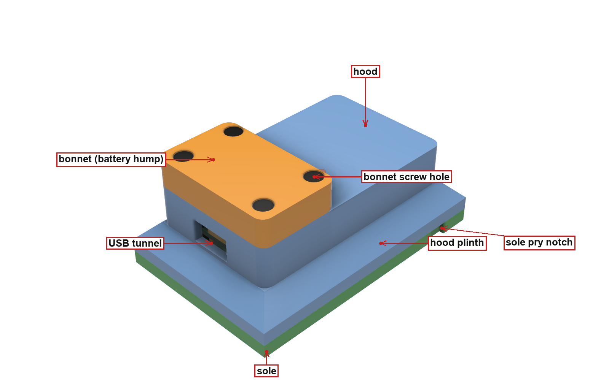

*Outside of the Crown.*

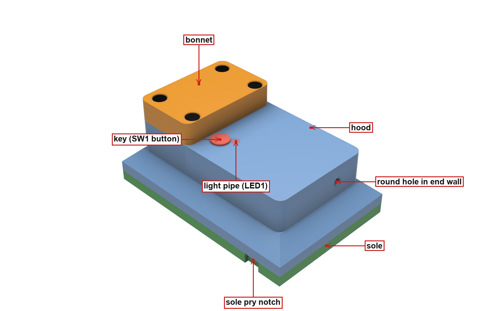

*Key and light pipe.*

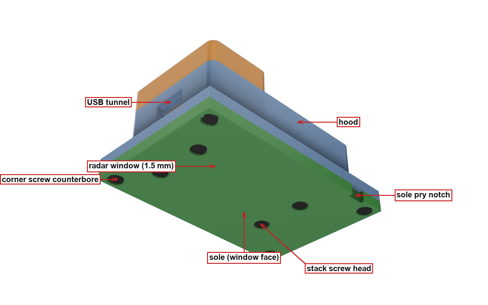

*Underside: radar window face and sole screw counterbores.*

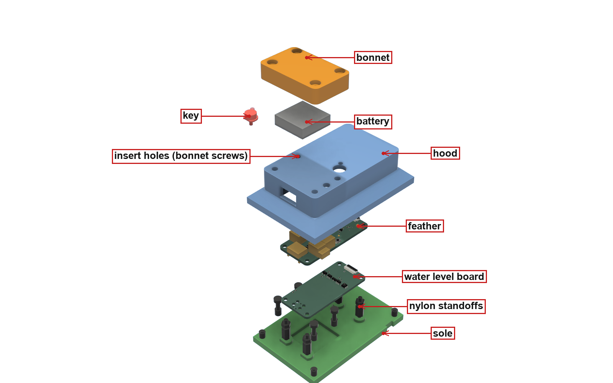

*Exploded stack.*

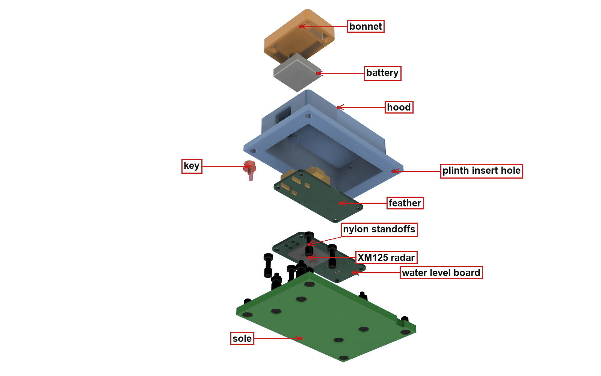

*Exploded from below: the XM125 radar on the underside of the water level board.*

### Dock

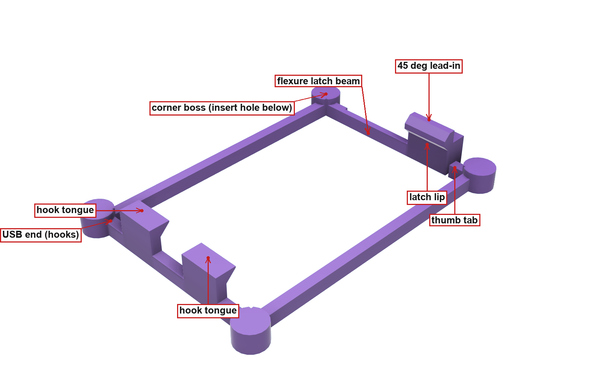

*Dock ring from above: hook tongues at the USB end, latch at the far end.*

*Dock ring from below: boss insert holes and plate seat.*

*Blank dock plate.*

*Latch close-up with the Crown seated. Push the thumb tab out (arrow) to release, then lift the far end.*

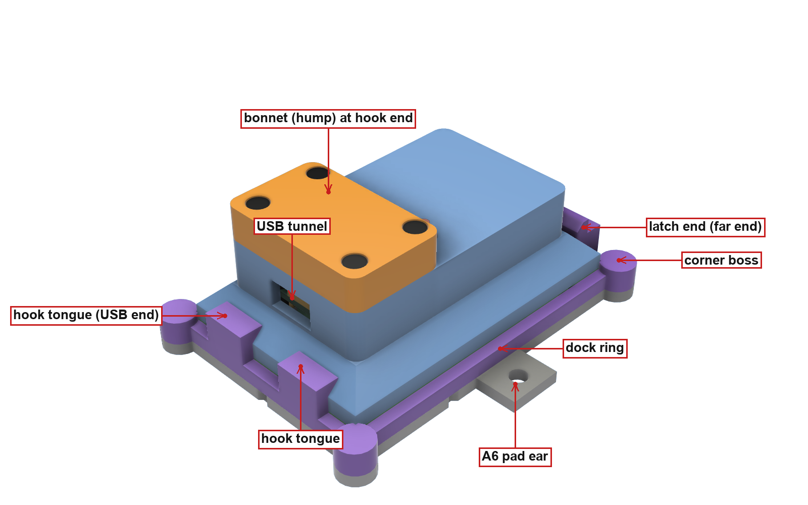

*Crown on the dock the right way round: bonnet and USB at the hook end.*

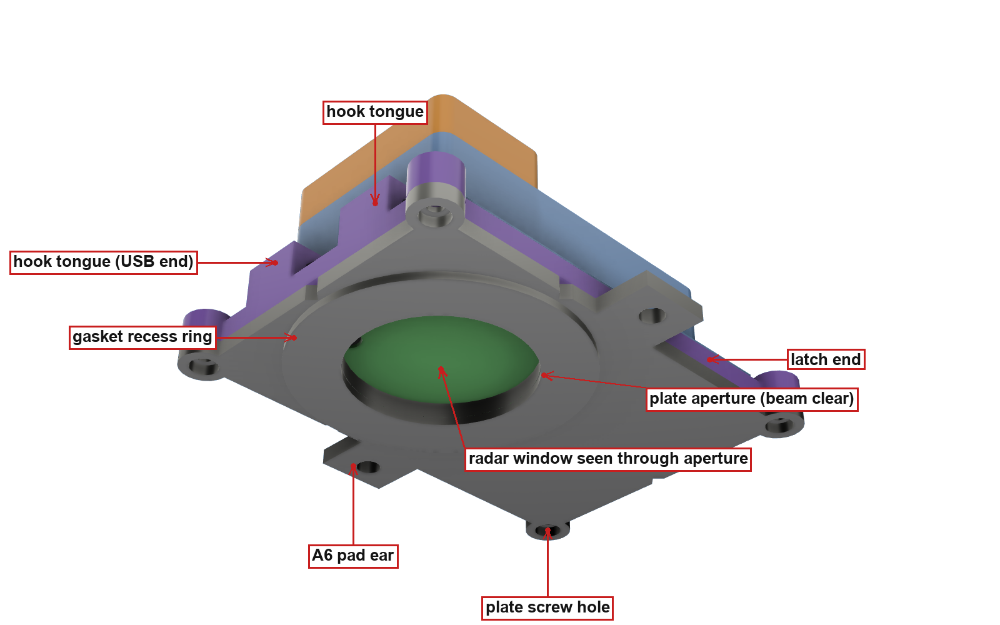

*From below: the radar window must be centred in the plate aperture.*

### Mounting plates

*A6 Pad.*

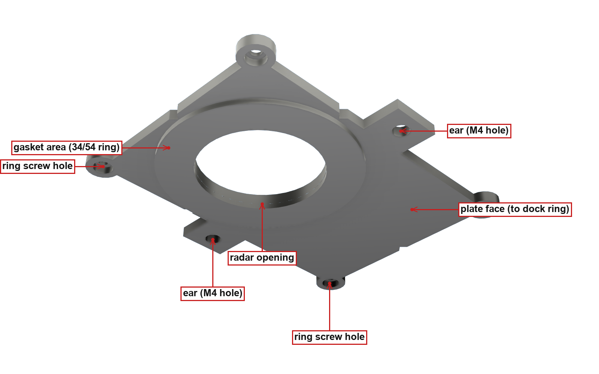

*A6 Pad from below: gasket area.*

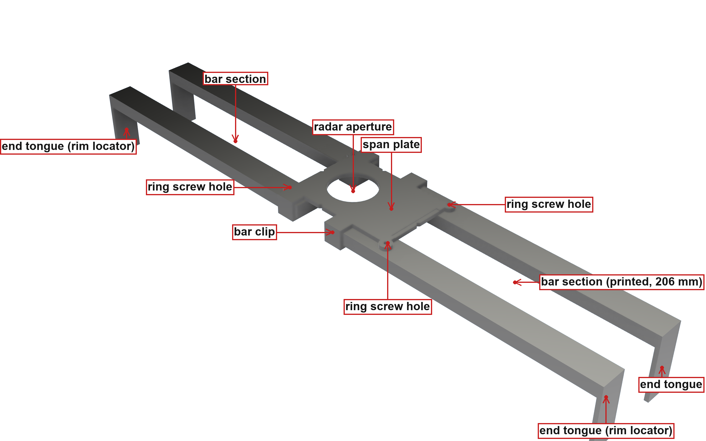

*A2 Span with printed bar sections.*

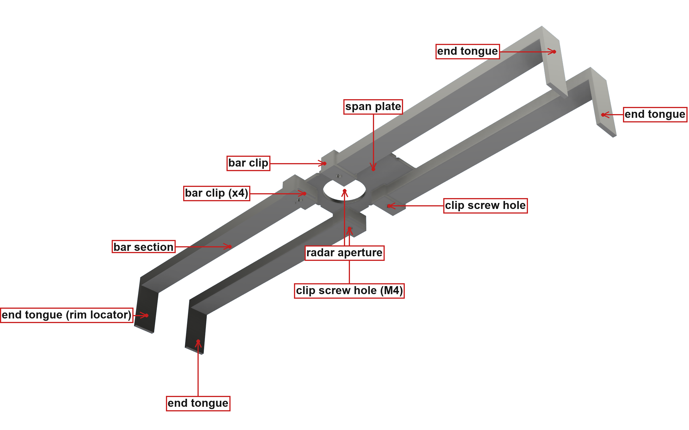

*A2 Span from below: bar clips.*

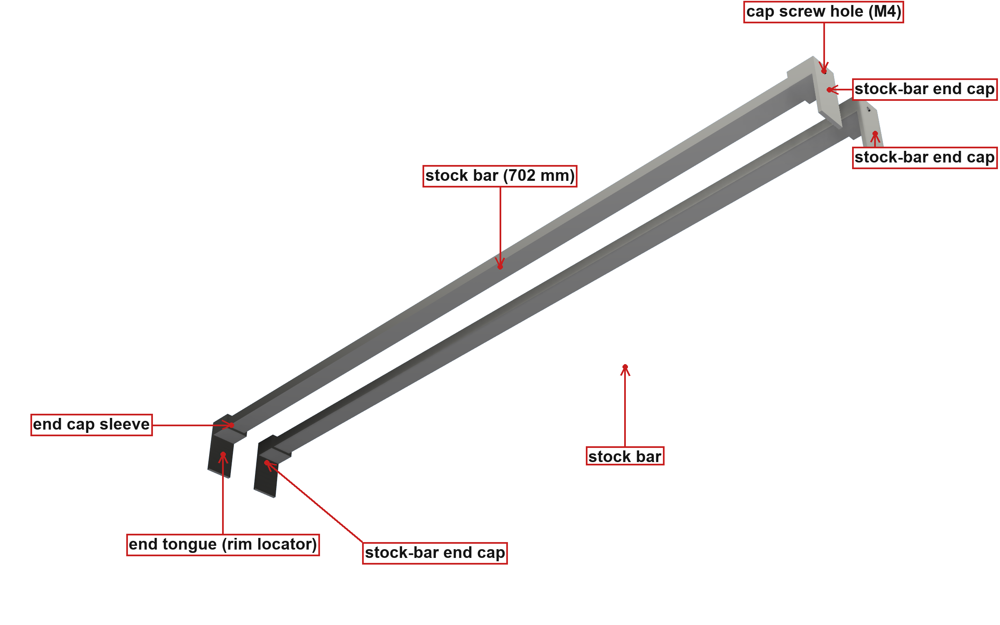

*A2 Span with stock bars and end caps.*

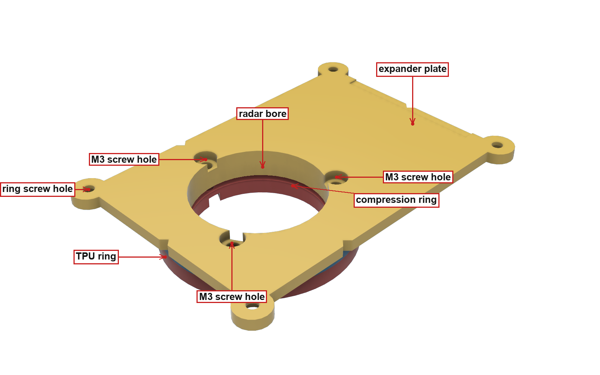

*A5 Expander.*

*A5 Expander from below: nut pockets, TPU ring, compression ring.*

---

## 1. Printed parts (PETG unless noted)

All STLs are in `..\print_draft_2026-11-11\`. No supports on any stage 2-4 part. Window and plates 100 % solid, 4 perimeters. Rotate in the slicer as in the orientation column. **Nothing has been sliced or printed.**

| STL | Qty | Material | Print orientation | Used for |
| --- | --- | --- | --- | --- |
| crown_sole.stl | 1 | PETG | window face down on smooth PEI, window 100 % solid | Base, carries the boards |
| crown_hood.stl | 1 | PETG | roof down (plinth flare overhangs at 45 deg; orientation not re-checked) | Cover |
| crown_bonnet.stl | 1 | PETG | top down | Battery hump |
| crown_key.stl | 1 | PETG | flange down | SW1 button |
| crown_lightpipe.stl | 1 | PETG | flange down | LED1 light pipe |
| crown_dock_ring.stl | 1 | PETG | as exported (bottom on bed) | Dock, reused on every plate |
| crown_dock_plate_blank.stl | 1 | PETG | flip: top on bed, counterbores up | Plain plate (no adapter) |
| crown_a6_pad_plate.stl | 1 | PETG | flip: top on bed | A6 Pad, holes 25-33 mm |
| crown_a2_span_plate.stl | 1 | PETG | flip: top on bed, clips grow up (19.45 mm bridges, check the first print) | A2 Span, trash can with lid off |
| crown_a2_bar_section_rim430_x4.stl | 4 | PETG | on its 9.525 x 206 side face, tongue flat | A2 printed bars (2 per side, rim about 430 mm) |
| crown_a2_stockbar_endcap_x4.stl | 4 | PETG | outer end face on the bed | A2 stock-bar version only |
| crown_a5_expander_plate_top3.stl | 1 | PETG | flip: top on bed, tube grows up (made for a 3 mm top) | A5, holes 50.5 mm and up |
| crown_a5_compression_ring.stl | 1 | PETG | TPU-side face on bed, nut pockets up | A5 |
| crown_a5_tpu_ring_top3_TPU95A.stl | 1 | **TPU 95A** | flat | A5 seal ring (PETG only as a fit check) |

Not printed: **A6 gasket**, a 34 mm ID / 54 mm OD / 1.5 mm ring cut from sheet.

Pictures of the dock parts are in the steps below.

## 2. Hardware kit

Amazon ASINs are from `mechanical\hardware_lists\enclosure_hardware_amazon_2026-11-01.md`. Items that NOTES.md says are **not on that list** are marked "not on the Amazon list yet".

| Item | ASIN | Qty used | Where |
| --- | --- | --- | --- |
| M2.5 brass heat-set insert, 4 mm long x 4 mm OD (3.6 mm hole, 5 mm deep) | B0DPQK6RJZ (pack of 100) | 4 ring bosses (NOTES). The hood plinth, hood roof and sole posts also use inserts; NOTES.md does not give their count or size. **PROVISIONAL: assumed the same M2.5 x 4 insert, count from the model** | Dock ring; hood; sole |
| MCMASKE M2.5 black nylon M-F standoff kit (6/8/10/... mm, 6 mm male thread) | B0B5M1M822 | Board stack: 8 mm standoffs ("8 mm nylon standoffs" in the model). Also the 4 M2.5 x 6 nylon screws for plate-to-ring (head must be 2.0 mm or less, not checked) | Boards; plate to ring |
| M2.5 x 6 socket head cap, 304 stainless | B0GCSRG1WD (pack of 50) | Hood-to-sole corner screws (4). **PROVISIONAL: NOTES.md says "corner screws" but not size or length; same screw as the Tidemark foot cap assumed** | Sole corners |
| Mr O-Ring 2 mm silicone cord | B00QVB0ZG6 | Not used in the Crown model: no o-ring groove is modelled (drip lip not modelled) | n/a |
| Nylon M4 x 10 pan head (Essentra 50M040070N010) | DigiKey, type on the list (2 bought for Perch) | **8 for the stock-bar A2** (4 clips + 4 caps), 4 for the printed-bar A2. **Need 8 more, not on the Amazon list yet** | A2 Span |
| M4 nylon screws, 2 | **not on the Amazon list yet** | A6 ears, optional (use foam tape instead) | A6 Pad |
| M3 nylon pan head screws, about 2.4 mm head, M3 x 12 for a 3 mm top | **not on the Amazon list yet** | 3 | A5 Expander |
| M3 nylon hex nuts, 5.5 AF x 2.4 | **not on the Amazon list yet** | 3 | A5 compression ring |
| 1.5 mm closed-cell foam or EPDM gasket sheet | **not on the Amazon list yet** (material not chosen) | 1 ring 34/54 | A6 Pad |
| 3/8 x 3/4 in HDPE or PVC flat bar, 702 mm long | **not on the Amazon list yet** (source not checked) | 2 | A2 stock-bar version only |
| Bull's-eye level vial, 6-8 mm | **not on the Amazon list yet** (not modelled) | 1 per adapter | Levelling |
| TinyCircuits ASR00003 LiPo cell, 20 x 20 x 5 mm, with plug | electronics, DigiKey/Mouser; not checked here | 1 | Bonnet |
| 14-way 0.5 mm FFC (feather CN1 to water level CN1) | Molex 0150200140 Type D, 30 mm, from the Tidemark list. **PROVISIONAL: the Crown boards sit about 10 mm apart, length and type not checked for this stack** | 1 | Between the boards |
| TC2030-IDC cable (tool, not a part) | Tag-Connect, DigiKey TC2030-IDC-ND | 1 | Firmware update only |
| TPU 95A filament | Brian has it | A5 ring | |

**WARNING: the feather's H4 screw must be nylon.** The head of H4 is only 0.49 mm from the antenna (AE1) reference box, inside the antenna keep-out on the board. Steel or brass there detunes the antenna. Use a nylon screw and nut at H4. **PROVISIONAL: whether the sole post under H4 gets a brass insert or nylon hardware is Brian's open question 6.**

## 3. Before you start

1. Remove brims and supports. Check the sole's window face is smooth and flat (the radar looks through 1.5 mm of PETG).
2. **Dock ring inserts.** Press one M2.5 x 4 mm insert (B0DPQK6RJZ) into each of the 4 corner bosses of the dock ring, from the bottom face (3.6 mm hole, 5 mm deep). Keep them square.
3. **Hood and sole inserts. PROVISIONAL.** The model has inserts in the hood plinth, in the hood roof (for the bonnet screws) and in the sole posts. Press them in from the face the model shows them in; count and size are not in NOTES.md, so read them off the Fusion model before heating anything.
4. Try the key and light pipe in their holes in the hood. They should slide freely. Sand if tight.

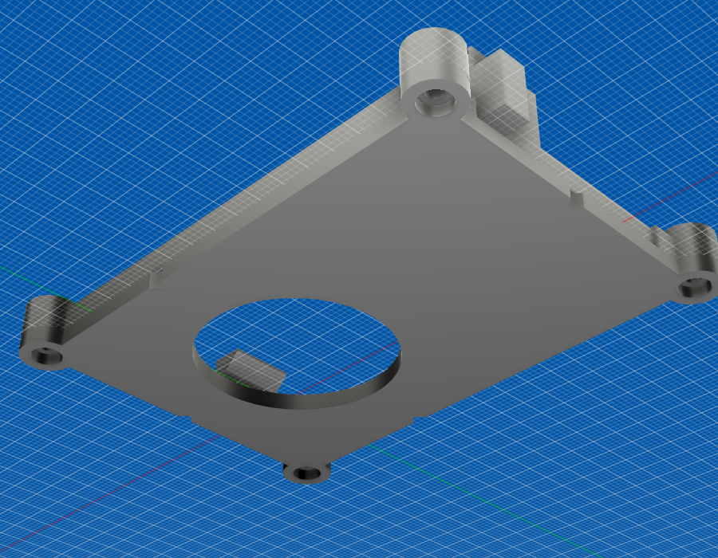

*Dock ring and plate from below: each of the 4 corner bosses has a hole for an insert. This picture is the dock after step 8.*

## 4. Build the Crown

### Step 1. Radar board onto the sole
The sole stands with its window face down. The four posts are 1.965 mm tall and fit the water level board's H1-H4 holes. Put the water level board on the posts with the radar (XM125) facing the window and the TC2030 pads (J1, between H1 and H2) facing the sole. Fix it with the standoff hardware as in the model (8 mm nylon standoffs, one per post).

**WARNING:** do not touch the radar face. It sits 4.0 mm above the window face under 1.5 mm of PETG.

<table><tr>
<td>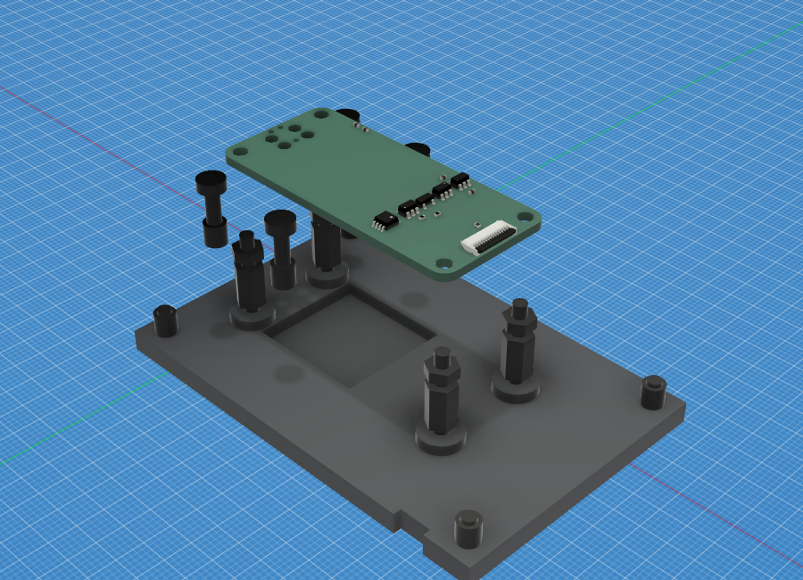 Before: the board floats above the 4 posts. The black standoffs are fixed in the model.</td>
<td>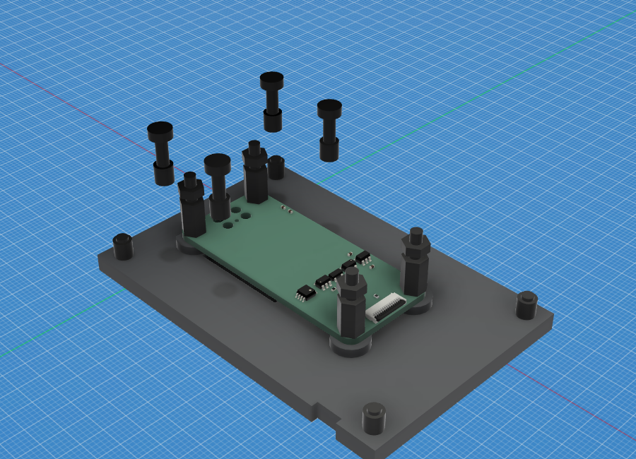 Fitted: the board sits on the posts. The four collared black screws floating above are the bonnet screws (step 6), not part of this step.</td>
</tr></table>

### Step 2. Feather onto the radar board
Plug the 14-way FFC into CN1 on both boards first (CN1 is at the +x end of both boards, see the white connectors in the pictures). Then lower the feather onto the standoffs, components up. **PROVISIONAL: how the feather is clamped on the standoff tops (screw and nut) is not given in NOTES.md; follow the model's hardware.**

**WARNING (H4, nylon only):** the H4 screw at the antenna corner must be nylon. See the hardware kit.

<table><tr>
<td>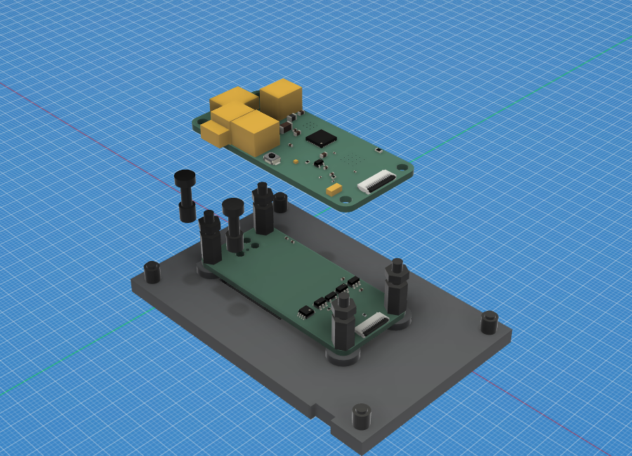 Before: the feather above the stack.</td>
<td>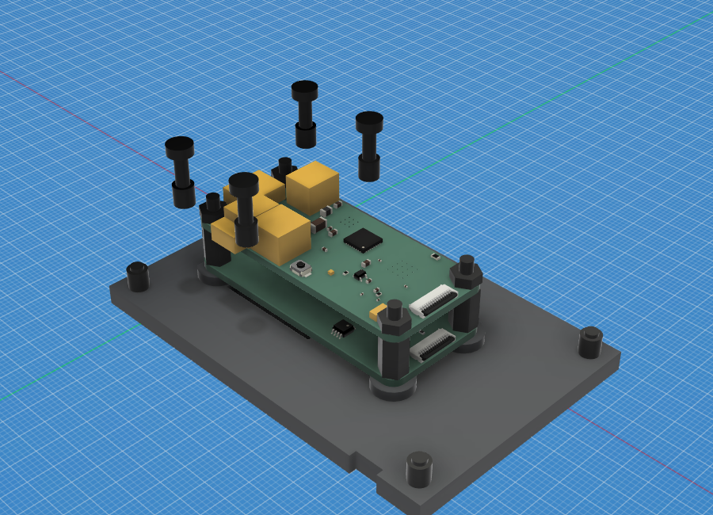 Fitted: both boards in one stack, about 10 mm between them.</td>
</tr></table>

### Step 3. Key and light pipe into the hood
Turn the hood roof down. Push the key and the light pipe into their holes from the underside (inside) of the roof. They are held later by the feather, which sits close under them.

<table><tr>
<td> Before: hood seen from below, key (red) and light pipe under their holes.</td>
<td>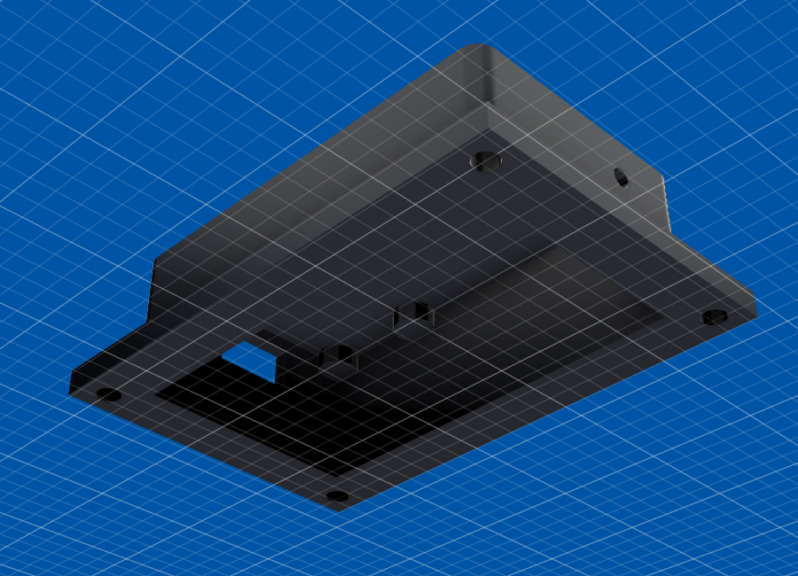 Fitted: they sit up in the roof pockets.</td>
</tr></table>

### Step 4. Battery pigtail into U4, then hood over the stack
**Do this before the hood goes on.** U4 (the feather's battery JST) sits under the hood roof, and the PH plug won't pass through the 4 mm roof hole, so the battery can only be plugged in while the stack is out.

1. Make the pigtail: a JST PHR-2 plug with **thin, flexible wire (AWG 28 silicone is best; AWG 26 PVC is too stiff for the bend)**, about **40-45 mm** from plug back to bare ends. Leave the far ends bare (not tinned into a blob) so they fit through the hole together.
2. Meter it: the contact that lands on U4 pad 1 must be + (red).
3. Push the plug fully home in U4. The wires leave the back of the plug toward the hood wall; there is only about 3 mm before the wall, so bend them straight up right behind the plug and twist the pair together.
4. Find the 4 mm battery-lead hole in the hood roof (under where the bonnet goes, between its two screw inserts on the U4 side). Feed the twisted pair up through it from inside as you lower the hood. The hole is about 1.5 mm toward the USB end from the plug centre, so lean the pair that way.

Then, keeping the wires through the hole: **PROVISIONAL (order inferred, not modelled).** Keep the hood roof down with the key and pipe in. Pick up the sole with its board stack as one rigid unit and lower it, boards first, into the hood. If you prefer, turn the stack the right way up and lower the hood over it, holding the key and light pipe in with a finger or tape. Then fit the 4 corner screws from the window face through the sole counterbores into the hood plinth inserts. Tighten in a cross pattern.

<table><tr>
<td> Before: hood above the stack.</td>
<td> Fitted: hood on the sole. The four black screws standing in the roof are the bonnet screws.</td>
</tr></table>

### Step 5. Splice the cell, battery into the hump, bonnet on
The cell (TinyCircuits ASR00003) lies on the hood roof on a 1 mm pad and the bonnet covers it. Its own lead is only 12 mm with a JST SH plug, which doesn't fit U4.

1. Cut the SH plug off the cell. Splice the cell leads to the pigtail ends coming up through the roof hole, **red to the + wire** (check with the meter).
2. **Stagger the two joints** (about 6 mm apart) with small heat-shrink on each. A straight 15-20 mm splice doesn't fit. The free space for the joints is a box about **10.9 x 6.9 x 6.5 mm**, between the two bonnet screw bosses on the hole side, beside the cell. The cell lead passes under a rib in the bonnet with a 2 mm gap, so keep the joints out from under it.
3. Lay the cell on its pad and tuck the joints into that space.
4. Put the bonnet on and fit its 4 screws into the roof inserts.

**Battery first:** with the pigtail plugged in at step 4, the battery is connected as soon as the splice is made. Do that before USB or any solar is connected.

Lead path measured in Fusion and from the JST datasheet on 2026-11-12 (`..\battery_lead_check_2026-11-12\LEAD_CHECK.md`). **Check the bend behind the plug on the first build.**

<table><tr>
<td>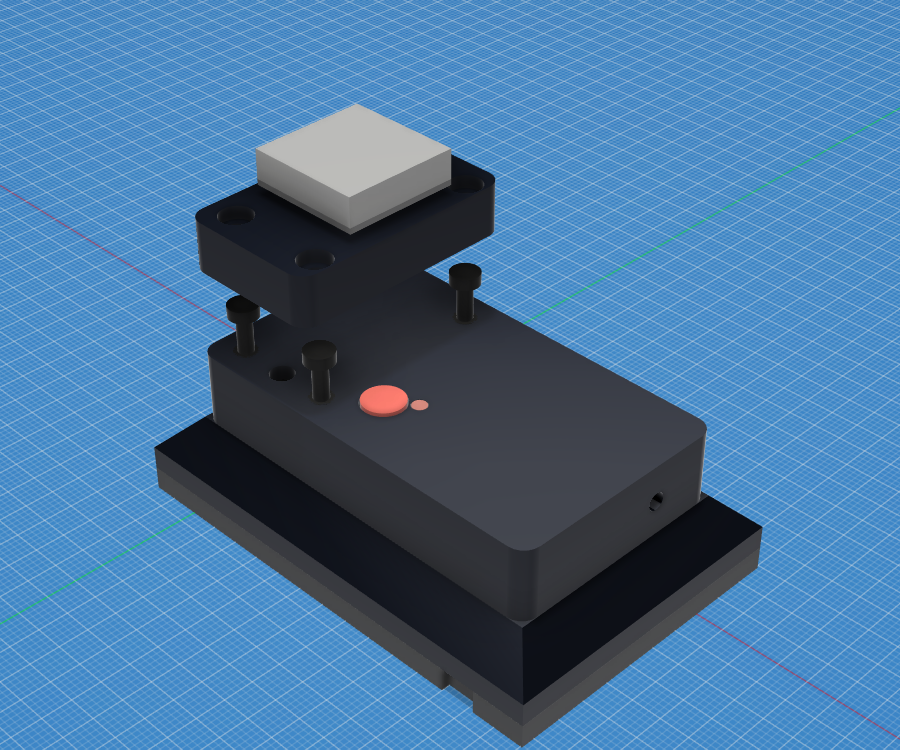 Before: cell and bonnet over the hood roof.</td>
<td> Fitted: the hump sits on the USB end of the hood.</td>
</tr></table>

### Step 6. Check the Crown
The USB-C connector is in the -x end wall (a tunnel in the hood), the 3 mm round vent is in the opposite (+x, latch) end wall (checked in the hood STL; NOTES.md says -x, which is wrong). The key sits just under the hump edge. If the Crown is for a first print only, test fit the cell and board before you glue or close anything.

## 5. Dock: ring and plate

### Step 7. Plate onto the ring. PROVISIONAL (polarity, latch)
Pick the plate you need (blank, A6 Pad, A2 Span or A5 Expander; steps 9-11). Hold the plate under the ring, plate top (the face with the counterbores facing up from below) against the ring's bottom. Fit four M2.5 x 6 nylon screws from below through the plate counterbores into the 4 ring inserts.

<table><tr>
<td>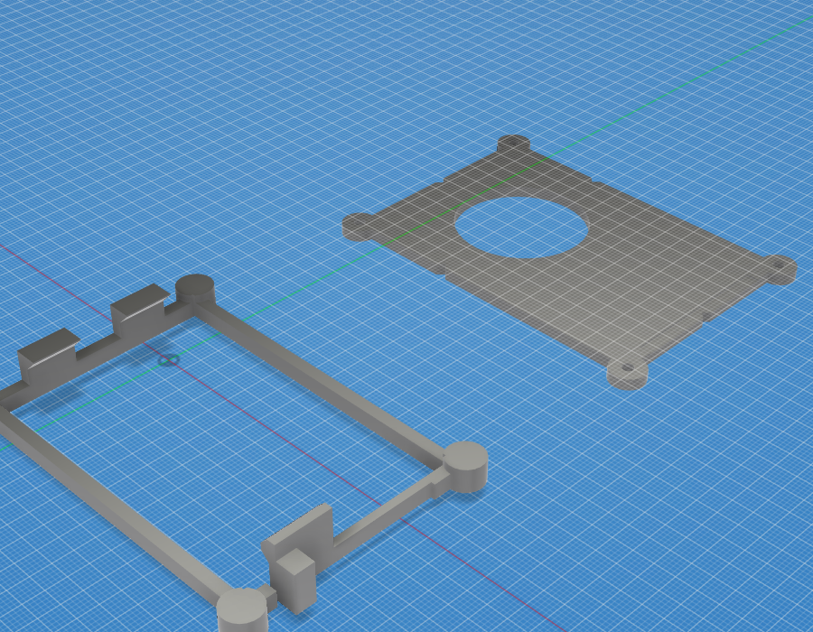 Before: ring (left) and plate (right). The model shows the plate flipped for printing.</td>
<td> Fitted: the plate closes the bottom of the ring. The two hook tongues are at the left end, the latch beam at the right end.</td>
</tr></table>

### Step 8. Crown into the dock. PROVISIONAL (polarity chamfer, off-centre latch)

 

*Left: right way round (bonnet at the hook tongues). Right: thumb tab and latch; push the tab the way of the arrow to release.*
1. **WARNING: orientation.** The Crown foot is a plain rectangle, so it also fits the dock turned 180 deg. Turned wrong, the radar sits 28.3 mm off the aperture centre and the **plate covers the radar beam**. The correct way: the **hump end (battery, key) and the radar are at the hook end** of the dock (the two hook tongues). The aperture in the plate is at the same end. Check by looking up through the aperture from below: you should see the radar window centred in it. Brian's open question 2 (an 8 x 8 mm polarity chamfer) would make the wrong way impossible; it is not in the model yet.
2. Slide the Crown's USB end under the two hook tongues.
3. Lower the far end. The latch beam is pushed out by its 45 deg lead-in and clicks back in. Check that the Crown does not rock.
4. To release: push the thumb tab (+x) outwards and lift the far end. The latch is off-centre (y -24.4 against the radar axis), fine for about 150 g, but test the hold on the bench.

<table><tr>
<td>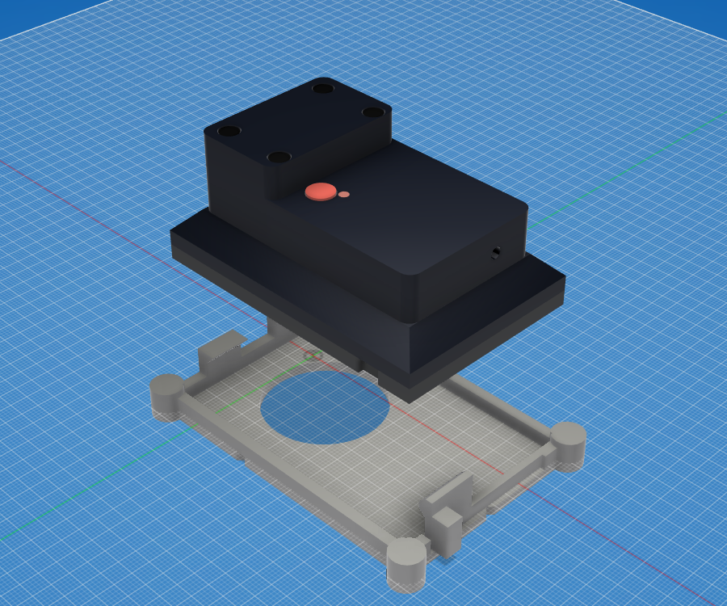 Before: the Crown above the dock, hook end towards you on the left.</td>
<td> Fitted: the Crown in the ring, hook tongues over its USB end, latch beam at the far end.</td>
</tr></table>

*The dock from below (plate side). You look through the aperture at the radar window. The 3 mm V notches on the four plate edges are on the radar axis lines for aiming. Right of the picture is the radar end.*

## 6. Mounting

Choose one plate. The Crown stays the same.

### 6a. A6 Pad: lid with a hole 25-33 mm wide (33-44 mm relies on the gasket overhang; bench test)
1. Cut the gasket ring (ID 34, OD 54, 1.5 mm) from your sheet. **PROVISIONAL: material not chosen (closed-cell foam or EPDM).**
2. Put it between the lid and the plate. The Crown's outer face ends up 4.5 mm above the lid.
3. Hold the pad with foam tape, or with up to two M4 nylon screws through the ears (4.5 mm holes). Screw length depends on the lid thickness, not on the Amazon list.
4. Level the Crown with the bull's-eye vial (not modelled, not on the list).

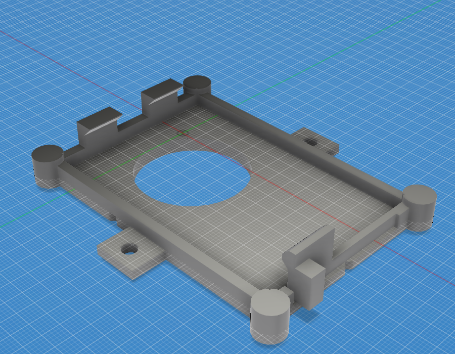 

*Left: A6 Pad under the ring (ears at the sides carry the M4 holes). Right: from below, the gasket ring lies round the aperture.*

### 6b. A2 Span: trash can with the lid off (rim up to about 430 mm printed, 700 mm with stock bar)
The A2 plate has four bar clips underneath. Bars lie flat across the rim, 3 mm tongues hang over the outside of the rim.

**Printed bars (rim about 430 mm)**
1. Print four 206 mm bar sections. Two go on each side of the plate. Put the end tongue on the outside of the rim, 1 mm of play.
2. Slide each bar into its clip (channel 19.45 x 9.725 mm). Fix it with a nylon M4 x 10 screw through the 4.5 mm bridge hole into a 3.4 mm hole in the bar (self-tapping).
3. The inner bar ends stop 26 mm apart under the plate. The plate and clips are the splice. No bolts in the bar.

**Stock bar (rim up to 700 mm)**
1. Cut two 3/8 x 3/4 in HDPE or PVC bars to 702 mm. **Not on the Amazon list yet, source not checked.**
2. Drill 3.4 mm vertical holes, 21.7 mm either side of each bar's centre, on the bar centre line, for the clip screws. Drill 3.4 mm holes about 10 mm deep into each bar end for the caps.
3. Fit a printed end cap to each end (20 mm sleeve, 4.5 mm hole) with an M4 x 10 nylon screw. The cap's 3 mm wall plus tongue hangs over the rim.
4. Bar into clips as above (nylon M4 x 10).
5. Sag at 700 mm is not calculated (bench test 5).

**Both versions:** the Crown's outer face sits 12.525 mm above the rim top. Water must be at least 70 mm below the outer face, so 57.5 mm below the rim. The 5.6 mm holes in the two left bridges are for the ring screw driver (reach the ring screws from below).

<table><tr>
<td>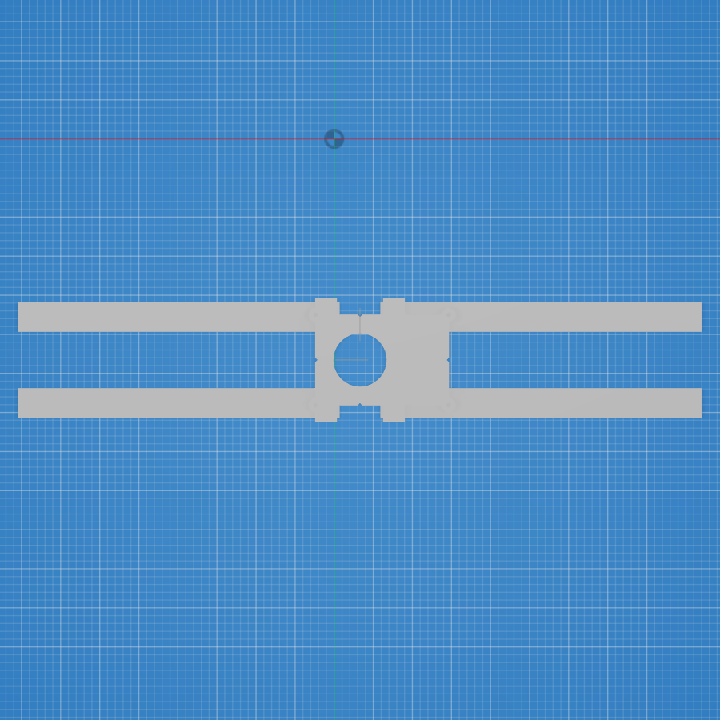 A2 plate seen from above with the four 206 mm bar sections (printed version). The two sections on a side are 26 mm apart.</td>
<td>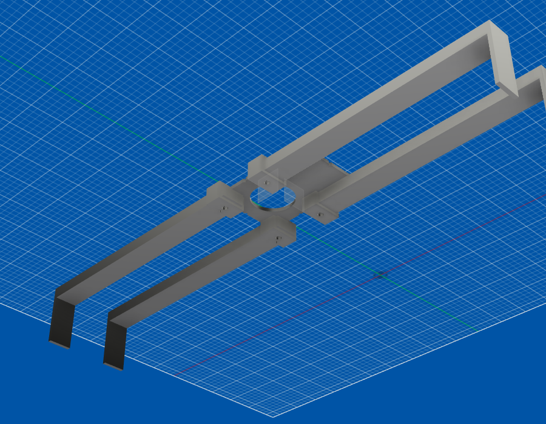 From below: the four clips under the plate, the bars sitting in them, the tongues at the far ends.</td>
</tr></table>

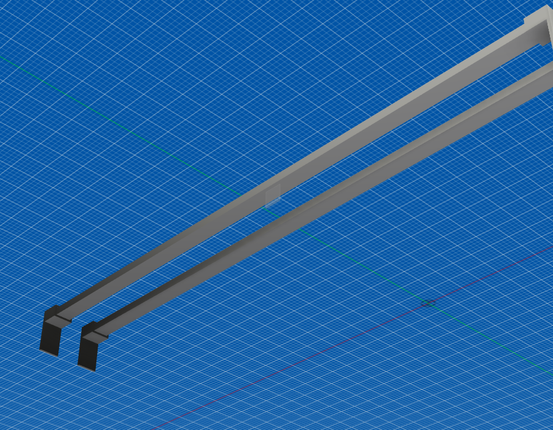

*Stock-bar version from below, only one end shown (700 mm is too long for one picture). The end cap and tongue are at the left. An overview picture of the A2 parts is in `..\print_draft_2026-11-11\crown_stage3_a2_span_overview.png`.*

### 6c. A5 Expander: hole 50.5 mm and up (default top 3 mm)
1. Print the A5 plate, compression ring and the TPU ring (TPU 95A). If the lid is not 3 mm, the heights need a model change (A5TopT), see NOTES.md.
2. Press the TPU ring (ID 44.4, OD 50) onto the plate's tube. Put the compression ring (ID 34, OD 50) under it, nut pockets facing down. Put an M3 nylon nut in each of its three pockets.
3. The Crown must be **off** the dock to reach the screws. From the plate top, drop M3 x 12 nylon screws through the three counterbored holes (r 19.5, at 90, 210, 330 deg) into the nuts. Do not tighten yet.
4. Put the tube through the lid hole. Tighten the three screws evenly. This closes the 1.5 mm gap between tube and ring; the TPU bulges against the hole wall.
5. Fit the dock ring, then the Crown (step 7-8).
6. Check the nut pockets: they break 0.4-0.85 mm into the bore (thin wall).

<table><tr>
<td> A5 plate from above: the three screw counterbores and the aperture.</td>
<td> From below: tube and compression ring with the three nut pockets. The TPU ring is not drawn separately here; it sits between plate and compression ring.</td>
</tr></table>

*Section through the radar axis (existing render): `..\print_draft_2026-11-11\crown_stage4_a5_section_radar_axis.png`.*

## 7. Firmware and radar update: the stack must come out

The TC2030 pads (J1, 6 pins) are on the **underside of the water level board, between the H1 and H2 posts**, facing the sole. The lid or hood alone is not enough.

1. Release the Crown from the dock (push the thumb tab, lift the far end). **It cannot be opened while it sits in the dock:** the sole's pry notch is covered by the ring wall.
2. Unplug the battery from U4 (battery first rule applies when you plug it back in).
3. Remove the bonnet screws and lift the bonnet and cell. Remove the 4 corner screws from the sole and lift the hood.
4. Unplug the FFC, unscrew the standoff hardware and lift the stack off the sole posts.
5. Plug the TC2030-IDC cable into J1. The plug is about 9.3 x 7.5 mm and needs finger room from both long edges; its leg tips stand 2.24 mm above the top face. **The cable is the UART one (J1 silk says "UART"): do not use an SWD TC2030 cable.** The nose is 1.42 mm from the XM125 body (box model, not checked with a real cable).
6. Power from the feather (VSENS) or 3.0 V bench supply on TP9/TP10. Follow `XM125_PROGRAMMING.md` (1 k to pin 2 for BOOT0, 1.8 V UART).
7. Rebuild in reverse (steps 1-5).

## 8. Taking it apart
Reverse of steps 8, 5, 4, 2, 1. For a mounting change, only the plate screws (step 7) come out.

## 9. Open questions that affect this guide (all in NOTES.md)
- **Polarity chamfer** (step 8): wrong-way fit covers the radar.
- **Gasket material** (6a).
- **H4 sole post insert**, nylon or brass (hardware kit, step 2).
- **Drip lip, vial seat, "lvl" engraving** not modelled.
- **Off-centre latch** (step 8).
- Fastener sizes for the hood corners, hood and sole inserts, and the feather stack screws are not in NOTES.md.
