# Crown water-level enclosure (first PETG draft): assembly guide

2026-11-12, hardware rewrite 2026-11-14. Board: `feather_water_level_tc2030` (XM125 radar on its underside) under the nRF54L15 feather. Model: Fusion `feather_water_level_enclosure_crown` v1 (all of stages 1-4). Parts, sizes and clearances are in `..\print_draft_2026-11-11\NOTES.md`. STLs are in `..\print_draft_2026-11-11\`.

**What changed on 2026-11-14:** every hole, counterbore, insert and fastener was measured in the Fusion model (section 2.1). The hardware is now given per hole: size, length, which side it goes in from and where it comes from. Most PROVISIONAL marks are closed; the ones left are listed in section 11 with the reason. Two fit problems were found (section 10); neither needs a model change if you follow the steps.

Most pictures are from the Fusion model. In each "before" picture the part floats clear of its seat; the "fitted" picture shows it in place. **The black hardware (standoffs, screws, nuts, inserts) is one lump in the model and cannot be moved**, so it stays in place in the "before" pictures. The section pictures (`step_xxb_section_...`) cut the model straight through the fasteners so you can see what goes where.

**Big picture:** the Crown is a flat box, radar window down. The sole carries the radar board (radar looks out through a 1.5 mm window) with the feather 8 mm above it on four nylon standoffs. The hood covers the boards and is held by 4 corner screws from underneath. A hump (bonnet) on the USB end holds the battery and is held by 4 screws from the top. The Crown clips into a separate **dock** (ring + plate). The plate comes in several versions that fit different containers: A6 Pad, A2 Span, A5 Expander. Swap the plate, keep the Crown.

**Directions used in this guide** (the same as the model): the **USB end** is the end with the USB-C tunnel and the battery hump; the **far end** is the other end (3 mm vent, dock latch). The **key side** is the long side nearest the key and light pipe (also the side of U4, the battery socket, and of AE1, the antenna). The other long side is the **plain side**. Board holes, looking down on the boards: **H1** USB end, plain side; **H2** USB end, key side; **H3** far end, plain side; **H4** far end, key side (the antenna corner).

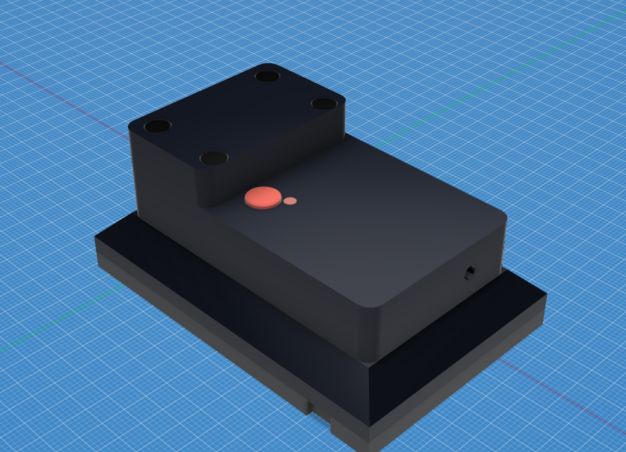

*The finished Crown, seen from above. Red = key button and light pipe. The hump with four screws is the battery bonnet.*

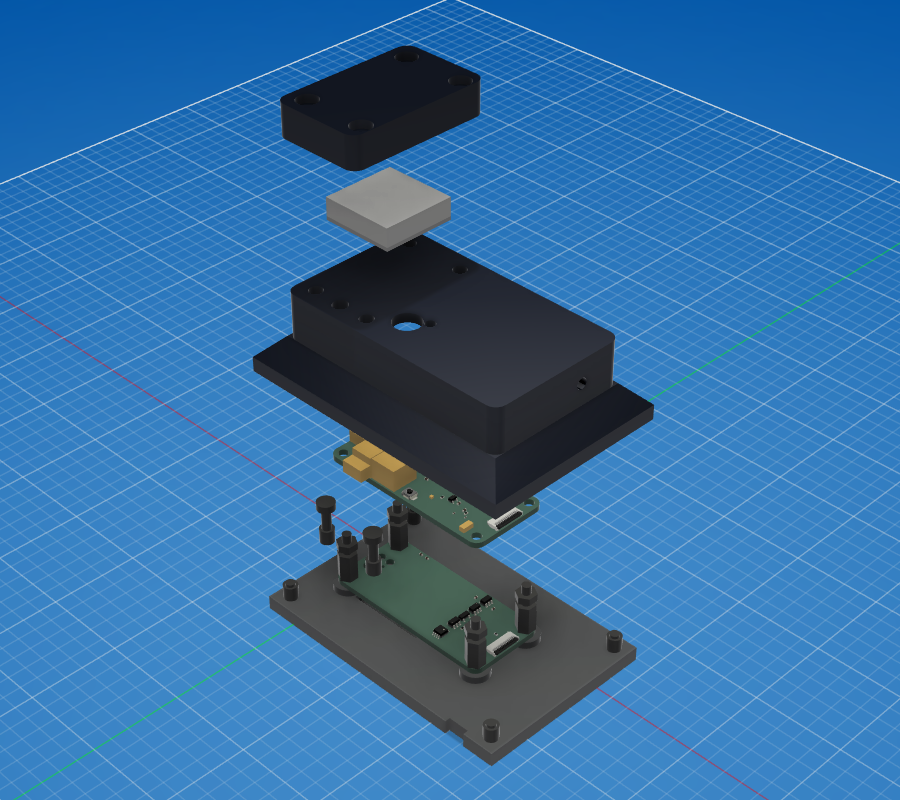

*Exploded, bottom to top: sole, radar board, feather, hood (key and light pipe under it), battery, bonnet.*

---

## 0. Know the parts (labelled pictures)

Names used in the steps below. Colours are only for the pictures (print everything in plain PETG, TPU ring in TPU). Labels were placed by eye; if one looks off, trust the step text.

### The Crown

*Outside of the Crown.*

*Key and light pipe.*

*Underside: radar window face and sole screw counterbores (4 corner screws for the hood, 4 board-stack screws under H1-H4).*

*Exploded stack.*

*Exploded from below: the XM125 radar on the underside of the water level board.*

### Dock

*Dock ring from above: hook tongues at the USB end, latch at the far end.*

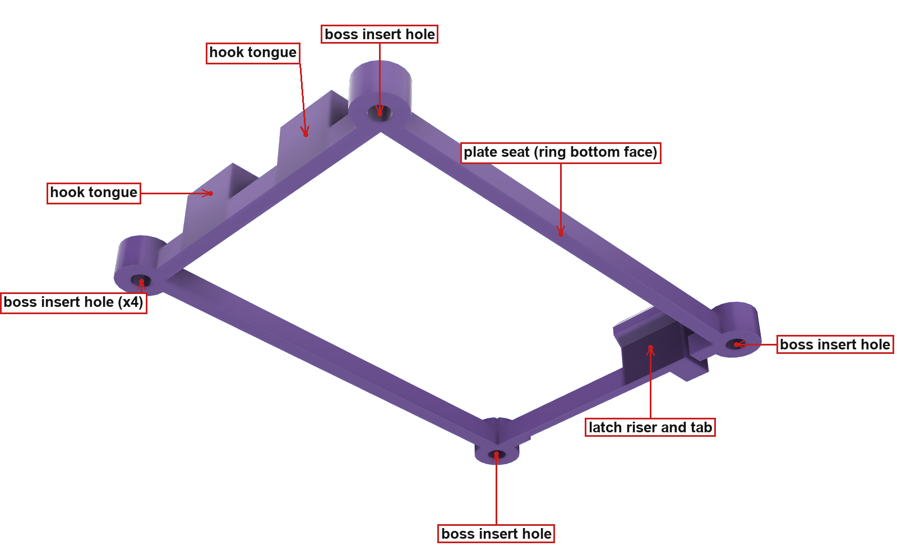

*Dock ring from below: boss insert holes and plate seat.*

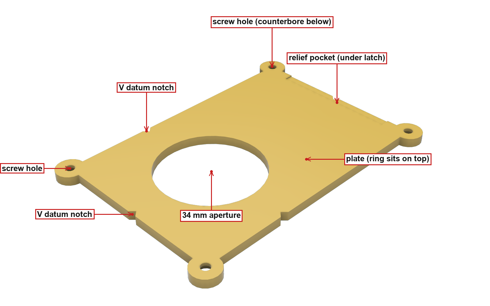

*Blank dock plate.*

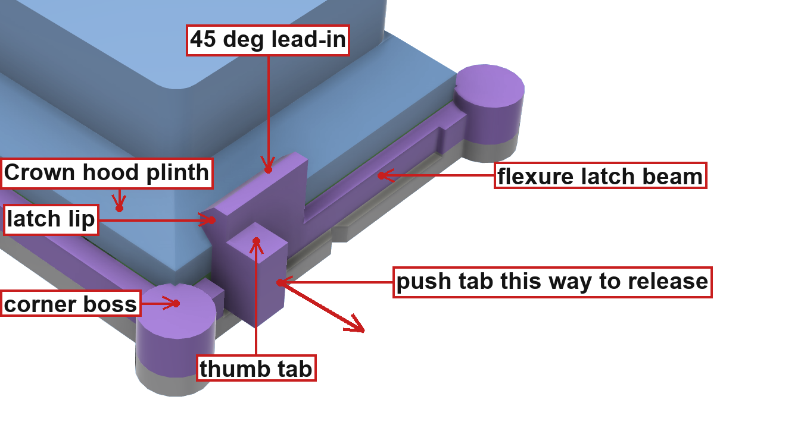

*Latch close-up with the Crown seated. Push the thumb tab out (arrow) to release, then lift the far end.*

*Crown on the dock the right way round: bonnet and USB at the hook end.*

*From below: the radar window must be centred in the plate aperture.*

### Mounting plates

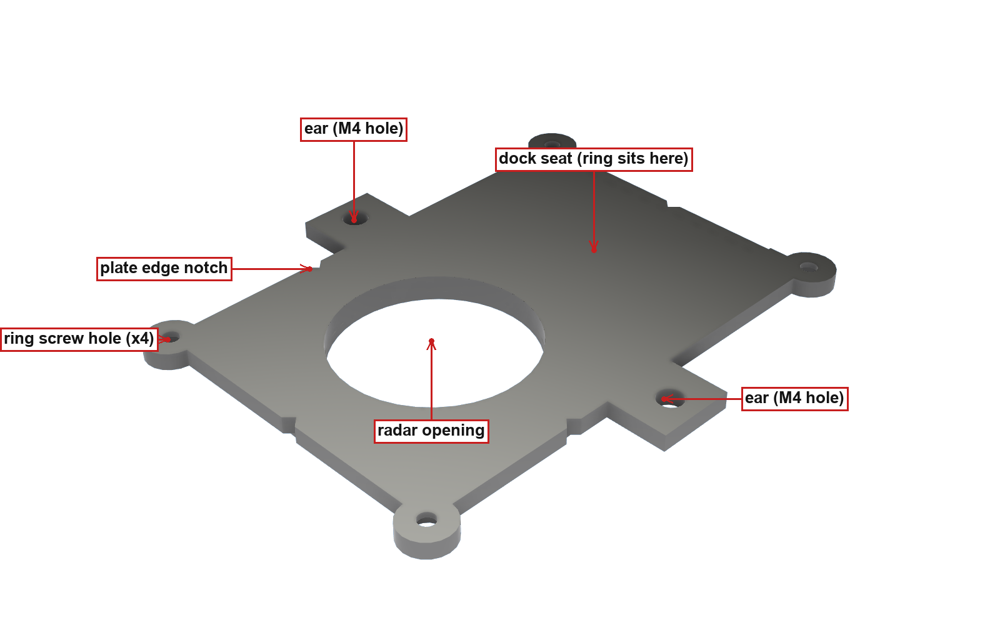

*A6 Pad.*

*A6 Pad from below: gasket area.*

*A2 Span with printed bar sections.*

*A2 Span from below: bar clips.*

*A2 Span with stock bars and end caps.*

*A5 Expander.*

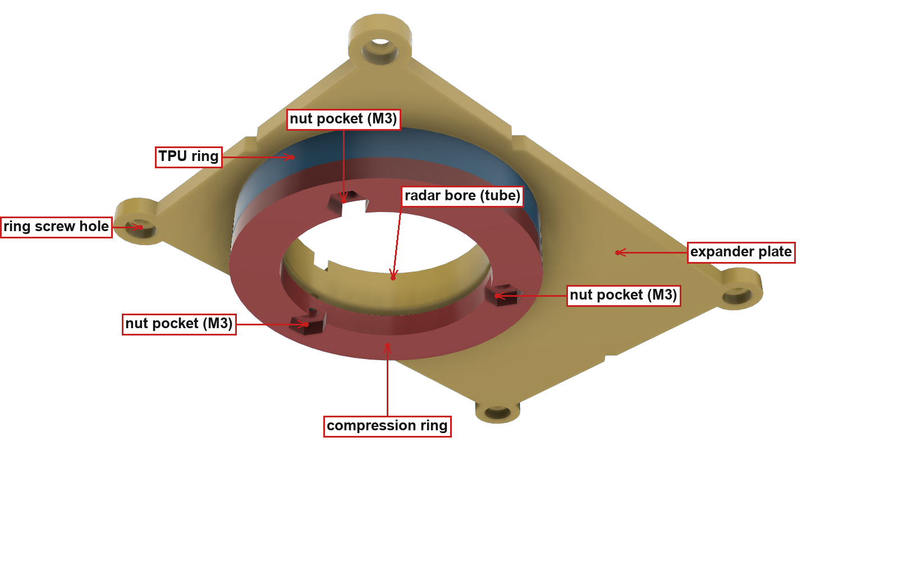

*A5 Expander from below: nut pockets, TPU ring, compression ring.*

---

## 1. Printed parts (PETG unless noted)

All STLs are in `..\print_draft_2026-11-11\`. No supports on any stage 2-4 part. Window and plates 100 % solid, 4 perimeters. Rotate in the slicer as in the orientation column. **Nothing has been sliced or printed.**

| STL | Qty | Material | Print orientation | Used for |
| --- | --- | --- | --- | --- |
| crown_sole.stl | 1 | PETG | window face down on smooth PEI, window 100 % solid | Base, carries the boards |
| crown_hood.stl | 1 | PETG | roof down (plinth flare overhangs at 45 deg; orientation not re-checked) | Cover |
| crown_bonnet.stl | 1 | PETG | top down | Battery hump |
| crown_key.stl | 1 | PETG | flange down | SW1 button |
| crown_lightpipe.stl | 1 | PETG | flange down | LED1 light pipe |
| crown_dock_ring.stl | 1 | PETG | as exported (bottom on bed) | Dock, reused on every plate |
| crown_dock_plate_blank.stl | 1 | PETG | flip: top on bed, counterbores up | Plain plate (no adapter) |
| crown_a6_pad_plate.stl | 1 | PETG | flip: top on bed | A6 Pad, holes 25-33 mm |
| crown_a2_span_plate.stl | 1 | PETG | flip: top on bed, clips grow up (19.45 mm bridges, check the first print) | A2 Span, trash can with lid off |
| crown_a2_bar_section_rim430_x4.stl | 4 | PETG | on its 9.525 x 206 side face, tongue flat | A2 printed bars (2 per side, rim about 430 mm) |
| crown_a2_stockbar_endcap_x4.stl | 4 | PETG | outer end face on the bed | A2 stock-bar version only |
| crown_a5_expander_plate_top3.stl | 1 | PETG | flip: top on bed, tube grows up (made for a 3 mm top) | A5, holes 50.5 mm and up |
| crown_a5_compression_ring.stl | 1 | PETG | TPU-side face on bed, nut pockets up | A5 |
| crown_a5_tpu_ring_top3_TPU95A.stl | 1 | **TPU 95A** | flat | A5 seal ring (PETG only as a fit check) |

Not printed: **A6 gasket**, a 34 mm ID / 54 mm OD / 1.5 mm ring cut from sheet.

---

## 2. Hardware

Sources: Amazon ASINs from `mechanical\hardware_lists\enclosure_hardware_amazon_2026-11-01.md` (list item numbers in brackets), DigiKey/Mouser picks from `mechanical\hardware_lists\tidemark_electronics_perch_2026-11-11.md`. The "Buy?" column says **listed** when the item is already on one of those lists (bought for Tidemark if Brian ordered that list; check the drawer), and **BUY** when it is on no list yet.

**Metal rule.** Everything that touches the boards is nylon: all four board-stack screws, standoffs and nuts, at H1-H4 alike. There is no insert and no metal in the sole posts. The only metal in the Crown is the 8 brass inserts in the hood (4 in the plinth corners, 4 in the roof under the bonnet) and the 4 stainless hood corner screws. The nearest of these to AE1 is the far-end, key-side corner screw and insert, about 26 mm from the antenna; all of them are behind the radar (above the window face) and 15 mm or more off the radar axis, so none is in the beam. In the dock, the 4 ring inserts are brass, 36 mm or more from the radar axis; all plate screws are nylon.

### 2.1 Fastener map (measured in the Fusion model, 2026-11-14)

Coordinates are the model's (z 0 = window face, see NOTES.md). "Clamped" is the plastic or board the screw passes through before it reaches the thread. Board thickness is 1.6 mm (the boards ordered); the model uses 1.51, so real stacks are 0.09 mm taller per board.

| # | Part | Where (x, y) | Hole | Depth / from | What goes in | Thread, length, head | Material | Source | Stack-up check |
| --- | --- | --- | --- | --- | --- | --- | --- | --- | --- |
| F1 | Hood plinth | 4 corners: (-5, 10.52), (-5, -33.38), (66.3, 10.52), (66.3, -33.38) | 3.6 mm blind | 5.0 deep, from the plinth's bottom face (z 4 to 9) | Heat-set insert | M2.5, 4 long x 4 OD | brass | B0DPQK6RJZ [2] | Insert flush with the plinth face, 1 mm of hole left above it |
| F2 | Sole | same 4 corners | 5.5 counterbore 2.7 deep, then 2.9 clearance 1.3 long | from the window face | Hood corner screw, up into F1 | M2.5 x 6, socket head 4.5 x 2.5 | 304 stainless | B0GCSRG1WD [5] | Clamped 1.3 (sole). 4.7 into the insert: full 4.0 of thread, tip 0.7 past it, **0.3 short of the hole floor**. Head 0.2 below the window face |
| F3 | Hood roof (bonnet bosses, 6.4 OD, hanging under the roof) | (2, 3.5), (19, 3.5), (2, -26.3), (19, -26.3) | 3.6 mm blind, 0.5 mm floor | 5.0 deep, from the roof's top face (z 26.485 down to 21.485) | Heat-set insert | M2.5, 4 long x 4 OD | brass | B0DPQK6RJZ [2] | Insert flush with the roof top. Push no deeper: the floor under it is only 0.5 mm |
| F4 | Bonnet | same 4 points | 5.5 counterbore 2.2 deep, then 2.9 clearance 6.3 long (the bonnet's screw bosses) | from the bonnet top | Bonnet screw, down into F3 | M2.5 x 10, pan head (kit, about 5.0 x 2.0) | nylon | B0B5M1M822 kit [6] | Clamped 6.3. 3.7 into the 4 mm insert, tip 1.3 above the hole floor. Head about 0.2 below the bonnet top |
| F5 | Sole board posts (8 OD, 1.965 tall) | H1 (2.54, -2.54), H2 (2.54, -20.32), H3 (48.26, -2.54), H4 (48.26, -20.32) | 5.5 counterbore 2.4 deep, then 2.7 clearance through sole and post | from the window face | Board-stack screw, up into F6 | M2.5 x 10, pan head (kit) | nylon | B0B5M1M822 kit [6] | Clamped 1.6 sole + 1.965 post + 1.6 radar board = 5.17. About 4.8 into the standoff's female end (see check 4.3). Head about 0.4 below the window face |
| F6 | Between the boards | H1-H4 | radar board holes and feather holes 2.7 (KiCad, `hardware_pad_check_2026-11-02.md`) | - | Standoff, female end down, male stud up | M2.5 M-F, 8 mm body, 6 mm stud, 4.7 hex | nylon | B0B5M1M822 kit [6] | Sets the 8 mm board gap. Stud passes the 1.6 feather and leaves 4.4 for the nut |
| F7 | Top of the feather | H1-H4 | - | - | Hex nut on the F6 stud | M2.5, about 5 AF x 2 | nylon | B0B5M1M822 kit [6] | About 2.4 of stud stands above the nut. **H4: turn the nut so a flat faces AE1** (section 10, item 2) |
| F8 | Dock ring bosses (9 OD, 6 tall) | (-12, 17.5), (-12, -40.36), (73.3, 17.5), (73.3, -40.36) | 3.6 mm blind | 5.0 deep, from the ring's bottom face | Heat-set insert | M2.5, 4 long x 4 OD | brass | B0DPQK6RJZ [2] | Insert flush with the bottom face |
| F9 | Every dock plate (blank, A6, A2, A5) | same 4 points | 5.2 counterbore 2.0 deep, then 2.9 clearance 1.0 long | from the plate's underside | Plate screw, up into F8 | **M2.5 x 5**, pan head (kit, about 5.0 x 2.0) | nylon | kit M2.5 x 6 cut to 5 mm, or buy x 5 | Clamped 1.0. A 6 mm screw reaches exactly the hole floor (0 margin): **use 5 mm** (section 10, item 1). 5 mm: 4.0 into the insert, 1.0 to spare |
| F10 | A6 ears | 2 ears, holes at y 23.7 and -46.56 | 4.5 through | ear 3 thick | Optional lid screw + nut | M4, length = lid + about 9 (M4 x 12 for a 3 mm lid), pan head | nylon | Essentra 50M040070N0xx + nut 04M040070HN (DigiKey) | Ear 3 + 1.5 gap (the ears sit 1.5 above the lid, gasket height) + lid + nut 3.2 + 1. Snug only: the ear bends if forced |
| F11 | A2 clip bridges (2 thick) | 4 clips, bars at x -5.2 and 38.2 | 4.5 in the bridge; 3.4 through the printed bar (9.525) | from below | Bar screw, self-tapping into the bar | M4 x 10, pan head | nylon | Essentra 50M040070N010 [17] | Clamped 2. 8 into the bar, tip 1.5 inside the bar. Stock bar: drill 3.4 at least 9 deep |
| F12 | A2 stock-bar end caps (end wall 3 thick) | 4 caps, one per bar end | 4.5 on the bar axis | through the end wall | Cap screw into the bar end | M4 x 10, pan head | nylon | Essentra 50M040070N010 [17] | Clamped 3. 7 into a 3.4 x 10 deep hole drilled in the bar end |
| F13 | A5 plate | 3 holes at r 19.5 (90, 210, 330 deg about the radar axis) | 6.0 counterbore 2.5 deep in the plate top; 3.4 through plate, tube and compression ring | from the plate top | Squeeze screw | M3 x 12, pan head (5.6 x 2.4 or smaller) | nylon | BUY (Essentra nylon, DigiKey) | Under the head: plate 0.5 + tube 4.5 + 1.5 gap + ring 4 = 10.5; nut in a 2.5 pocket. 12 mm passes the nut by about 1.6 before tightening, 3.1 after |
| F14 | A5 compression ring underside | 3 hex pockets | 5.8 AF x 2.5 deep | from below | Nut | M3, 5.5 AF x 2.4 | nylon | BUY (Essentra nylon, DigiKey) | |

Interference check (Fusion, 2026-11-14): Crown parts, boards, battery and hardware against each other: the only overlap is the 8 brass inserts in their 3.6 mm hood holes (0.0764 cm3, press fit, as designed).

### 2.2 Hardware per sub-assembly

**Crown stack (boards on the sole)**

| Item | Size | Qty | Where | Source | Buy? |
| --- | --- | --- | --- | --- | --- |
| Nylon pan head screw | M2.5 x 10 | 4 | F5: up through the sole posts at H1-H4 | B0B5M1M822 kit [6] (50 x 10 in the kit) | listed |
| Nylon M-F standoff | M2.5, 8 mm body, 6 mm stud, 4.7 hex | 4 | F6: between the boards, H1-H4 | B0B5M1M822 kit [6] (15 of each length) | listed |
| Nylon hex nut | M2.5 | 4 | F7: on top of the feather, H1-H4 | B0B5M1M822 kit [6] | listed |
| 14-way 0.5 mm FFC, 30 mm, **Type D** (contacts on opposite sides) | Molex 0150200140 | 1 | CN1 (radar board) to CN1 (feather), U-turn round the far edge | DigiKey 0150200140-ND | BUY one per node (the Tidemark one stays in the Tidemark) |
| TinyCircuits ASR00003 LiPo, 20 x 20 x 5 | | 1 | Bonnet | DigiKey/Mouser (not re-checked here) | BUY if not owned |
| Battery pigtail: JST PHR-2 housing + 2 SPH-002T-P0.5S contacts + 2 x 45 mm AWG 28 silicone wire (red, black) | | 1 | U4 to the cell splice | DigiKey/Mouser (MPNs; DigiKey part numbers not read) | BUY |
| Heat-shrink, about 1.5 mm | | 2 short pieces | Splice joints | any | probably owned |

**Hood and bonnet**

| Item | Size | Qty | Where | Source | Buy? |
| --- | --- | --- | --- | --- | --- |
| Brass heat-set insert | M2.5 x 4 long x 4 OD | 4 | F1: hood plinth corners, from the plinth's bottom face | B0DPQK6RJZ [2] (100) | listed |
| Brass heat-set insert | M2.5 x 4 long x 4 OD | 4 | F3: hood roof, from the roof's top face | B0DPQK6RJZ [2] | listed |
| Socket head cap screw, 304 stainless | M2.5 x 6 | 4 | F2: sole to hood, from the window face | B0GCSRG1WD [5] (50) | listed |
| Nylon pan head screw | M2.5 x 10 | 4 | F4: bonnet to roof, from the top | B0B5M1M822 kit [6] | listed |

**Dock (ring and any plate)**

| Item | Size | Qty | Where | Source | Buy? |
| --- | --- | --- | --- | --- | --- |
| Brass heat-set insert | M2.5 x 4 long x 4 OD | 4 | F8: ring corner bosses, from the bottom face | B0DPQK6RJZ [2] | listed |
| Nylon pan head screw, **5 mm** | M2.5 x 5 | 4 | F9: plate to ring, from below | kit M2.5 x 6 with 1 mm cut off the tip (flush cutters), or buy M2.5 x 5 nylon | listed (cut) / BUY (x 5) |

**A6 Pad**

| Item | Size | Qty | Where | Source | Buy? |
| --- | --- | --- | --- | --- | --- |
| Gasket ring cut from 1.5 mm closed-cell foam or EPDM sheet | ID 34, OD 54 | 1 | Under the plate, round the aperture | sheet not chosen | BUY |
| Nylon pan head screw (optional; or foam tape) | M4, lid thickness + 9 mm (M4 x 12 for a 3 mm lid) | 2 | F10: through the ears and the lid | Essentra nylon M4 pan, DigiKey | BUY |
| Nylon hex nut (with the screws above) | M4, 7 AF x 3.2 | 2 | Under the lid | Essentra 04M040070HN [16] | listed type (only 1 bought, for Perch) / BUY 2 |
| Bull's-eye level vial (not modelled) | 6-8 mm | 1 | Levelling only | - | BUY |

**A2 Span**

| Item | Size | Qty | Where | Source | Buy? |
| --- | --- | --- | --- | --- | --- |
| Nylon pan head screw | M4 x 10 | 4 (printed bars) or 8 (stock bars: 4 clips + 4 caps) | F11 clip bridges; F12 end caps | Essentra 50M040070N010 [17] | listed type (2 bought for Perch) / BUY 8 |
| HDPE or PVC flat bar, stock version only | 3/8 x 3/4 in, 702 mm | 2 | In the clips | source not checked | BUY |
| Bull's-eye level vial | 6-8 mm | 1 | Levelling | - | BUY (one vial can move between plates) |

**A5 Expander**

| Item | Size | Qty | Where | Source | Buy? |
| --- | --- | --- | --- | --- | --- |
| Nylon pan head screw | M3 x 12 (for a 3 mm top; length = top + 9) | 3 | F13: plate top, down through tube and ring | Essentra nylon, DigiKey | BUY |
| Nylon hex nut | M3, 5.5 AF x 2.4 | 3 | F14: compression ring pockets | Essentra nylon, DigiKey | BUY |
| TPU 95A filament | | A5 ring | | Brian has it | owned |

**Tools:** soldering iron with an M2.5 insert tip (or a plain conical tip), 2.0 mm hex key for the M2.5 socket screws, small Phillips or flat driver for the nylon kit screws (check the kit head type), 5 mm nut driver or small pliers for the M2.5 nylon nuts, flush cutters, calipers, multimeter, a flat piece of metal (a steel rule) to square the inserts.

---

## 3. Heat-set inserts (12 in total)

All 12 are the same insert: M2.5, 4 mm long, 4 mm OD, brass (B0DPQK6RJZ). All holes are 3.6 mm and 5.0 mm deep, so a flush insert leaves 1 mm of empty hole beyond it.

| Group | Part | Count | Insert from | Picture |
| --- | --- | --- | --- | --- |
| A | Hood plinth corners (F1) | 4 | The plinth's **bottom** face (the face that sits on the sole). The hood prints roof down, so after printing this face is already up: leave it on the bench that way | step_03a_hood_insert_holes_underside.png (the 4 black dots in the corners) |
| B | Hood roof, bonnet bosses (F3) | 4 | The roof's **top** face (under the bonnet). Turn the hood roof-up on a flat block that supports the roof from inside, so the roof does not sag while you press | step_05b_section_bonnet_screws.png |
| C | Dock ring corner bosses (F8) | 4 | The ring's **bottom** face (the face the plate sits against). Turn the ring over | step_07b_section_dock_ring_boss.png |

How to set each one:

1. Iron at **220-230 C** for PETG. Let it settle for a minute after switching on.
2. Put the insert on the hole, small (pilot) end down, by hand or with tweezers. It must stand upright before you heat it.
3. Put the iron tip into the insert and let the heat do the work: push lightly, straight down, along the hole axis. It should sink in 3-5 s. If it needs force, wait longer; do not lean on it.
4. Stop when the top of the insert is **flush with the face, or up to 0.1 mm below it**. Never push past flush: the screw lengths in section 2.1 count on the insert sitting at the face. Group B has only a 0.5 mm floor under it.
5. Take the iron away and at once press a flat metal object (steel rule) on the face over the insert for about 5 s. This squares the insert and makes it flush.
6. Let it cool for 30 s before the next one in the same part.
7. **Check each one:** (a) flush: slide a fingernail or the rule across; nothing proud. (b) square: screw a spare M2.5 screw 2-3 turns in by hand and look at it from two sides at 90 deg; it should stand straight up from the face (no visible lean; about 2 deg is the most you should accept). (c) the hole beyond is clear: the screw for that hole (section 2.1) turns in by hand until the head seats, with no hard stop before it. (d) no plastic bulge round the insert that would stop the mating part sitting flat; trim with a knife if there is.

If an insert goes in crooked, reheat it, pull it out with the iron still in it (pliers on the insert), let the hole cool, and set it again.

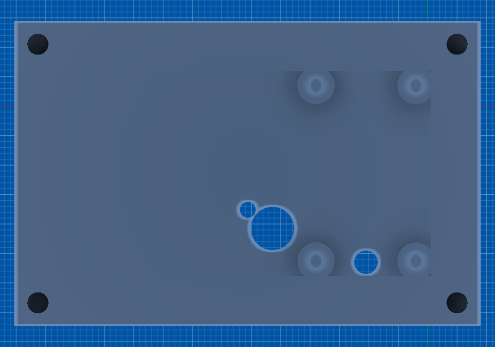

*Hood from below. The 4 dark dots in the corners of the plinth are the F1 inserts (group A). The 4 round bosses with dimples are the roof bosses for the bonnet screws; their inserts (group B) go in from the other side, the roof top. The large round hole is the key, the small one beside it the light pipe, the hole near the lower right boss the 4 mm battery-lead hole.*

---

## 4. Before you start

1. Remove brims and supports. Check the sole's window face is smooth and flat (the radar looks through 1.5 mm of PETG). Check that all 8 counterbores in the window face (4 corner, 4 board-stack) are clean and round.
2. Set the 12 heat-set inserts (section 3).
3. **Check the kit screws** (one-time, with calipers):
   - Nylon M2.5 pan head (x 10 and x 6): head **5.1 mm or less** across and **2.0 mm or less** tall. The dock plate counterbores are 5.2 x 2.0, the sole and bonnet ones 5.5 x 2.4 and 5.5 x 2.2. If a head is wider than 5.1, it will not drop into the plate counterbores: use a stainless M2.5 x 5 button head there instead (section 12). If it is taller than 2.0, it stands slightly proud on the plate underside; that is harmless except under the A6 gasket area (it is not there: the bosses are outside the gasket).
   - Nylon M2.5 nut: about 5 mm across the flats.
   - 8 mm standoff: screw a 10 mm kit screw into its **female** end by hand. It must go in **at least 5 mm** before it stops (at most 5 mm of the screw shank left showing). If it stops sooner, the female thread is short: cut the four board-stack screws by the difference with flush cutters, and note it here.
4. **Make the four dock-plate screws:** cut 1.0 mm off the tip of four kit M2.5 x 6 nylon screws with flush cutters, so they are 5 mm under the head. Clean the cut end with a knife so it starts in the thread. (Or use bought M2.5 x 5.) Keep them in a separate bag marked "dock 5 mm": a 6 mm screw in the dock bottoms out (section 10).
5. Try the key and light pipe in their holes in the hood. They should slide freely. Sand if tight.
6. FFC: test-fit one end of the FFC in a CN1 (both CN1 are Molex 503480-1400 and want 0.3 mm cable). It should slide in under the open latch with light force.

---

## 5. Build the Crown

### Step 1. Standoffs onto the radar board
**Pieces:** water level board, 4 x 8 mm nylon M-F standoffs.

1. Lay the water level board on the bench **components up** (the XM125 radar is on the underside; rest the board on two thin strips so the radar does not take the weight).
2. At each of H1, H2, H3, H4, push an 8 mm standoff's **female end down** onto the hole from the top. You cannot screw it yet (the screw comes from the sole); just stand it there. The male stud points up.

**Check:** 4 standoffs standing on the component side, studs up. Nothing is tight yet.

### Step 2. Radar board onto the sole (4 x M2.5 x 10 nylon from below)
**Pieces:** sole, water level board with standoffs, 4 x M2.5 x 10 nylon pan head screws.

1. Stand the sole window face down. Its four 8 mm posts (1.965 mm tall) line up with H1-H4 of the board.
2. Lower the board onto the posts: **radar (XM125) down**, toward the window, and the TC2030 pads (J1, between H1 and H2) facing the sole. Holding each standoff on its hole with a finger, turn the sole + board over carefully onto a soft cloth (window face up), or lift the sole to the edge of the bench so you can reach under it.
3. From the **window face**, put one M2.5 x 10 nylon screw into each of the four board-stack counterbores (the four 5.5 mm counterbores under H1-H4, **not** the four corner ones at the outer corners). Each goes up through the sole post, through the board and into the female end of the standoff above.
4. Tighten by hand, **finger tight for nylon**: turn until the head seats in the counterbore and the board is pulled down on the post, then stop. Go round in a cross pattern (H1, H4, H2, H3) in two passes.

**WARNING:** do not touch the radar face. It sits 4.0 mm above the window face under 1.5 mm of PETG.

**Check:** the board sits flat on all four posts (no rocking), each standoff stands upright and cannot be turned by hand, and each screw head is just below the window face (about 0.4 mm; run a fingernail across).

<table><tr>
<td> Before: the board floats above the 4 posts. The black standoffs are fixed in the model.</td>
<td> Fitted: the board sits on the posts. The four collared black screws floating above are the bonnet screws (step 6), not part of this step.</td>
</tr></table>

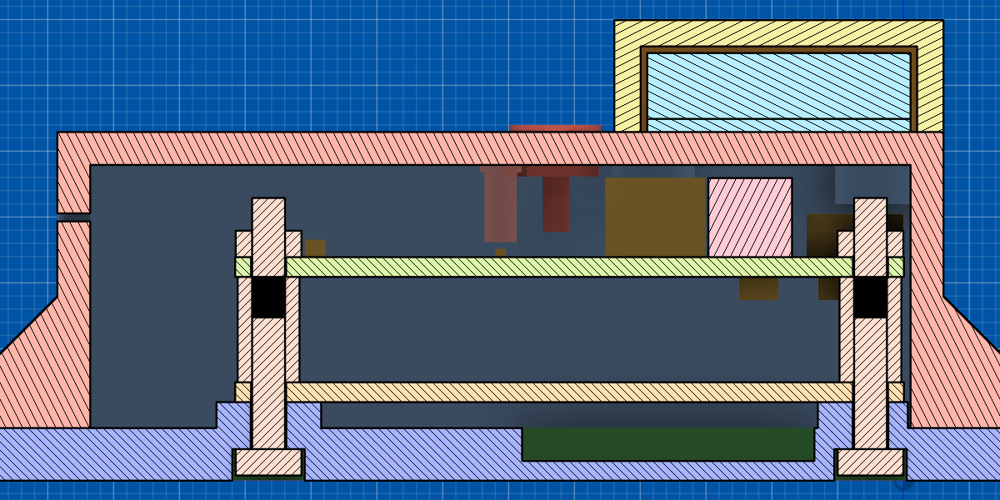

*Section through H1 (right) and H3 (left), seen from the plain side. From the bottom: the M2.5 x 10 nylon screw head sits in the sole counterbore (blue, window face at the bottom), its shank goes up through the sole post and the radar board (lower board) into the 8 mm standoff. The feather (upper board) sits on the standoff, and the nylon nut on top of the feather holds it; the stud stands about 2.4 mm above the nut. The dark square inside each standoff is the empty part of its bore above the screw tip. The battery hump is at the top right.*

### Step 3. FFC into the radar board, then the feather onto the standoffs (4 x M2.5 nylon nuts)
**Pieces:** feather, 14-way FFC (30 mm, Type D), 4 x M2.5 nylon nuts.

1. **FFC into the radar board first.** CN1 on both boards is at the far end (the end with H3/H4), in the middle of the short edge, and on the component side of both boards. Open the CN1 latch on the radar board, slide one end of the FFC in fully (3.5 mm insertion), contacts toward the connector's contacts, cable leaving toward the far edge of the board, and close the latch.
2. Hold the feather above the stack, **components up**, USB end over the USB end of the sole (the USB-C connector toward the USB end; AE1 at the far end, key side, over H4).
3. Bend the free end of the FFC up and back over in a U round the far edge of the boards, and plug it into the feather's CN1 (also opening toward the far edge). Pin 1 meets pin 1 because both boards have CN1 the same way round; with a Type D cable the contacts face the connector at both ends. If the contacts face away at one end, you have a Type A cable: use Molex 15020-0139 instead (see the Tidemark list).
4. Lower the feather onto the four standoff studs: each 6 mm stud goes up through H1-H4 of the feather.
5. Screw one M2.5 nylon nut onto each stud from the top, **finger tight**, cross pattern (H1, H4, H2, H3).
6. **H4 (antenna corner, far end, key side): turn the nut so one of its flat sides faces the antenna AE1** (toward the middle of the board), not a corner. With a flat toward AE1 there is 0.29 mm between nut and antenna in the model; with a corner toward it they would touch. Turn the nut back a little if you need to, a sixth of a turn moves it from corner to flat.

**WARNING (H4, nylon only):** H4 is inside the AE1 antenna keep-out. Its standoff, screw and nut must be nylon, and so are those at H1-H3. No metal washer anywhere in the stack.

**Check:** the feather is flat and parallel to the radar board (about 8 mm gap all round), no board flexes, the FFC is seated square in both latches with the U standing clear of the H3/H4 standoffs (about 2 mm each side) and staying inside about 10 mm beyond the board edge (the hood wall is 10.9 mm out). At H4, a nut flat faces AE1 and the nut does not touch it.

<table><tr>
<td> Before: the feather above the stack.</td>
<td> Fitted: both boards in one stack, about 8 mm between them.</td>
</tr></table>

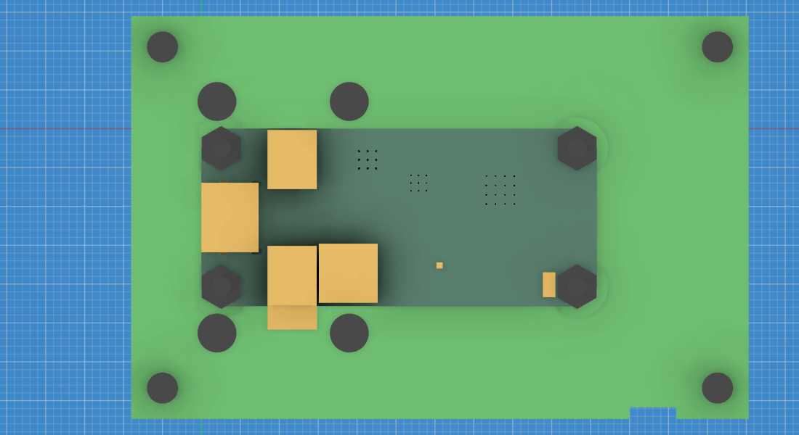

*The stack from above with the hood, bonnet and battery hidden (USB end left, plain side at the top). The four hex nuts sit on the feather at H1 (top left), H2 (bottom left), H3 (top right) and H4 (bottom right). The small orange block just left of the H4 nut is AE1, the antenna: the nut's flat faces it. The four round dark heads near the USB end are the bonnet screws (higher up, step 6); the four dots at the outer corners are the hood plinth inserts.*

### Step 4. Key and light pipe into the hood
Turn the hood roof down. Push the key (7.4 mm hole) and the light pipe (2.7 mm hole) into their holes from the underside (inside) of the roof. They are held later by the feather, which sits close under them.

**Check:** both sit fully up in their pockets and slide freely.

<table><tr>
<td>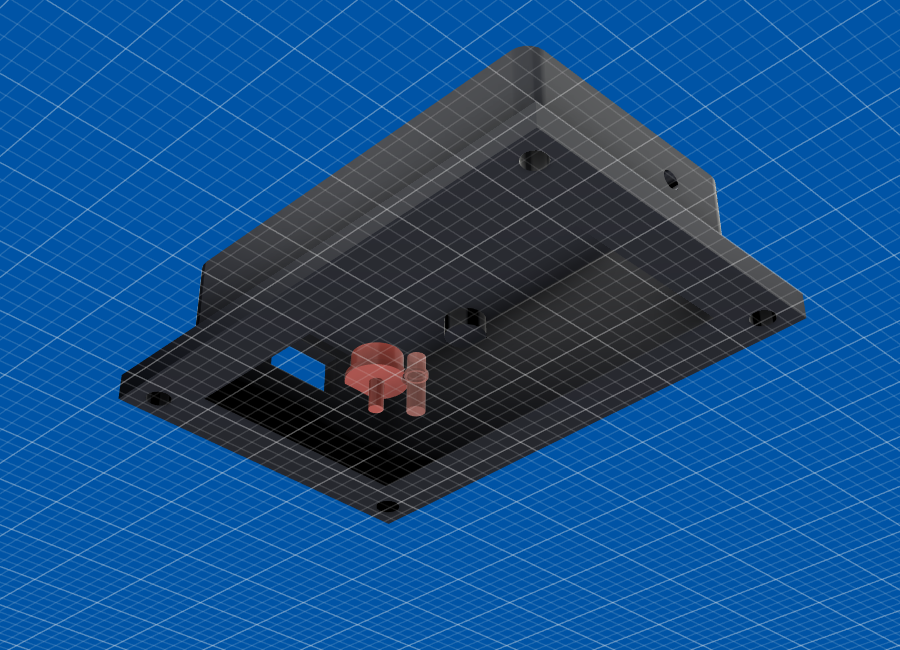 Before: hood seen from below, key (red) and light pipe under their holes.</td>
<td> Fitted: they sit up in the roof pockets.</td>
</tr></table>

### Step 5. Battery pigtail into U4, then hood onto the sole (4 x M2.5 x 6 stainless from below)
**Pieces:** battery pigtail (made here), hood with key and light pipe, sole stack, 4 x M2.5 x 6 socket head screws, 2.0 mm hex key.

**Do the pigtail before the hood goes on.** U4 (the feather's battery JST, key side, USB half) sits under the hood roof, and the PH plug won't pass through the 4 mm roof hole, so the battery can only be plugged in while the stack is out.

1. Make the pigtail: a JST PHR-2 plug with **thin, flexible wire (AWG 28 silicone is best; AWG 26 PVC is too stiff for the bend)**, about **40-45 mm** from plug back to bare ends. Leave the far ends bare (not tinned into a blob) so they fit through the hole together.
2. Meter it: the contact that lands on U4 pad 1 must be + (red).
3. Push the plug fully home in U4. The wires leave the back of the plug toward the hood wall; there is only about 3 mm before the wall, so bend them straight up right behind the plug and twist the pair together.
4. Hold the hood roof down with the key and pipe in it. Find the 4 mm battery-lead hole in the roof (key side, USB half, between the two key-side bonnet bosses). Turn the sole stack over and lower it, boards first, into the hood, feeding the twisted pair up through the hole from inside as it goes. The hole is about 1.5 mm toward the USB end from the plug centre, so lean the pair that way. Make sure the **USB-C connector lines up with the tunnel** in the hood's USB end wall and the hump is over the USB end. (If you prefer, keep the stack window-down and lower the hood over it, holding the key and light pipe in with tape.)
5. The sole's foot now sits on the plinth face. The 4 corner counterbores in the window face (5.5 mm, the outer four) line up with the 4 plinth inserts.
6. From the **window face**, put one M2.5 x 6 stainless socket head screw into each corner counterbore. It goes through the 1.3 mm of sole and into the brass insert in the plinth.
7. Tighten with the 2.0 mm hex key in a **cross pattern** (USB-plain, far-key, USB-key, far-plain), two passes: first all just seated, then snug. Snug means firm with two fingers on the short arm of the key, about 0.3 Nm; the PETG sole is only 1.3 mm thick under the head, so do not crank it. If a screw stops hard before the head seats, take it out: the insert hole floor is only 0.3 mm beyond the screw tip (section 10, item 3).

**Check:** the sole sits flat on the plinth all round (no gap at any corner), the 4 heads are 0.2 mm below the window face, the USB-C receptacle is centred in its tunnel, the pigtail pair stands up through the roof hole, and the key clicks SW1 when pressed.

<table><tr>
<td>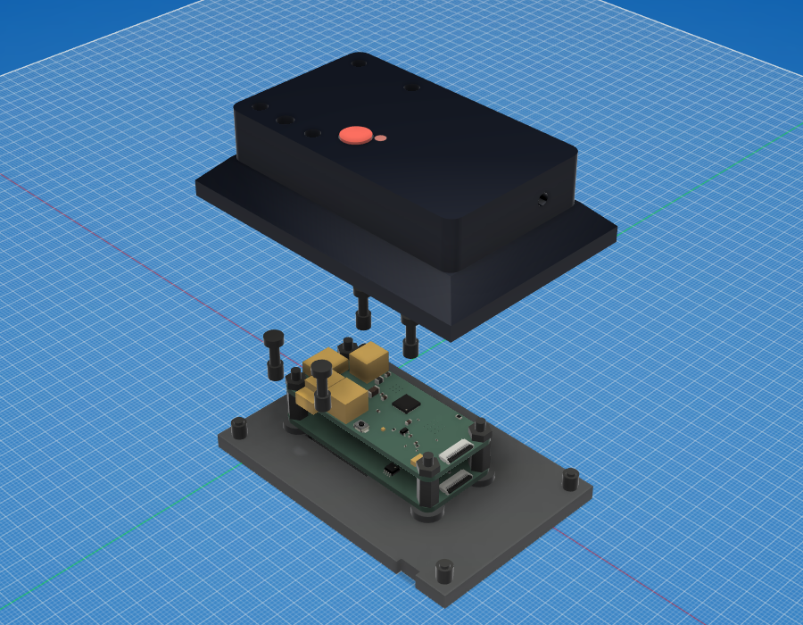 Before: hood above the stack.</td>
<td>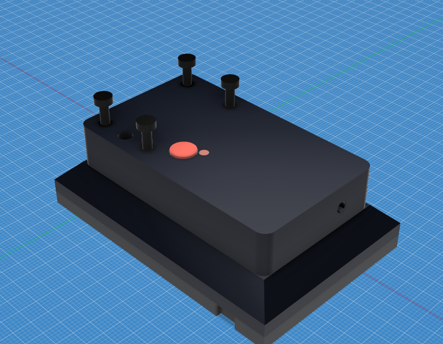 Fitted: hood on the sole. The four black screws standing in the roof are the bonnet screws.</td>
</tr></table>

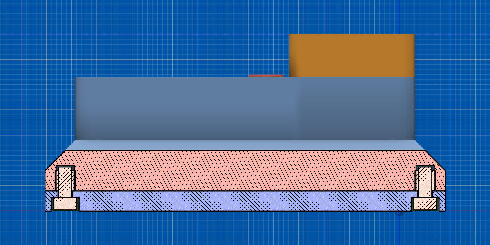

*Section through the plain-side corner screws (USB end on the right). Each M2.5 x 6 socket head sits in its counterbore in the sole (blue, bottom), passes 1.3 mm of sole and screws into the brass insert in the plinth (pink). The insert hole goes 1 mm beyond the insert; the screw tip stops 0.3 mm short of its floor.*

### Step 6. Splice the cell, battery into the hump, bonnet on (4 x M2.5 x 10 nylon from the top)
**Pieces:** TinyCircuits ASR00003 cell, 2 small heat-shrink sleeves, bonnet, 4 x M2.5 x 10 nylon pan head screws.

The cell lies on the hood roof on a 1 mm pad and the bonnet covers it. Its own lead is only 12 mm with a JST SH plug, which doesn't fit U4.

1. Cut the SH plug off the cell. Splice the cell leads to the pigtail ends coming up through the roof hole, **red to the + wire** (check with the meter).
2. **Stagger the two joints** (about 6 mm apart) with small heat-shrink on each. A straight 15-20 mm splice doesn't fit. The free space for the joints is a box about **10.9 x 6.9 x 6.5 mm**, between the two key-side bonnet bosses, beside the cell. The cell lead passes under a rib in the bonnet with a 2 mm gap, so keep the joints out from under it.
3. Lay the cell on its pad (plain side of the hump) and tuck the joints into that space.
4. Put the bonnet on, its four screw bosses over the four roof inserts.
5. From the **top**, drop one M2.5 x 10 nylon screw into each of the four bonnet counterbores (5.5 mm). Each passes 6.3 mm of bonnet boss and screws into the brass insert in the roof.
6. Tighten **finger tight** (nylon into brass strips easily), cross pattern, two passes.

**Battery first:** with the pigtail plugged in at step 5, the battery is connected as soon as the splice is made. Do that before USB or any solar is connected.

Lead path measured in Fusion and from the JST datasheet on 2026-11-12 (`..\battery_lead_check_2026-11-12\LEAD_CHECK.md`). **Check the bend behind the plug on the first build.**

**Check:** the bonnet sits flat on the roof all round with no wire pinched under its edge, the four heads are just below the bonnet top (about 0.2 mm), and the feather LED comes on / the board starts (battery connected).

<table><tr>
<td> Before: cell and bonnet over the hood roof.</td>
<td>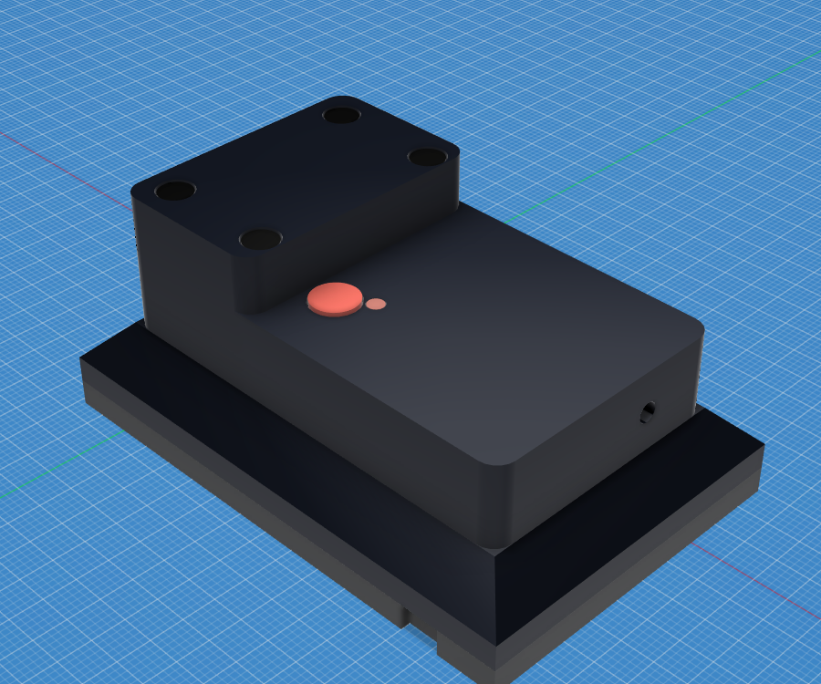 Fitted: the hump sits on the USB end of the hood.</td>
</tr></table>

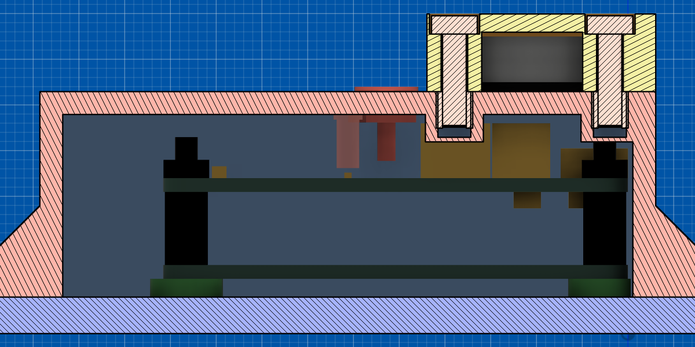

*Section through the two plain-side bonnet screws (USB end on the right). Each M2.5 x 10 nylon screw drops through the bonnet's screw boss (yellow) into the brass insert at the top of a roof boss (pink, hanging under the roof). The cell (grey) lies between the bosses. The boards and their standoffs are seen behind the cut.*

### Step 7. Check the Crown
The USB-C connector is in the USB end wall (a tunnel in the hood); the 3 mm round vent is in the far end wall (checked in the hood STL; NOTES.md says -x, which is wrong). The key sits just under the hump edge.

Hardware count when done: 8 screws in the window face (4 socket head at the corners, 4 nylon under the boards), 4 nylon heads on the bonnet. Nothing loose rattles when you shake it gently.

---

## 6. Dock: ring and plate

### Step 8. Plate onto the ring (4 x M2.5 x 5 nylon from below). PROVISIONAL (polarity, latch)
**Pieces:** dock ring (inserts set, section 3 group C), one plate (blank, A6 Pad, A2 Span or A5 Expander; for A5 do the A5 steps in 7c first), 4 x M2.5 x **5** nylon screws (the cut ones, section 4 item 4).

1. Lay the ring on the bench **bottom face up** (inserts up).
2. Lay the plate on it, **plate top down** against the ring's bottom face, so the 4 plate counterbores face up at you and sit over the 4 inserts. The aperture is at the hook end (USB end) of the ring, the V notches on the radar axis lines.
3. Put one M2.5 x 5 nylon screw into each counterbore (5.2 mm, 2.0 deep). It passes 1 mm of plate into the insert.
4. Tighten **finger tight**, cross pattern. A2 Span: the two hook-end screws are reached through the 5.6 mm access holes in the left-hand clip bridges.

**Check:** the plate lies flat on the ring with no gap, the 4 heads are at or just below the plate underside, and every screw went in to the head without a hard stop. If one stopped hard, it is a 6 mm screw: swap it (section 10, item 1).

<table><tr>
<td> Before: ring (left) and plate (right). The model shows the plate flipped for printing.</td>
<td>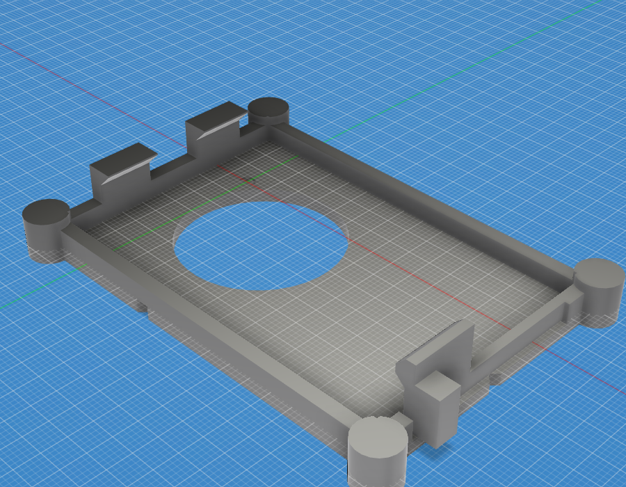 Fitted: the plate closes the bottom of the ring. The two hook tongues are at the left end, the latch beam at the right end.</td>
</tr></table>

*Dock ring and plate from below: one screw counterbore at each of the 4 corner bosses.*

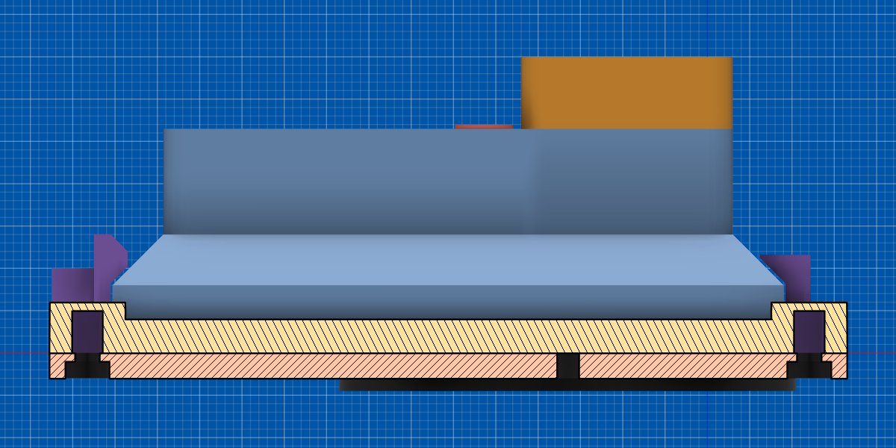

*Section through the two plain-side ring bosses, with the A6 Pad fitted (pink, bottom) and the Crown in the ring. Each boss (yellow) has a 3.6 x 5 mm insert hole from its bottom face (dark); the plate has a 5.2 mm counterbore from below and a 2.9 mm hole through its last 1 mm. The ring screws are not drawn in the model. With the insert flush, a 6 mm screw would end exactly at the top of the dark hole; a 5 mm screw ends 1 mm below it.*

### Step 9. Crown into the dock. PROVISIONAL (polarity chamfer, off-centre latch)

 

*Left: right way round (bonnet at the hook tongues). Right: thumb tab and latch; push the tab the way of the arrow to release.*

No hardware in this step.

1. **WARNING: orientation.** The Crown foot is a plain rectangle, so it also fits the dock turned 180 deg. Turned wrong, the radar sits 28.3 mm off the aperture centre and the **plate covers the radar beam**. The correct way: the **hump end (battery, USB) and the radar are at the hook end** of the dock (the two hook tongues). The aperture in the plate is at the same end. Brian's open question 2 (an 8 x 8 mm polarity chamfer) would make the wrong way impossible; it is not in the model yet.
2. Slide the Crown's USB end under the two hook tongues.
3. Lower the far end. The latch beam is pushed out by its 45 deg lead-in and clicks back in.
4. To release: push the thumb tab outwards (toward the far end) and lift the far end. The latch is off-centre, about 13 mm to the key side of the radar axis line (NOTES.md: y -24.4 against -11.43). That is fine for about 150 g, but test the hold on the bench.

**Check:** looking up through the aperture from below, the radar window is centred in it; the Crown does not rock; the latch has clicked.

<table><tr>
<td> Before: the Crown above the dock, hook end towards you on the left.</td>
<td>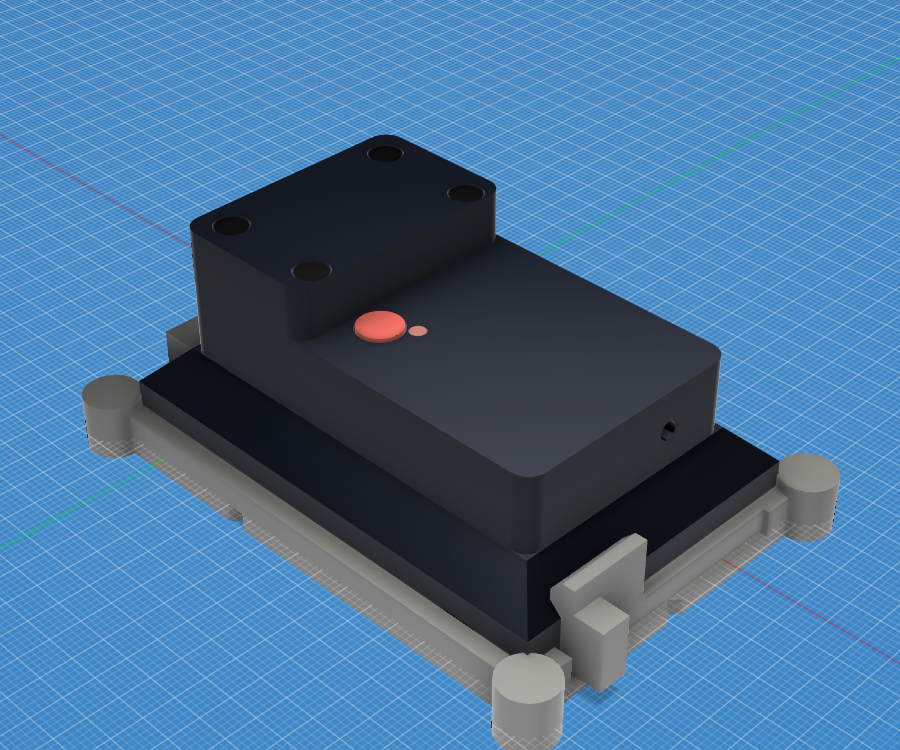 Fitted: the Crown in the ring, hook tongues over its USB end, latch beam at the far end.</td>
</tr></table>

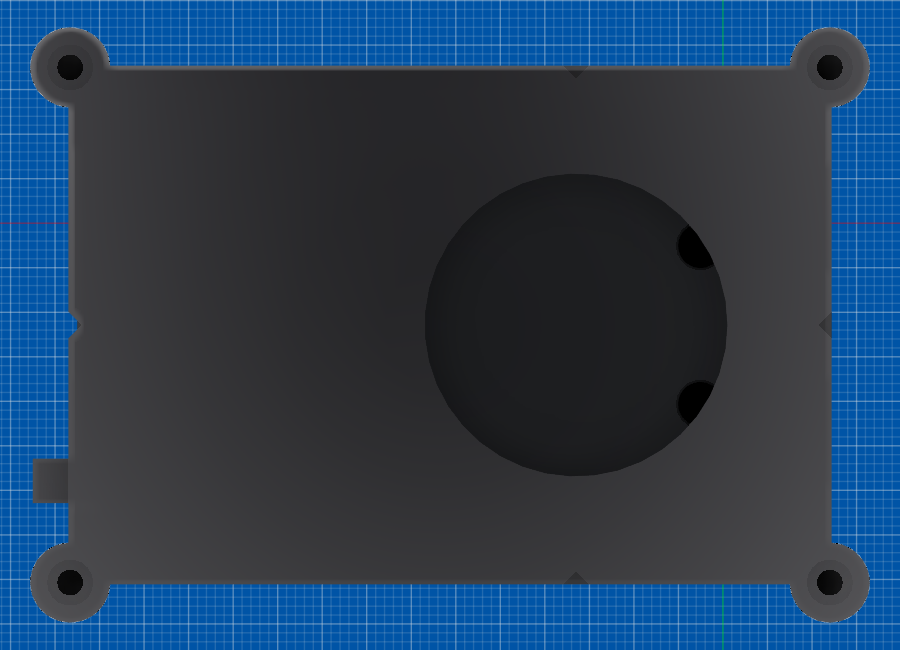

*The dock from below (plate side). You look through the aperture at the radar window. The 3 mm V notches on the four plate edges are on the radar axis lines for aiming. Right of the picture is the radar end.*

---

## 7. Mounting

Choose one plate. The Crown stays the same. Fix the plate to the container first, then the ring (step 8), then the Crown (step 9), unless a step says otherwise.

### 7a. A6 Pad: lid with a hole 25-33 mm wide (33-44 mm relies on the gasket overhang; bench test)
1. Cut the gasket ring (ID 34, OD 54, 1.5 mm) from your sheet. **PROVISIONAL: material not chosen (closed-cell foam or EPDM).**
2. Centre the hole in the lid under the plate aperture (use the V notches), with the gasket ring between lid and plate, round the aperture. The Crown's outer face ends up 4.5 mm above the lid.
3. Fix the pad, either:
   - **Foam tape** on the two ears (no holes in the lid), or
   - **Two M4 nylon screws** (length = lid thickness + 9 mm; M4 x 12 for a 3 mm lid): mark the lid through the two 4.5 mm ear holes, drill 4.5 mm, screw from the **top** through each ear and the lid, nylon M4 nut underneath. The ears sit 1.5 mm above the lid (the gasket thickness) and are outside the gasket, so tighten **only until snug**; forcing them bends the ears. A 1.5 mm washer or a scrap of the gasket sheet under each ear stops that.
4. Fit the ring (step 8) and the Crown (step 9).
5. Level the Crown with the bull's-eye vial (not modelled, not on the list).

**Check:** the pad does not move when you push it sideways, the gasket is squeezed evenly all round (look from the side), and the radar window is centred over the hole.

 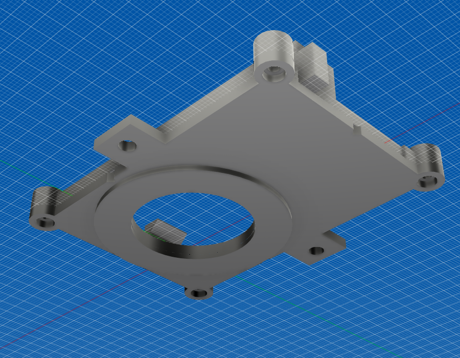

*Left: A6 Pad under the ring (ears at the sides carry the M4 holes). Right: from below, the gasket ring lies round the aperture.*

### 7b. A2 Span: trash can with the lid off (rim up to about 430 mm printed, 700 mm with stock bar)
The A2 plate has four bar clips underneath, two per side, 21.7 mm either side of the radar axis. Bars lie flat across the rim; the 3 mm tongues hang over the outside of the rim.

**Printed bars (rim about 430 mm), 4 x M4 x 10 nylon**
1. Fix the ring to the A2 plate first (step 8): the two hook-end ring screws are reached through the 5.6 mm access holes in the left-hand clip bridges.
2. Each 206 mm bar section has one 3.4 mm hole through it near its inner end. Slide each section into its clip (channel 19.45 x 9.725 mm), inner end first, until that hole lines up with the 4.5 mm hole in the clip bridge. The tongue end points outward. The two sections on a side end 26 mm apart under the plate; the plate and clips are the splice, no bolts in the bar.
3. From **below**, put an M4 x 10 nylon screw through each bridge hole into the bar. It cuts its own thread in the 3.4 mm hole (8 mm of engagement). Turn it in slowly by hand until the head is snug on the bridge; stop there (nylon into PETG strips if forced).
4. Lay the span across the can, tongues outside the rim (about 1 mm play), then fit the Crown (step 9).

**Stock bar (rim up to 700 mm), 8 x M4 x 10 nylon**
1. Cut two 3/8 x 3/4 in HDPE or PVC bars to 702 mm. **Not on the Amazon list yet, source not checked.**
2. Drill, with a 3.4 mm drill: (a) two vertical holes through each bar on its centre line, 21.7 mm either side of the bar's centre (for the clip screws); (b) one hole about 10 mm deep into the centre of each bar end, along the bar (for the caps).
3. Push a printed end cap onto each bar end (20 mm sleeve). Screw an M4 x 10 nylon screw through the 4.5 mm hole in the cap's end wall into the end hole (7 mm of engagement), snug.
4. Slide the bars into the clips, line up the clip holes, and screw M4 x 10 nylon from below as for the printed bars.
5. Sag at 700 mm is not calculated (bench test 5).

**Both versions:** the Crown's outer face sits 12.525 mm above the rim top. Water must be at least 70 mm below the outer face, so 57.5 mm below the rim.

**Check:** the bars do not slide in the clips, both tongues sit outside the rim on each side, and the span does not rock on the rim.

<table><tr>
<td> A2 plate seen from above with the four 206 mm bar sections (printed version). The two sections on a side are 26 mm apart.</td>
<td> From below: the four clips under the plate, the bars sitting in them, the tongues at the far ends.</td>
</tr></table>

*Stock-bar version from below, only one end shown (700 mm is too long for one picture). The end cap and tongue are at the left. An overview picture of the A2 parts is in `..\print_draft_2026-11-11\crown_stage3_a2_span_overview.png`.*

### 7c. A5 Expander: hole 50.5 mm and up (default top 3 mm), 3 x M3 x 12 nylon + 3 nuts
1. Print the A5 plate, compression ring and the TPU ring (TPU 95A). If the lid is not 3 mm, the heights need a model change (A5TopT), see NOTES.md; the screw length is then top + 9 mm.
2. Press the TPU ring (ID 44.4, OD 50) onto the plate's tube, up against the plate.
3. Push one M3 nylon nut into each of the 3 hex pockets in the compression ring (on its underside). A dab of glue stick keeps them in.
4. Hold the compression ring (ID 34, OD 50) under the TPU ring, **nut pockets facing down**, and line its 3 holes up with the 3 counterbored holes in the plate (r 19.5, at 90, 210, 330 deg).
5. The ring and Crown must be **off** the plate to reach the screws. From the **plate top**, drop an M3 x 12 nylon screw through each counterbored hole (6.0 x 2.5 counterbore), down through the tube wall and the compression ring, and start it 2-3 turns into its nut. Do not tighten yet.
6. Put the tube, with the TPU and compression rings on it, down through the lid hole from above.
7. Tighten the three screws a half turn at a time each, in turn, until the 1.5 mm gap between the tube end and the compression ring is closed (that is the stop). The TPU bulges out against the hole wall.
8. Fit the ring (step 8; screws through the A5 plate's four corner counterbores), then the Crown (step 9).
9. Check the nut pockets: they break 0.4-0.85 mm into the bore (thin wall).

**Check:** the A5 does not turn in the hole, the three heads are below the plate top (the Crown sits on them otherwise), and the gap at the tube end is closed evenly all round.

<table><tr>
<td>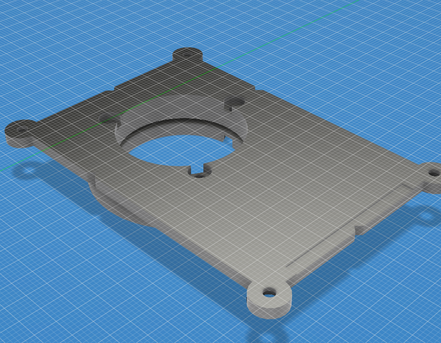 A5 plate from above: the three screw counterbores and the aperture.</td>
<td>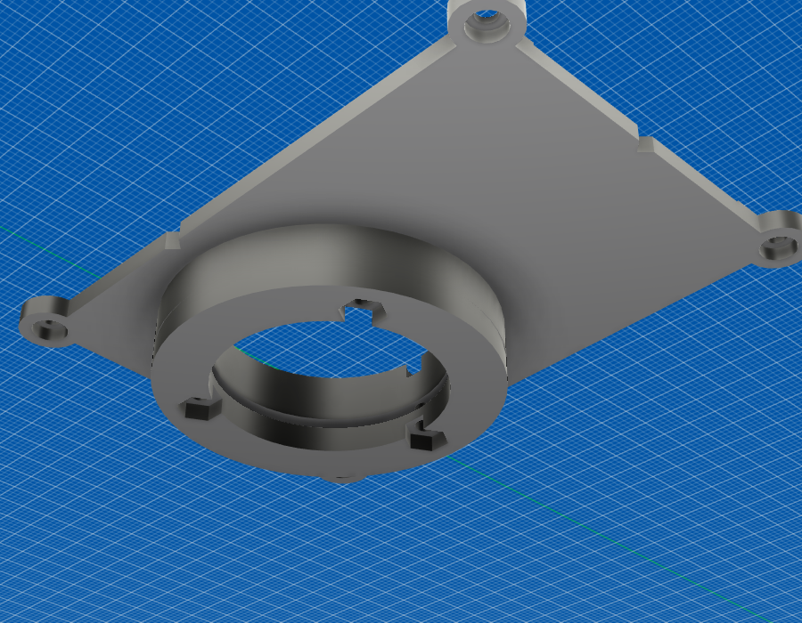 From below: tube and compression ring with the three nut pockets. The TPU ring is not drawn separately here; it sits between plate and compression ring.</td>
</tr></table>

*Section through the radar axis (existing render): `..\print_draft_2026-11-11\crown_stage4_a5_section_radar_axis.png`.*

---

## 8. Firmware and radar update: the stack must come out

The TC2030 pads (J1, 6 pins) are on the **underside of the water level board, between the H1 and H2 posts**, facing the sole. The lid or hood alone is not enough.

1. Release the Crown from the dock (push the thumb tab, lift the far end). **It cannot be opened while it sits in the dock:** the sole's pry notch is covered by the ring wall.
2. Remove the 4 bonnet screws (M2.5 x 10 nylon, from the top). Lift the bonnet and the cell. Cut or unsolder the splice if you need the hood fully off (or leave the cell hanging on its leads while you work).
3. Remove the 4 corner screws (M2.5 x 6 socket head, 2.0 mm key) from the window face. Lift the sole stack out of the hood (use the pry notch). The pigtail comes down through the roof hole.
4. Unplug the battery pigtail from U4 (battery first rule applies when you plug it back in).
5. Take the 4 nylon nuts off the feather studs and lift the feather off; unplug the FFC from both CN1.
6. Remove the 4 board-stack screws (M2.5 x 10 nylon) from the window face and lift the radar board off the posts. The standoffs come with it (or drop off).
7. Plug the TC2030-IDC cable into J1. The plug is about 9.3 x 7.5 mm and needs finger room from both long edges; its leg tips stand 2.24 mm above the top face. **The cable is the UART one (J1 silk says "UART"): do not use an SWD TC2030 cable.** The nose is 1.42 mm from the XM125 body (box model, not checked with a real cable).
8. Power from the feather (VSENS) or 3.0 V bench supply on TP9/TP10. Follow `XM125_PROGRAMMING.md` (1 k to pin 2 for BOOT0, 1.8 V UART).
9. Rebuild with steps 1-6.

## 9. Taking it apart
Reverse order: release from the dock (step 9), bonnet screws (step 6), corner screws (step 5), nuts and feather (step 3), board-stack screws (step 2). For a mounting change, only the 4 plate screws (step 8) come out. Keep each set of screws in its own bag: the dock plate screws are 5 mm, the board and bonnet ones 10 mm nylon, the corner ones 6 mm stainless; mixing them up gives the problems in section 10.

---

## 10. Conflicts found (2026-11-14, model not changed)

1. **Dock plate screw bottoms out with a 6 mm screw.** The plate has 1.0 mm of material under its 2.0 mm counterbore and the ring boss hole is 5.0 mm deep. An M2.5 x 6 screw ends exactly at the hole floor (0 mm margin) with the insert flush; any PETG pushed down into the hole while setting the insert makes it stop before the head clamps the plate. **Fix used in this guide:** 5 mm screws (kit 6 mm cut by 1 mm, or bought M2.5 x 5): 4 mm of thread, 1 mm to spare. A model fix would be a deeper boss hole (the boss is 6 mm tall, so a 6 mm hole would break through; a 7 mm boss with a 6 mm hole, or a 1.0 mm deeper plate counterbore, would do it). Not changed.
2. **H4 nut against AE1.** The M2.5 nylon nut on top of the feather at H4 is 0.29 mm from the AE1 antenna body in the model with a flat toward it (nut modelled 5.0 across flats). With a corner toward AE1 (5.77 across corners) it would overlap the antenna by about 0.1 mm. **Fix used in this guide:** turn the H4 nut so a flat faces AE1 (step 3). A nylon nut touching AE1 does no electrical harm, but it could press on the chip antenna. A smaller nut (4.5 AF) would give more room; not changed.
3. **Hood corner screws: 0.3 mm to the hole floor.** M2.5 x 6 through the 1.3 mm sole goes 4.7 mm into the plinth: the 4 mm insert plus 0.7 mm, with 0.3 mm left before the floor of the 5 mm hole. It works if the inserts are flush and the hole floor is clean. If a corner screw stops hard before the head seats, use an M2.5 x 5 socket head (to buy, section 12) for that corner. Not a model change.
4. **Kit screw head fit in the plate counterbores (5.2 x 2.0) is not measured.** A DIN 7985 M2.5 pan head is 5.0 x 2.0 nominal, so it should fit with 0.1 mm a side. Measure one (section 4, item 3) before printing many plates.

No screw is too short, no hole is the wrong size for its insert (3.6 mm for the 4 mm OD insert, as on Tidemark since v14), and no fastener sits in the radar beam.

## 11. PROVISIONAL items

**Closed on 2026-11-14 (measured in the model):**
- Heat-set inserts: count 12 (4 hood plinth, 4 hood roof, 4 dock ring), all M2.5 x 4 x 4 brass B0DPQK6RJZ in 3.6 x 5 mm holes. **The sole posts have no inserts**: the board stack is held by screws from the window face (old NOTES.md wording "sole posts use inserts" was wrong).
- Hood-to-sole corner screws: M2.5 x 6 socket head, 304 stainless, B0GCSRG1WD (head 4.5 x 2.5 in a 5.5 x 2.7 counterbore).
- Bonnet screws: M2.5 x 10, into roof inserts. Chose the kit's nylon pan head (owned, head fits the 5.5 x 2.2 counterbore); a stainless M2.5 x 10 would also fit.
- Board stack: at each of H1-H4, M2.5 x 10 nylon pan head up from the window face, 8 mm M-F nylon standoff (female end down, stud up through the feather), M2.5 nylon nut on top. All from kit B0B5M1M822.
- H4: nylon screw, standoff and nut, same as H1-H3; there is no insert or metal in the sole post under it (Brian's open question 6 is answered by the model: nylon, no brass).
- FFC: Molex 0150200140, 30 mm, Type D, same part as Tidemark. Both CN1 face up on the same end, 8 mm apart; the cable makes a U round the far edge with about 3 mm of slack, inside the 10.9 mm to the hood wall. Shorter standard lengths were not found; 30 mm fits.
- Hood/stack order (old step 4): confirmed as written; the model leaves no other way to reach U4.

**Still open:**
- Plate counterbore fit of the kit pan head: needs calipers on a real screw (section 10, item 4).
- Standoff female thread depth (at least 5 mm needed): needs the real kit (section 4, item 3).
- Dock polarity chamfer and off-centre latch (step 9): Brian's open questions 2 and 8, need a model change.
- A6 gasket material (7a): Brian's question 5.
- A2 stock bar source (7b): Brian's question 3.
- A5 screws and nuts not bought; tops other than 3 mm need a model change (7c): Brian's question 4.
- Drip lip, vial seat and "lvl" engraving not modelled: Brian's question 7.
- FFC thickness (0.3 mm at the contacts) unconfirmed for the Molex 15020 (same open check as Tidemark).

## 12. Hardware to buy (not on any list yet, or more needed)

Owned / in cart / to-buy check for everything below, with live DigiKey/Mouser stock and the order-now totals (2026-11-14): `..\..\hardware_lists\crown_2026-11-14.md`.

For one Crown with one of each plate. Packs as sold at the source named; DigiKey part numbers for the Essentra screws were not read, order by MPN.

| Item | Qty needed | Source | Pack | Note |
| --- | --- | --- | --- | --- |
| Molex 0150200140 FFC, 14-way, 0.5 mm, 30 mm, Type D | 1 per Crown | DigiKey 0150200140-ND | single, MOQ 1 | About $3.82 each |
| JST PHR-2 housing + SPH-002T-P0.5S contacts | 1 + 2 | DigiKey/Mouser (MPN) | singles or a 10-pack | Or a ready-made JST PH 2-pin lead with AWG 28 silicone wire |
| AWG 28 silicone hook-up wire, red and black | about 100 mm each | any | small spool | AWG 26 PVC is too stiff for the bend behind U4 |
| TinyCircuits ASR00003 LiPo, 20 x 20 x 5 | 1 | DigiKey/Mouser | single | Not re-checked |
| Nylon pan head M2.5 x 5 (optional; or cut kit 6 mm screws) | 4 | DigiKey/Mouser, Essentra nylon | bag | Head 5.1 or less across, 2.0 or less tall |
| Socket head M2.5 x 5, 304 stainless (only if a corner screw bottoms, section 10 item 3) | 0-4 | Amazon | pack of 50 or so | Head 4.5 x 2.5 |
| Nylon pan head M4 x 10, Essentra 50M040070N010 | 8 for the stock A2 (4 for printed only); the 2 bought for Perch are used there | DigiKey | bag, MOQ 1 | About $0.15 each |
| Nylon pan head M4, lid + 9 mm long (M4 x 12 for 3 mm), Essentra 50M040070N0xx | 2 (A6, optional) | DigiKey | bag | |
| Nylon hex nut M4, Essentra 04M040070HN | 2 (A6, optional) | DigiKey | bag | |
| Nylon pan head M3 x 12, Essentra nylon | 3 (A5) | DigiKey | bag | Head 5.6 or less across, 2.4 or less tall |
| Nylon hex nut M3, 5.5 AF, Essentra nylon | 3 (A5) | DigiKey | bag | |
| 1.5 mm closed-cell foam or EPDM sheet | 1 ring 54 OD | any | small sheet | A6 gasket |
| HDPE or PVC flat bar 3/8 x 3/4 in, 702 mm | 2 (stock A2 only) | not checked | | |
| Bull's-eye level vial 6-8 mm | 1 | any | | Moves between plates |

Already on the Amazon list (check the drawer, no new buy if Tidemark's order arrived): B0DPQK6RJZ inserts (12 used here, 8 on Tidemark, pack of 100), B0B5M1M822 nylon kit (8 x M2.5 x 10, 4 x M2.5 x 6, 4 x 8 mm standoffs, 4 nuts used here), B0GCSRG1WD M2.5 x 6 stainless (4 used here, 4 on Tidemark, pack of 50).

**Amazon cart 2026-11-14 (added, not ordered):** HVAZI M3 nylon kit B098QCD7TM $9.99 (M3 x 6-25, 80 nuts; a reviewer measured the nuts 2.84 mm tall vs the 2.5 mm A5 pocket, check); Ulifebet 60-pair JST PH 2-pin 28 AWG PVC leads 150 mm B0F6T5K1CW $9.99 (pigtail; PVC, not silicone); BNTECHGO 28 AWG silicone red/black 10 ft B01F8PO7UK $6.48; 1/16 in closed-cell neoprene adhesive pads 4 x 4 in x 22 B0BQD5QFP2 $8.59 (A6 gasket); 15 x 8 mm stick-on bull's-eye levels x 5 B0D29B9Z8G $4.55. Total $39.60. Not added: A2 stock bar (only UHMW 3/4 x 3/8 x 36 in B07GBGSG1Y, $31.52 each, 2 needed), M2.5 x 5 screws (cut kit screws instead). M4 parts covered by the HVAZI M4 kit B098QDHCDP (owned). FFC and ASR00003 cell: DigiKey.
