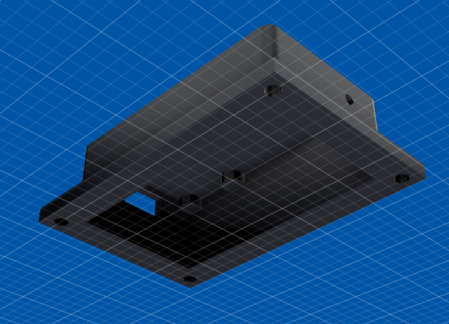
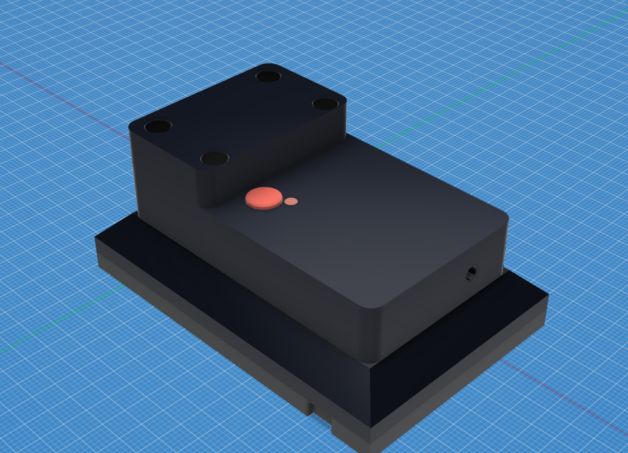
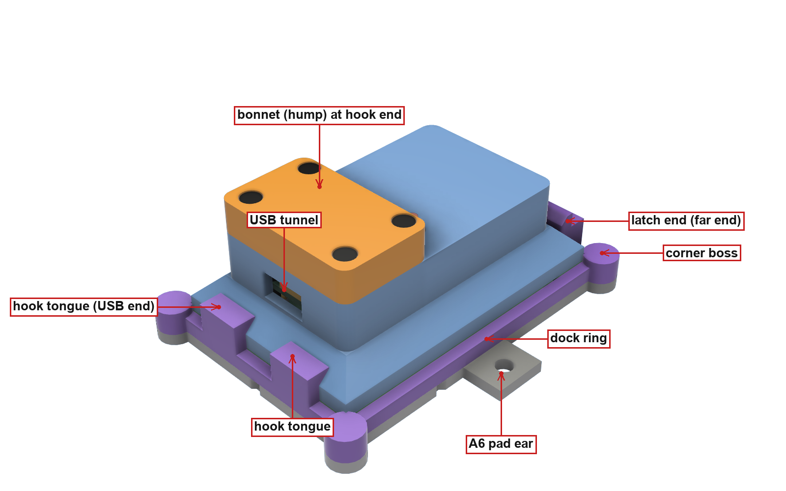

# Crown: quick assembly

Short version. Full details, checks and reasons are in [ASSEMBLY.md](ASSEMBLY.md) (section numbers in brackets).

**Rules:** nylon is finger tight. Everything touching the boards is nylon. Keep each screw type in its own bag.

## Hardware

| Bag | Part | Qty | Goes |
| --- | --- | --- | --- |
| A | Brass insert M2.5 x 4 | 12 | Hood plinth 4, hood roof 4, dock ring 4 |
| B | Nylon screw M2.5 x 10 | 8 | Board stack 4, bonnet 4 |
| C | Nylon standoff M2.5 M-F 8 mm | 4 | Between the boards |
| D | Nylon nut M2.5 | 4 | On top of the feather |
| E | Stainless socket screw M2.5 x 6 | 4 | Sole to hood corners |
| F | Nylon screw M2.5 x 5 (6 mm, cut 1 mm off) | 4 | Dock plate to ring |

Tools: soldering iron (220-230 C), 2.0 mm hex key, small screwdriver, 5 mm nut driver, flush cutters.

---

## 1. Set the inserts (bag A) [3]

Iron at 220-230 C. Insert upright, push lightly, stop **flush**. Press flat with a steel rule. Let cool.

**1a. Hood plinth, 4, from the bottom face**

<!-- HW:hw_01_hood_plinth_inserts -->

**1b. Hood roof, 4, from the top face. Don't push past flush (0.5 mm floor).**

<!-- HW:hw_02_hood_roof_inserts -->

**1c. Dock ring, 4, from the bottom face**

<!-- HW:hw_03_dock_ring_inserts -->

## 2. Cut the dock screws [4]

Cut 1 mm off four M2.5 x 6 nylon screws so they are 5 mm. Bag F. A 6 mm screw bottoms out.

## 3. Board stack (bags B, C, D) [steps 1-3]

1. Stand 4 standoffs on the radar board, components up, studs up.
2. Board onto the sole posts, radar down. 4 x M2.5 x 10 nylon up from the window face into the standoffs.
3. FFC into the radar board CN1, U-turn, into the feather CN1.
4. Feather onto the studs, 4 nylon nuts on top.
5. **H4 nut: a flat faces the antenna (AE1).**

<!-- HW:hw_04_board_stack -->

## 4. Key and light pipe [step 4]

Push into the hood from inside.

## 5. Hood onto the sole (bag E) [step 5]

1. Battery pigtail into U4 first (red to pin 1).
2. Stack into the hood, pigtail up through the 4 mm roof hole, USB-C into its tunnel.
3. 4 x M2.5 x 6 stainless from the window face, corner holes. Snug, cross pattern. Don't crank.

<!-- HW:hw_05_hood_corner_screws -->

## 6. Battery and bonnet (bag B) [step 6]

1. Cut the cell's plug off, splice to the pigtail (red to red), stagger the joints, heat-shrink.
2. Cell on its pad, joints tucked beside it.
3. Bonnet on. 4 x M2.5 x 10 nylon from the top, finger tight.

<!-- HW:hw_06_bonnet_screws -->

## 7. Dock plate onto the ring (bag F) [step 8]

Ring bottom up, plate on it top down. 4 x M2.5 x **5** nylon, finger tight.

<!-- HW:hw_07_dock_plate_screws -->

## 8. Crown into the dock [step 9]

**Hump end at the hook tongues**, or the plate blocks the radar. Slide the USB end under the hooks, press the far end down until the latch clicks. To release, push the tab out.

## 9. Mount it [7]

Fix the plate to the container first, then the ring (7), then the Crown (8).

**A6 Pad (hole 25-33 mm):** gasket ring under the plate, then foam tape or 2 x M4 nylon screws and nuts through the ears. Snug only.

<!-- HW:hw_08_a6_ears -->

**A2 Span (can, lid off):** bars into the clips, M4 x 10 nylon up through each clip into the bar. Tongues go outside the rim.

<!-- HW:hw_09_a2_clips -->

**A5 Expander (hole 50.5 mm+):** TPU ring on the tube, nuts in the compression ring, 3 x M3 x 12 from the top. Tighten evenly until the gap closes.

<!-- HW:hw_10_a5_squeeze -->

## Taking it apart

Release from the dock, then remove the bonnet screws, corner screws, nuts and feather, then the board screws.
