# Ledger enclosure (pouch gateway, first PETG draft): assembly guide

2026-11-01. From Fusion model `pouch_gateway_enclosure_ledger` v4 (v3 plus the hardware bodies) and `..\NOTES.md`. Pictures are in this folder. The new hardware pictures (`hw_*.png`) show the inside of the front shell with its opening facing up; the shell is drawn light grey there so the hardware stands out (the real part is navy). Colours: **gold = brass M2 inserts, steel grey = M2 screws.** In each "before" picture the part floats about 15 mm from its seat, in line with it; the "fitted" picture shows it in place.

**Big picture:** the Ledger is a flat box, 82 x 100 x 24 mm. Everything mounts to the **inside of the front shell**: the LCD near the top under the brow, the gateway board below it. The rear cover screws on to close it. The finished box leans back 15 degrees on the wedge stand. USB-C on the left side is the only external port (power and data).

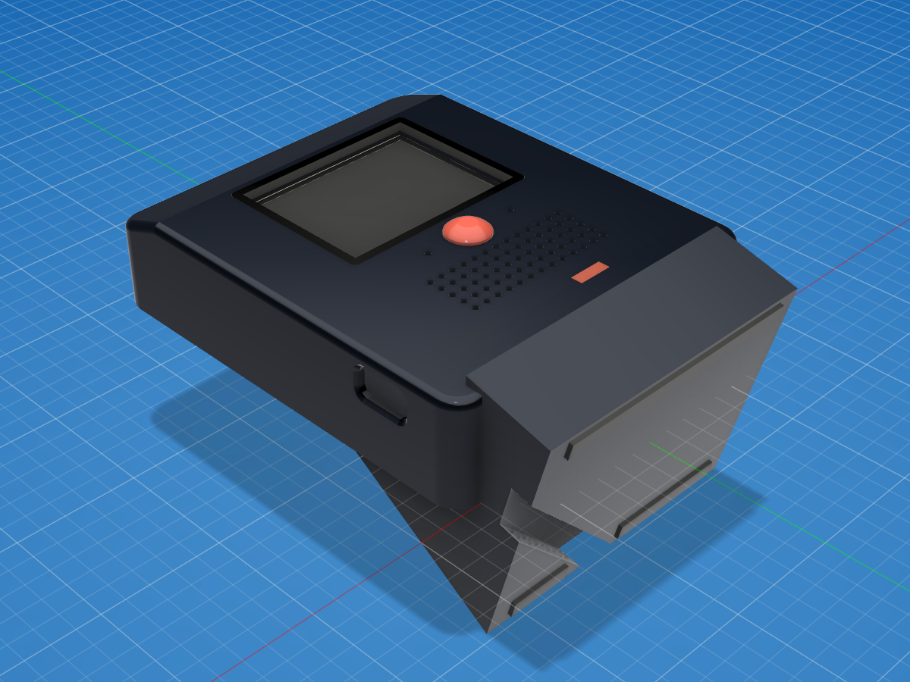 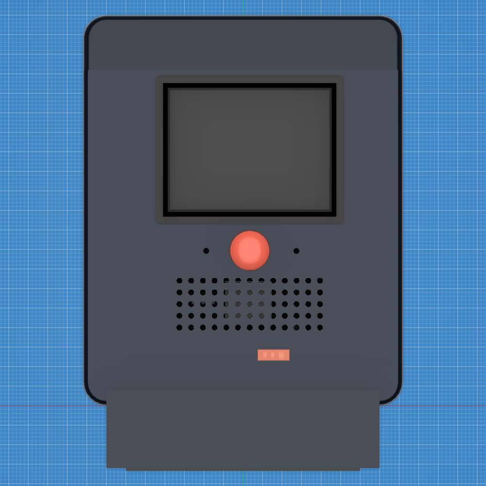

---

## 1. Parts list

### Printed parts (STLs in `..\print_draft_2026-10-29\`)
| # | Part | Qty | File | What it does |
| --- | --- | --- | --- | --- |
| A | Front shell | 1 | Front_Shell_PETG_face_down.stl | Main body: front face, 4 side walls and the sloped brow at the top. Display window and recess for the bezel, 10.4 mm key hole, slot for the status pill, RESET/ISP pinholes, dot grille, USB-C opening on the left wall. Inside: bosses for the LCD, gateway and rear cover |
| B | Rear cover | 1 | Rear_Cover_PETG_outer_face_down.stl | 77 x 95 x 2 mm back plate, set 1 mm into the rim. "Contains FCC ID: HSW2FR" debossed |
| C | Wedge stand | 1 | Wedge_Stand_PETG_ground_face_down.stl | 15 degree desk stand. Front lip and rear back-rest hold the box; 7 x 5 mm groove underneath for the USB cable |
| D | Bezel insert (optional, accent) | 1 | tpu_or_accent_optional\Bezel_Insert_PETG_back_face_down.stl | Thin black frame (1.2 mm) round the display window |
| E | Key cap (optional, accent) | 1 | tpu_or_accent_optional\Key_Cap_PETG_dome_down.stl | Coral USER button. Dome outside, cone flange inside, stem presses the USER switch |
| F | Status pill (optional, accent) | 1 | tpu_or_accent_optional\Status_Pill_PETG_stem_down.stl | Light guide for LEDs D3/D4/D5. Meant to be translucent; in plain PETG it is a fit check only |
| G | Foot strips (optional) | 3 | tpu_or_accent_optional\TPU_Foot_1/2/3_PETG_flat.stl | 1 mm strips (60, 29 and 15 mm long) glued under the stand. They restore the stand's design height |

Parts D, E and F are drawn as separate colours (black, coral, translucent coral). For the plain-PETG draft you can print them in navy or leave D and F off. **E (key cap) is needed** to press the USER button.

**What each printed part looks like:**

| | |
| --- | --- |
| 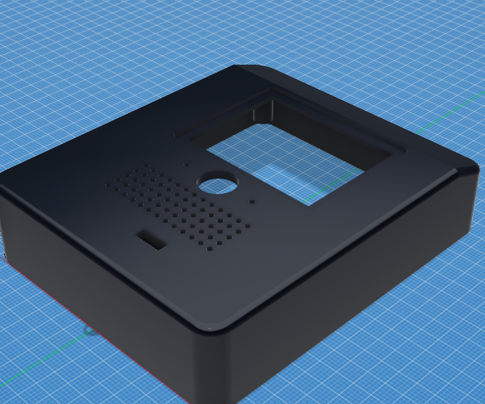 A Front shell, face | 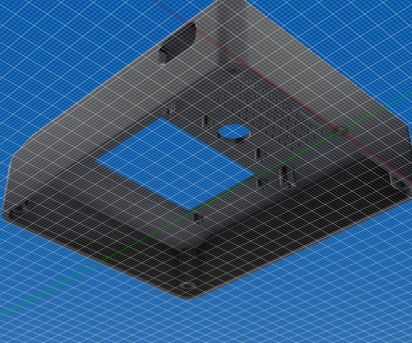 A Front shell, inside (bosses) |
| 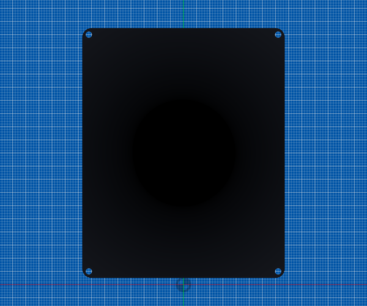 B Rear cover (outside) | 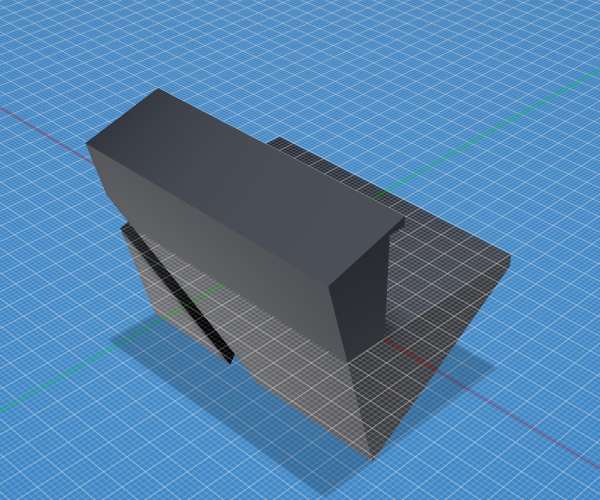 C Wedge stand |
| 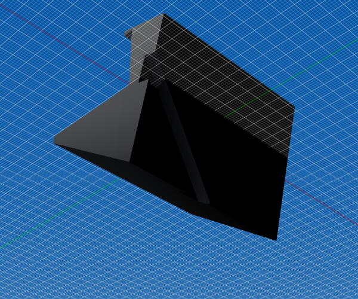 C Wedge stand, underside (cable groove) | 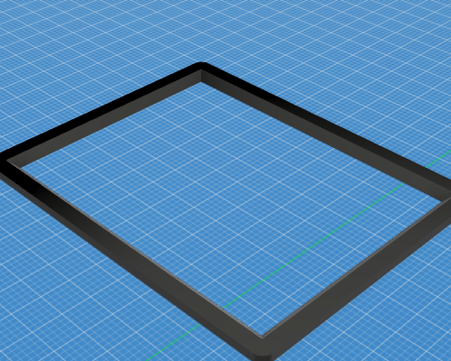 D Bezel insert |
| 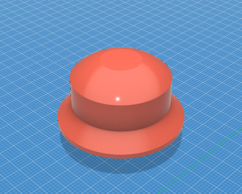 E Key cap | 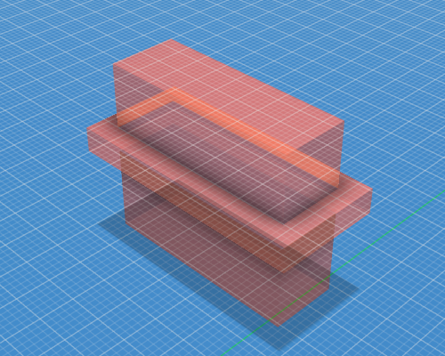 F Status pill |
| 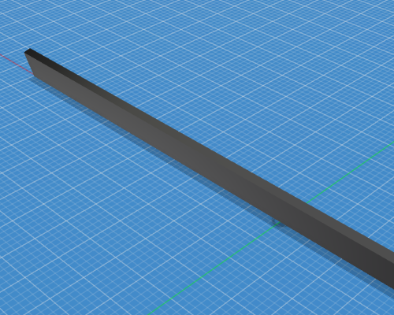 G Foot strip | |

### Hardware and other parts (not printed)

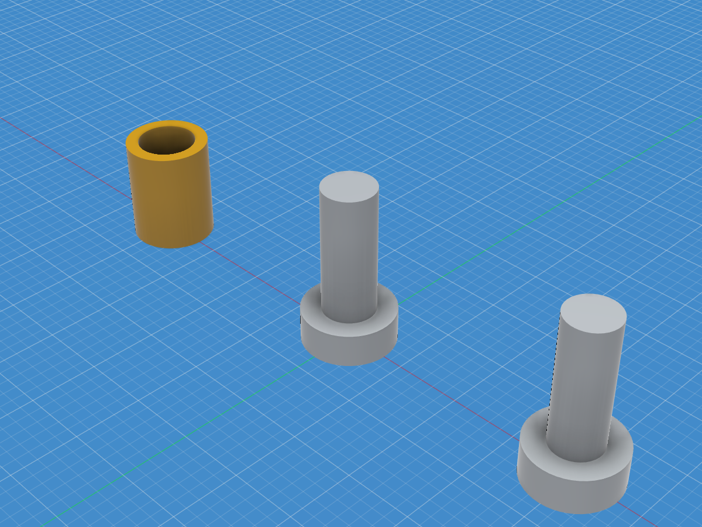

*The screws and inserts, one of each type. Left to right: brass M2 insert (x8), M2 x 5 button head screw (x8), M2 x 5 thread-forming screw with a pan head (x4).*

Hardware is the Amazon version, from `shared\design\enclosure_hardware_amazon_2026-11-01.md` (ASINs, packs and prices checked on amazon.com 2026-11-01). The earlier McMaster-Carr hardware version of this guide and the model notes are in `..\variant_mcmaster_2026-11-01\`.

| Item | ASIN | Qty | Where |
| --- | --- | --- | --- |
| ruthex RX-M2x4 M2 brass heat-set insert, 4 mm long (3.2 mm hole, 4 mm deep). Pack of 70 | B088QJG676 | 4 | Gateway board bosses on the inside of the front wall |
| M2 x 5 304 stainless button head hex screw. Pack of 100 | B0DLKCR1CQ | 4 | Gateway board into those inserts |
| uxcell M2 x 5 316 stainless pan head Phillips self-tapping screw. Pack of 50 | B07Q36GBKY | 4 | LCD module into its 4 bosses (1.6 mm pilot holes, no inserts) |
| ruthex RX-M2x4 M2 brass heat-set insert, 4 mm long (3.2 mm hole, 4 mm deep) | B088QJG676 | 4 | Rear cover corner bosses |
| M2 x 5 304 stainless button head hex screw | B0DLKCR1CQ | 4 | Rear cover |
| Waveshare 2inch LCD Module | (in the gateway BOM) | 1 | Top half of the box, behind the window |
| Cable W1: PH2.0 8-pin to PH2.0 8-pin, 60-80 mm | (in the gateway BOM) | 1 | Gateway J5 to the LCD. **Probably wired reversed (lead 1 to slot 8 ... 8 to 1)**, see `..\..\lcd_module\cable_W1_wiring.md`. Continuity-check before fitting the second housing |
| Molex 146153-0100 FPC antenna (100 mm lead, U.FL) | (in the gateway BOM) | 1 | Stuck under the top wall, under the brow; lead to J3 |
| 0.5 mm foam or TPU gasket (optional, not in the model) | | 1 | Between the LCD glass and the front wall |
| Thin double-sided adhesive ring or CA dots | | some | Bezel insert |
| USB-C cable, overmould no bigger than 12 x 6.5 mm, straight | | 1 | Must reach about 6.5 mm into the case. Right-angle or bulky plugs will not fit |

Totals for the Amazon order: 8 inserts (1 pack of 70), 8 button head screws (1 pack of 100), 4 self-tapping screws (1 pack of 50). Note that 304 stainless (the button head screws) will stain over time near salt water; this is only a concern if the box lives in a splash zone.

---

## 2. Before you start (prepare the printed parts)
1. Remove the painted supports from the brow facet on the front shell and clean up the surface.
2. **Heat-set inserts:** press the 4 M2 inserts (B088QJG676) into the gateway-board bosses on the inside of the front wall, and 4 more into the corner bosses for the rear cover (part_A_front_shell_inside.png). The LCD bosses get **no** inserts; their screws cut their own thread.

<table><tr>
<td>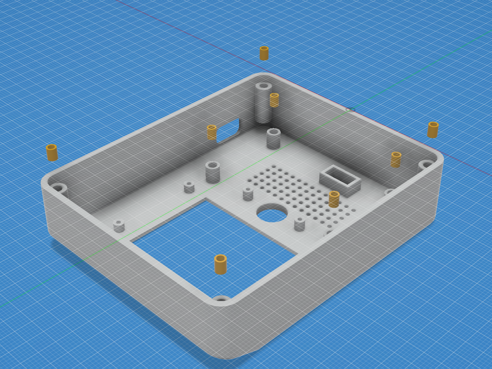 Before: 8 gold inserts above their bosses. The 4 near the corners are for the rear cover, the 4 further in are for the gateway board.</td>
<td>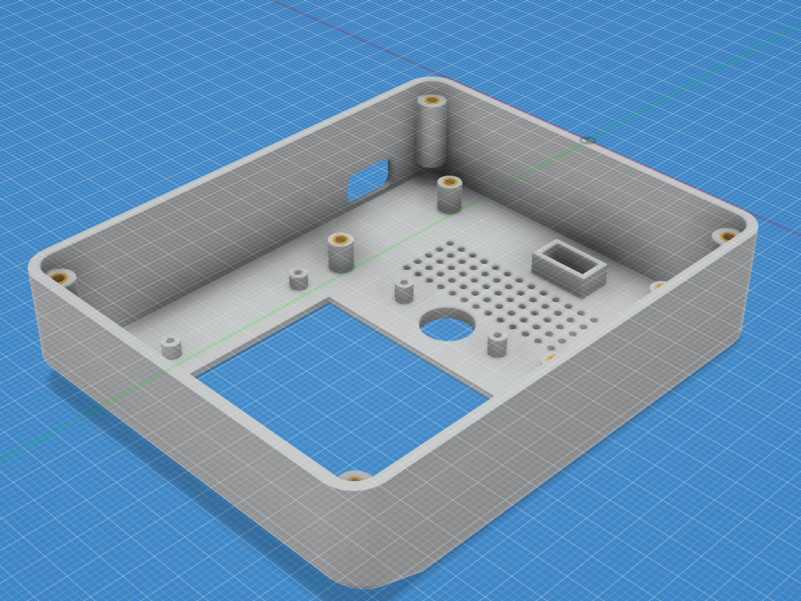 Fitted: each insert flush with its boss face. The 4 shorter plain bosses (no insert) are the LCD bosses.</td>
</tr></table>

3. Check the key cap slides freely in its 10.4 mm hole and the status pill in its slot. Sand if tight (the dome-down print can leave rough layers on the dome).
4. Make up cable W1 and check it end to end (see the table above) before you fit the second housing.

## 3. Assembly

**Step 1. Shell face down** (build_01_shell_inside.png). Lay the front shell on a soft cloth, face down, so you're looking into it.

**Step 2. Bezel insert (optional).** From the front, drop the bezel into the shallow recess round the display window, chamfer facing out. Fix it with a thin adhesive ring or a few CA dots. Do this first, while the window is empty, so the glue can't reach the LCD.

**Step 3. Key cap and status pill.** From the inside, push the key cap into the round hole, dome first, so its cone flange sits against the inside of the wall. Push the status pill into its slot from the inside, face first, flange against the wall. Nothing holds them yet; the gateway board traps them in step 6, so keep the shell face down.

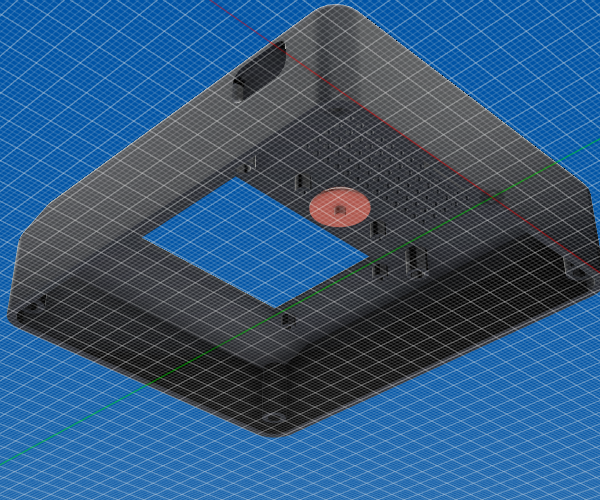

**Step 4. Antenna.** Peel the backing off the Molex FPC antenna and stick it flat on the underside of the top wall, under the brow (shown in tan). Keep it clear of the screw bosses. Leave the U.FL lead loose for now.

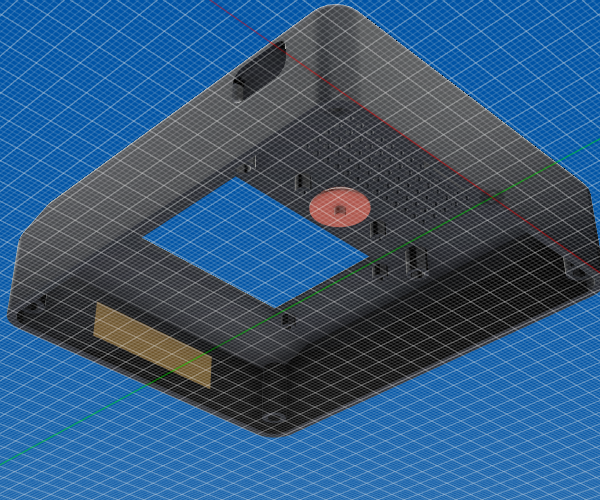

**Step 5. LCD module.** Plug cable W1 into the LCD's PH2.0 connector first. Optionally lay the 0.5 mm gasket round the window. Put the LCD in the top half of the shell, glass towards the window, connector end to the right, and screw it down with the 4 M2 x 5 self-tapping screws (B07Q36GBKY). Tighten until snug: the glass should not be clamped (0.5 mm gap to the wall).

<table><tr>
<td> Before: 4 screws below the LCD (above it in this picture), one in line with each corner hole and its plain boss.</td>
<td>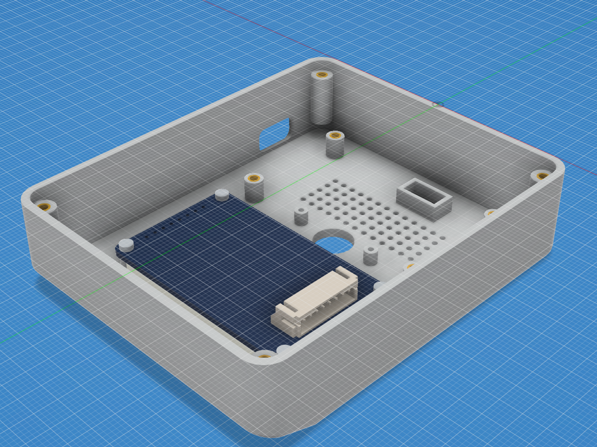 Fitted: heads on the back of the LCD board at its 4 corners, tips cutting into the bosses.</td>
</tr></table>

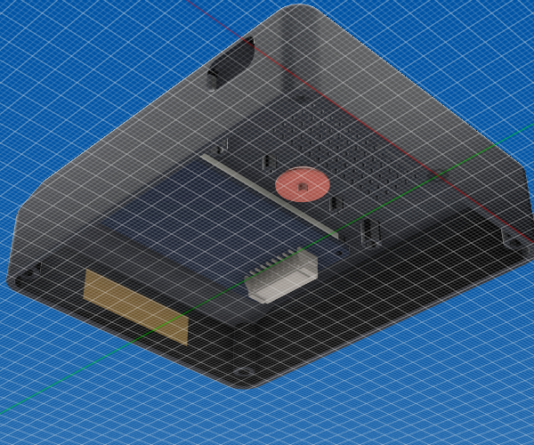

**Step 6. Gateway board.** Put the gateway board in the lower half, components facing the front wall: USB-C (J1) to the left wall opening, USER switch under the key cap stem, LEDs D3-D5 under the status pill. Screw it down with the 4 M2 x 5 button head screws (B0DLKCR1CQ) into the inserts. Then:
- Plug the free end of cable W1 into J5 (8-pin, right-hand side).
- Snap the antenna's U.FL plug onto **J3** (the main antenna U.FL, not J7). Run the lead up the right-hand side, beside the W1 cable.
- Press the key: you should feel a short free travel (0.2 mm) and then the click.

<table><tr>
<td>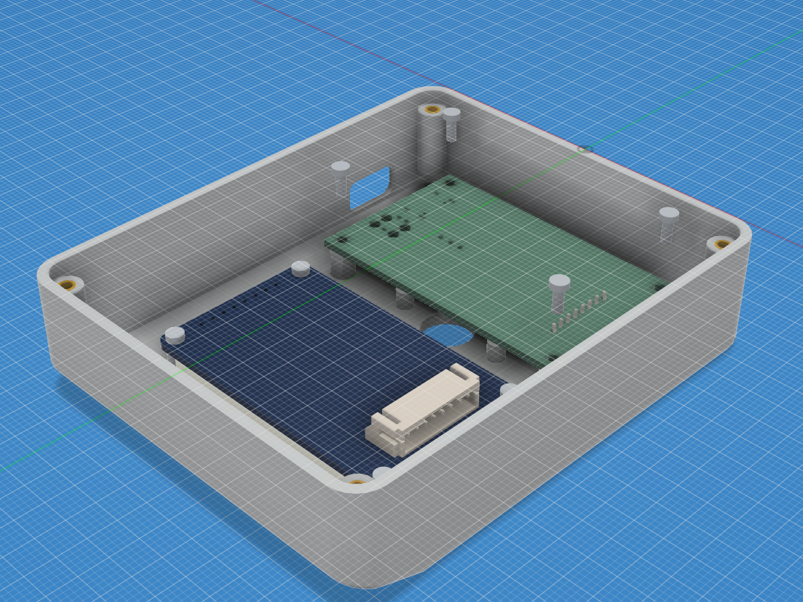 Before: the gateway board (green) rests on its 4 bosses, the 4 screws float in line with its corner holes.</td>
<td>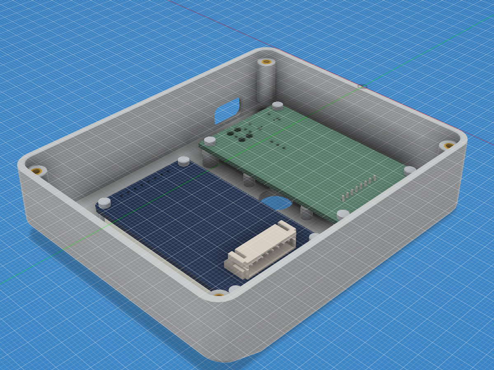 Fitted: screw heads on the back of the board, shanks in the gold inserts underneath.</td>
</tr></table>

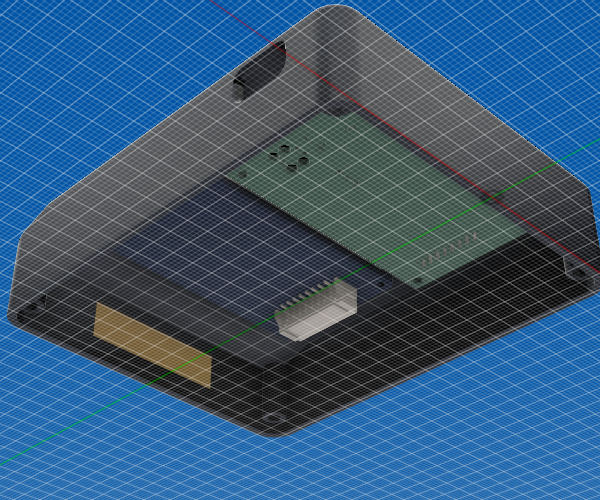 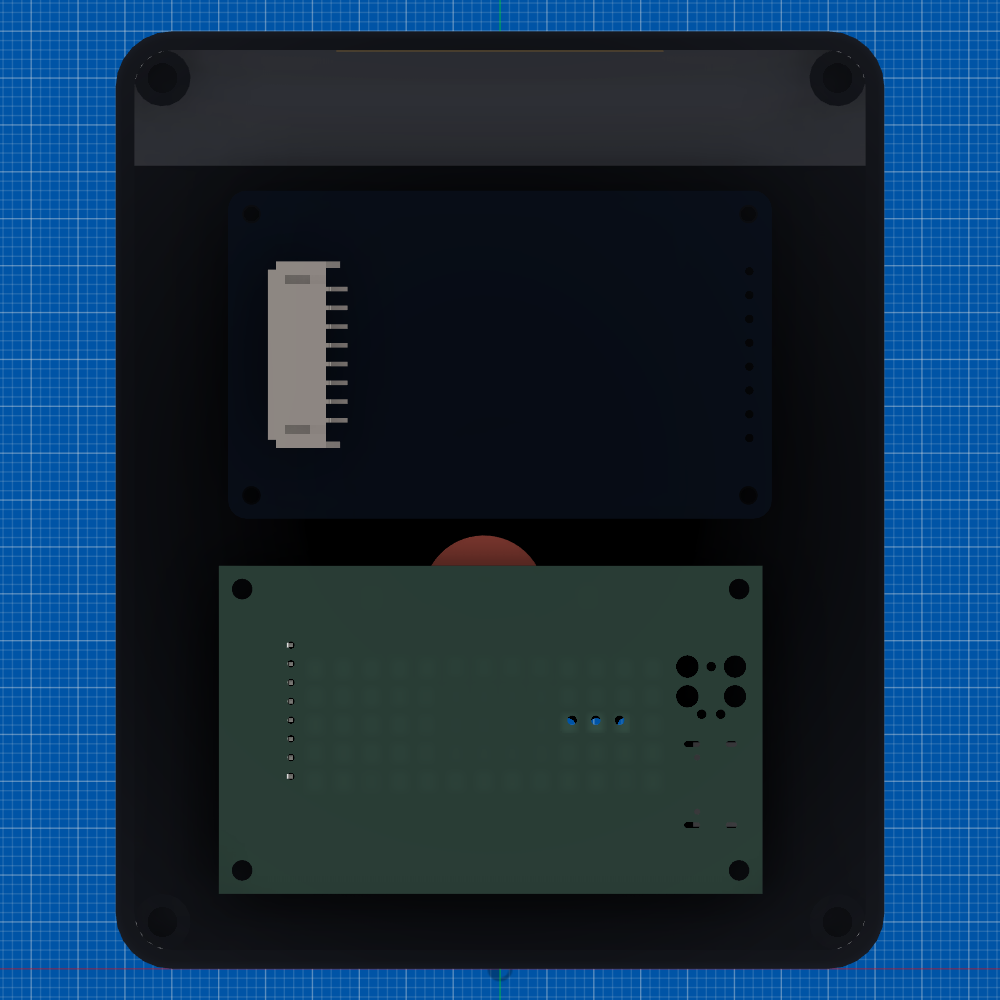

The second picture is from the back with the rear cover off. It is **mirrored left to right** because it's seen from behind.

**Step 7. Test before closing.** Plug in USB-C through the left-hand opening (check the plug goes fully home). Check the LCD lights, the status LEDs show through the pill, and the USER key works. If the LCD backlight is on but the picture is wrong or blank, check the W1 pin order.

**Step 8. Rear cover.** Lay the rear cover into the back opening, debossed text facing out (it sits 1 mm into the rim with a 0.5 mm shadow gap round it). Screw it on with the 4 M2 x 5 button head screws (B0DLKCR1CQ) into the 4 corner inserts.

<table><tr>
<td>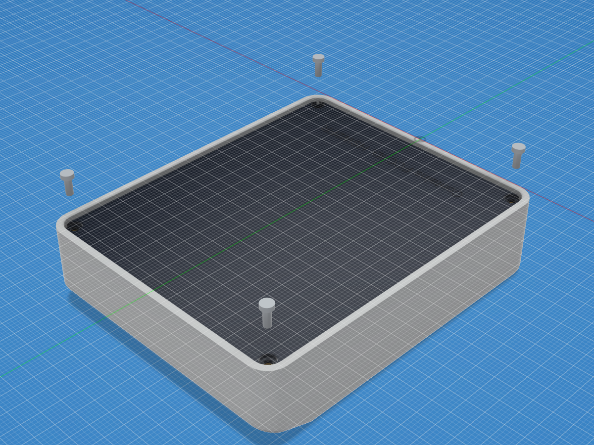 Before: the cover lies in the opening, 4 screws float above its corner holes.</td>
<td>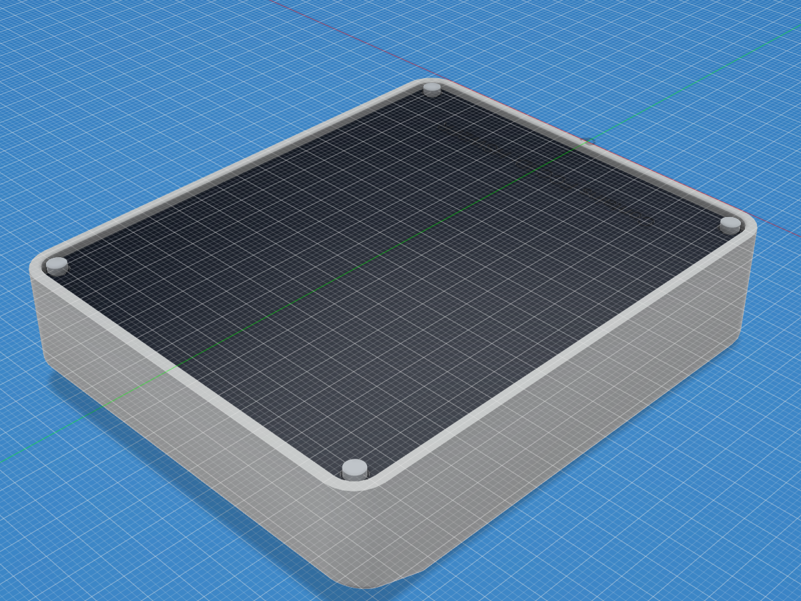 Fitted: button heads in the counterbores, shanks in the corner inserts.</td>
</tr></table>

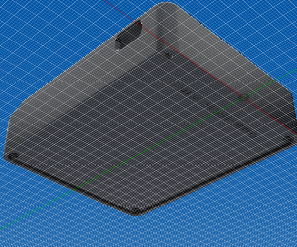

## 4. Stand
**Step 9. Feet (optional).** Glue the 3 foot strips into the underside of the stand. Without them the stand sits 1 mm lower than designed. Stick-on rubber feet work too.

**Step 10. Put the box on the stand.** Set the bottom edge of the box on the stand seat against the front lip and lean it back onto the back-rest (15 degrees). Run the USB cable from the left side down through the groove under the stand to the back.

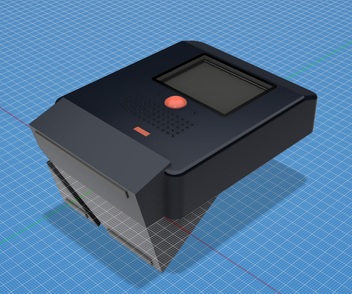 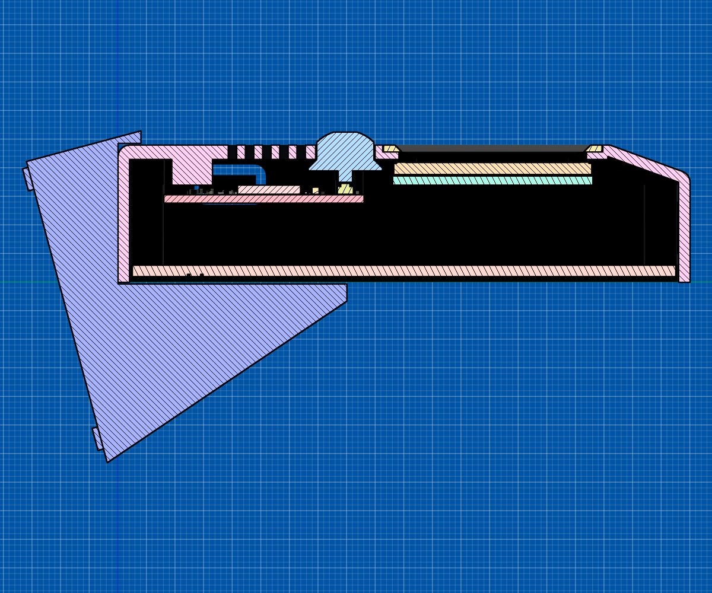

The section picture is rotated: the face is at the top and the bottom of the box is on the left, with the stand at lower left.

## Debug access
The Tag-Connect debug pads (J6) face the front shell. To reach them, take off the rear cover and unscrew the gateway board (4 screws).

## Taking it apart
Lift the box off the stand. Undo the 4 rear-cover screws. Unplug J5 and the U.FL, undo the 4 gateway screws and lift the board out. The key cap and pill are now loose. The LCD stays in unless you undo its 4 screws.

## Not covered by this draft
The battery, PowerBoost, charge port, power switch and wall keyholes are not in the model, so they aren't part of this build.
