# Tidemark enclosure (first PETG draft): assembly guide

2026-11-02, mounting updated 2026-11-05. From Fusion model `nrf54l15_feather_enclosure_tidemark` v17 (Amazon hardware version: 3.6 mm insert holes, 8 mm + 6 mm nylon standoff stacks, foot-cap screws sunk flush, one 1 g silica pack in a slot on the sled), and v20 for the mounting (the dovetail rail and sliding rim clip were replaced by a hook-on cleat, Brian 2026-11-05). The McMaster-Carr hardware version of this guide, its pictures, STLs and notes are in `..\variant_mcmaster_2026-11-01\` (Fusion v11; it still has the old rail and clip). All pictures in this guide were re-made from v17 (apart from the exceptions named under the hardware kit picture and in the parts table below); part_A_sleeve.png, part_G_rimclip.png, step5_clip_side.png, step5_clip_section.png, build_11_complete.png and build_09_sleeve_on.png were re-made from v20. Colours: **gold = brass inserts, white = nylon standoffs and screws, steel grey = stainless screws, black = o-ring, pale blue = silica pack, light disc = vent patch.** The sled, sleeve and foot cap are shown in plain light grey so the hardware stands out. In each "before" picture the part floats clear of its seat, in line with it; the "fitted" picture shows it in place.

**Big picture:** the feather stands upright with its USB end down. The boards, sled and battery form one "cartridge". The sleeve is a cover, open at the bottom, that goes over the cartridge, and the foot cap screws on underneath to seal it. The rim clip hangs on the tank rim, and the node hangs on the clip by a cleat on the back of the sleeve.

---

## 1. Parts list

### Printed parts (STLs in `..\print_draft_2026-10-29\`)
Part letter D is not used any more: the printed board spacer was replaced by a purchased nylon standoff stack (see Hardware).

| # | Part | Qty | Picture | What it does |
| --- | --- | --- | --- | --- |
| A | Sleeve | 1 | part_A_sleeve.png (seen from the back) | Main body: 4 walls, roof, sloped brow on the front, flared base (plinth) at the bottom, and a cleat (a 24 mm wide hook, 3 mm proud, top edge 2.8 mm below the roof) high on the back wall. Key hole (7.4 mm) and LED "eye" hole (2.7 mm) on the front wall. Plinth insert holes 3.6 mm. STL `tidemark_sleeve_PETG_roof-down.stl` (2026-11-05) |
| B | Foot cap | 1 | part_B_footcap_top.png, part_B_footcap_bottom.png | Bottom lid. Top face: o-ring groove and 4 screw holes. Bottom: USB-C tunnel with a bung recess, the box-shaped "heel" with the SMA bulkhead hole, a 4.5 mm solar-cable hole and a 3.0 mm vent hole. The 4 screw counterbores are 2.7 mm deep, so the screw heads sit 0.2 mm below the flat underside |
| C | Sled | 1 | part_C_sled.png (posts side), part_C_sled_battery_side.png | 2 mm plate. Front: 4 posts (8 mm OD, 3.6 mm insert holes) for the boards, plus a thin vertical rib (1.5 x 20 x 30 mm) at the left edge of the boards that forms the silica pack slot with the sleeve wall. Back: 2 rails and 2 ledges that hold the battery |
| E | Key | 1 | part_E_key.png | Push button cap. Its small plunger presses SW1 on the main board. The notch in the flange clears the light pipe |
| F | Light pipe | 1 | part_F_lightpipe.png (thin rod with collar, beside the key) | 2.5 mm rod that carries the LED1 light to the front. A clear 2.5 mm acrylic rod cut to 8.8 mm and glued in works better |
| G | Rim clip, cleat version ("L piece") | 1 | part_G_rimclip.png | Hook that hangs on the tank rim (12 mm rim, same hook as before). Its lower part is a 30 mm wide block with a pocket: the sleeve's cleat drops into the pocket and rests on a 45 deg lip, and two side cheeks keep the node from swinging sideways. STL `tidemark_rimclip_12mm_cleat_PETG_hook-top-down.stl` (2026-11-05). The old dovetail clip is in `superseded_2026-11-05\`: do not print it |
| H | Leaf card | 1 | part_H_leafcard.png | Backing card for the LL200-2.4-75 solar panel (panel sits in the 1 mm pocket, the cable leaves through the notch). It is separate from the enclosure; only the solar cable runs to the node |
| I | USB bung (optional, fit check) | 1 | part_I_usb_bung.png | Plug that closes the USB-C tunnel in the foot cap. Real part will be TPU |
| J | SMA boot (optional, fit check) | 1 | part_J_sma_boot.png | Sleeve over the SMA bulkhead and probe plug under the heel. Real part will be TPU |
| K | Clip pads (optional, fit check) | 2 | part_K_clip_pad.png | 1.5 mm pads that go on the two inner faces of the clip hook so it grips the rim. Real part will be TPU. Unchanged by the cleat |

**What each printed part looks like** (part_E to part_K are unchanged since the first draft and were not re-rendered, apart from part_G, re-made 2026-11-05):

| | |
| --- | --- |
| 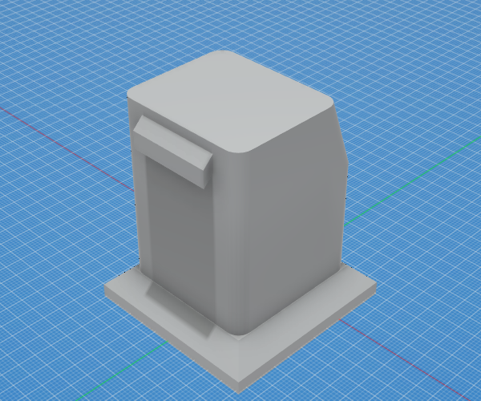 A Sleeve, seen from the back (the cleat is the bar at the top of the back wall) | 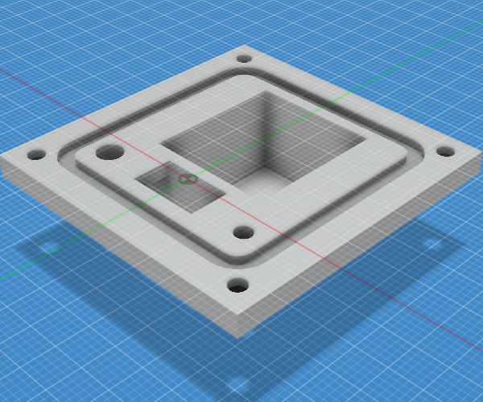 B Foot cap, top (o-ring groove) |
| 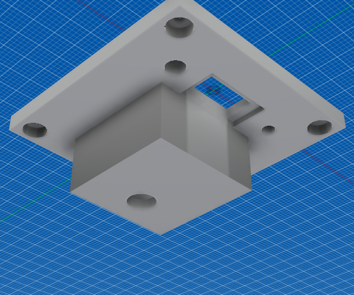 B Foot cap, bottom (heel, USB tunnel) | 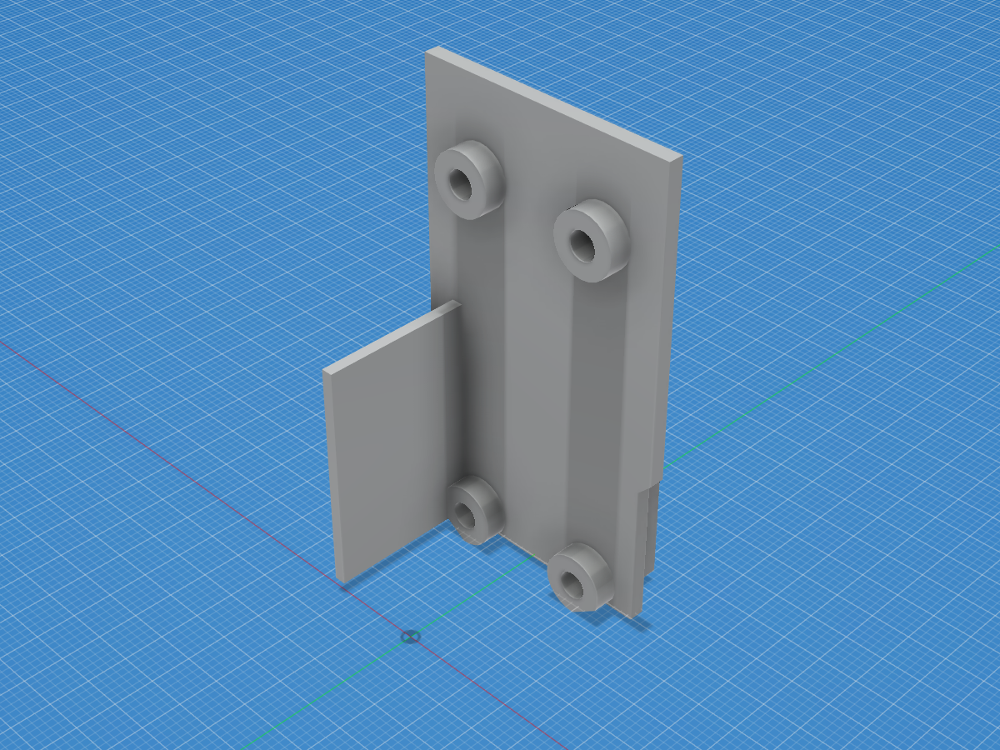 C Sled, posts side (8 mm OD posts, 3.6 mm insert holes; the thin wall at the left is the silica slot rib) |
| 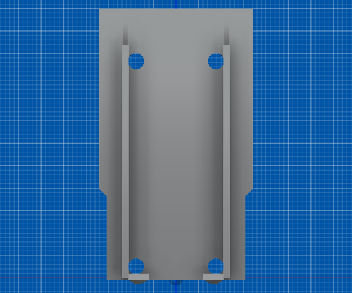 C Sled, battery side | 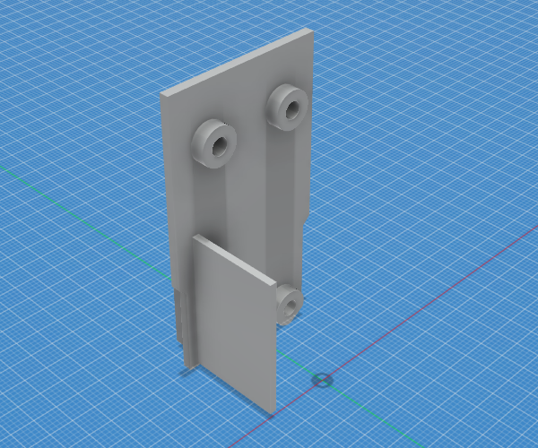 C Sled, posts side from the other corner |
| 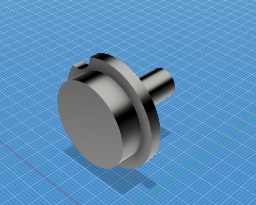 E Key | 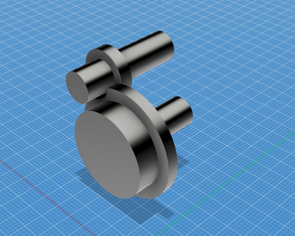 F Light pipe (rod with collar) beside the key |
| 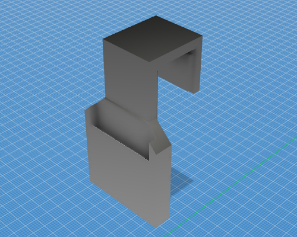 G Rim clip, cleat version (the pocket and its two cheeks face the sleeve) | 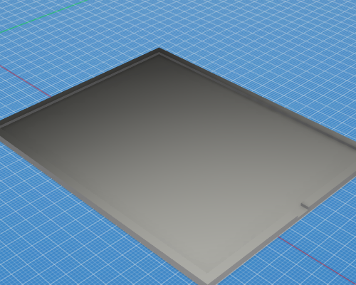 H Leaf card |
| 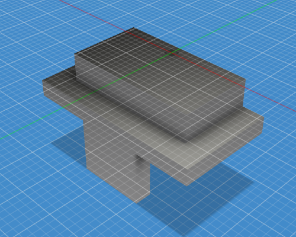 I USB bung | 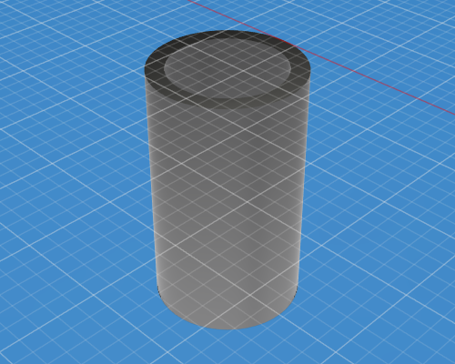 J SMA boot |
| 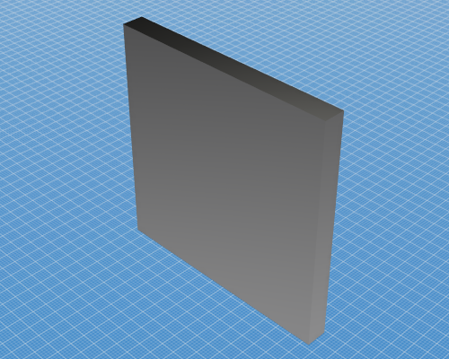 K Clip pad | |

### Hardware (not printed). Amazon ASINs from `mechanical\hardware_lists\enclosure_hardware_amazon_2026-11-01.md` (in the repo; it was in `shared\design\` before the 2026-11-10 reorg)
The McMaster-Carr version of this list is in `..\variant_mcmaster_2026-11-01\` (NOTES.md and assembly_guide).

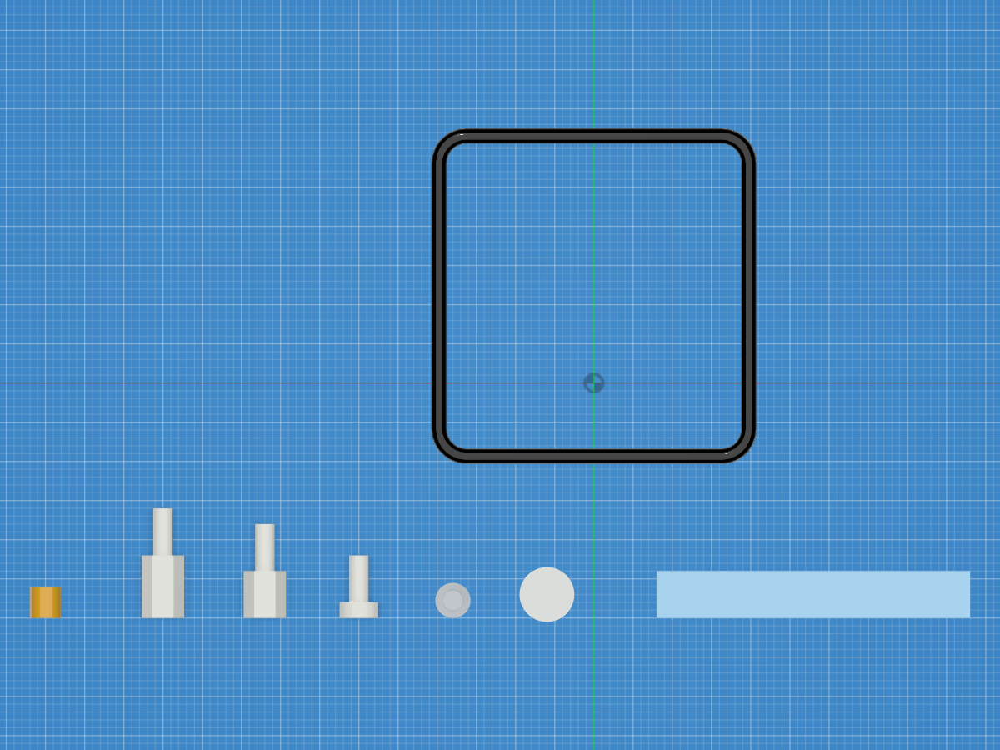

*The kit, seen from above, one of each type. Left to right along the bottom: brass insert (x8), 8 mm nylon standoff (x4, bottom of each stack), 6 mm nylon standoff (x4, top of each stack), nylon M2.5 x 6 screw (x4), stainless foot-cap screw (x4), vent patch (x1); silica pack at the far right; the black o-ring loop (x1) above them. This overview picture was not re-made: the silica pack in it is the old 3 g size and the foot-cap screw is drawn the same as before. The 1 g pack you are buying is flatter (about 30 x 20 x 3 mm).*

| Item | ASIN | Pack | Qty used | Where |
| --- | --- | --- | --- | --- |
| M2.5 brass heat-set insert, 4 mm long x 4 mm OD (3.6 mm hole, 5 mm deep) | B0DPQK6RJZ | 100 | 8 | 4 in the sled posts, 4 in the sleeve plinth corners (underside) |
| MCMASKE M2.5 black nylon M-F standoff kit, 435 pc (6/8/10/12/15/18/20/22/25 mm, 6 mm male thread, 4.7 mm across flats) | B0B5M1M822 | kit | 4 x 8 mm + 4 x 6 mm | Board stack, 14 mm in total: an 8 mm standoff at the bottom (male end down through sens1 into the sled insert) and a 6 mm one on top of it |
| Nylon M2.5 x 6 pan head screw (from the same kit) | B0B5M1M822 | kit | 4 | Main board top into the 6 mm standoffs |
| M2.5 x 6 socket head cap screw, 304 stainless | B0GCSRG1WD | 50 | 4 | Foot cap to plinth (304 will stain over time on a salt tank) |
| Mr O-Ring 2 mm silicone cord, 70A, 10 ft (cut a ~154 mm loop, join with CA glue) | B00QVB0ZG6 | 10 ft | 1 | Foot cap groove |
| 1 g silica gel packets | B0GSRKXHFT | 100 | 1 | In the slot on the sled, beside the boards (see the silica pack note and step 10) |
| VOSAREA adhesive ePTFE breathable membrane | B0F45VY7KK | 100 sheets | 1 | Over the 3.0 mm vent hole in the cap (cut a 6-10 mm disc) |
| 14-way 0.5 mm FFC, 30 mm, **Type D (opposite-side contacts)**: Molex 0150200140 | DigiKey 0150200140-ND | | 1 | CN1 (main) to CN1 (sens1). Thickness to be checked against CN1's 0.3 mm |
| 602050 LiPo (6 x 20 x 50 mm) with JST PH 2-pin (red on U4 pad 1) | not stocked at DigiKey/Mouser; source open | | 1 | Back of sled. See `mechanical\hardware_lists\tidemark_electronics_perch_2026-11-11.md` |
| RG316 pigtail, right-angle SMA plug, with IP68 SMA bulkhead jack: Molex 73230-7070 (152.4 mm, longer than the 60-80 mm assumed) | Mouser 73230-7070 | | 1 | sens1 J1 to the bulkhead (one assembly with the next row) |
| IP67 SMA bulkhead jack (6.5 mm hole) | part of the Molex 73230-7070 assembly above | | 1 | Heel floor of the foot cap |
| Thin foam | | | some | Round the battery |

**Silica pack note.** There is no flat room beside the battery (about 5 x 6 mm), so the pack lives somewhere else: on the board side of the sled, in the 6 mm wide channel between the boards and the sleeve's left wall (the side away from the antenna and the key). The sled has a thin rib there; the rib and the sleeve wall make a slot 3.95 mm wide that the 1 g pack slides into from below. The model uses one pack of 3 x 19.9 x 30 mm (thickness x width x length, assumed size for the B0GSRKXHFT packet; check the real packet). It stands on the foot cap floor and runs from the cap up along the left wall for 30 mm. It clears the boards by 2.5 mm, the battery JST plug by 0.5 mm, the vent hole by 0.9 mm and the antenna (AE1) by 14 mm, and it does not block the FFC, USB or the battery. A second pack does not fit in this slot; there is no designed place for one.

**Standoff stack note.** The 8 mm standoff's 6 mm male thread goes through the 1.6 mm sens1 board and 4.4 mm into the sled insert (the 4 mm insert plus 0.4 mm past it, inside the 5 mm deep hole, 0.6 mm to spare). The 6 mm standoff's 6 mm male thread screws into the 8 mm one's female end.

---

## 2. Before you start (prepare the printed parts)
1. Remove brims and supports. Check that the sleeve's top rim (the face the o-ring presses on) is flat and smooth. On the clip, check the tip of the lip inside the pocket (it prints as a 24.7 mm bridge): trim any sagging strands so the sleeve's cleat can sit on the 45 deg face below it.
2. **Heat-set inserts in the sled:** press one M2.5 x 4 mm insert (B0DPQK6RJZ) into each of the 4 posts on the front of the sled (part_C_sled.png). The hole is 3.6 mm and 5 mm deep, so the insert sits flush with the post face with 1 mm of hole left below it. Keep them square to the plate.

<table><tr>
<td>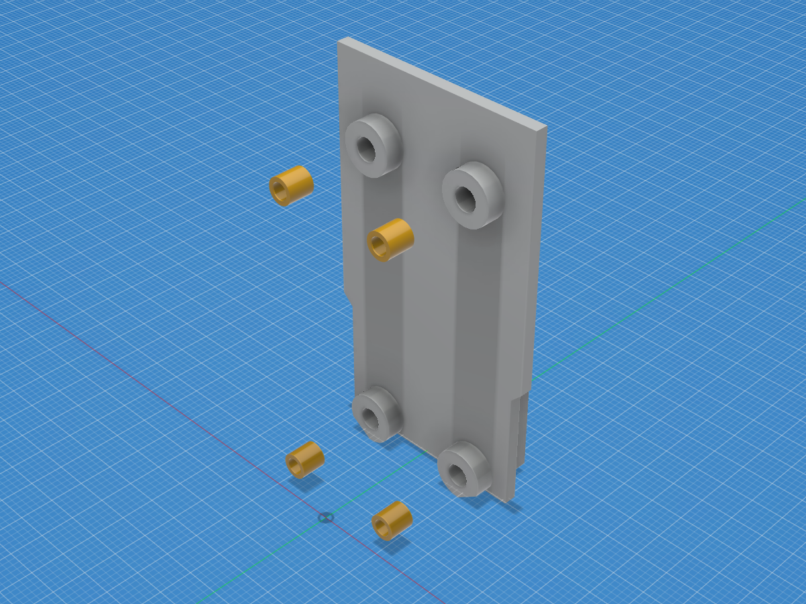 Before: 4 gold inserts (B0DPQK6RJZ), one per post.</td>
<td>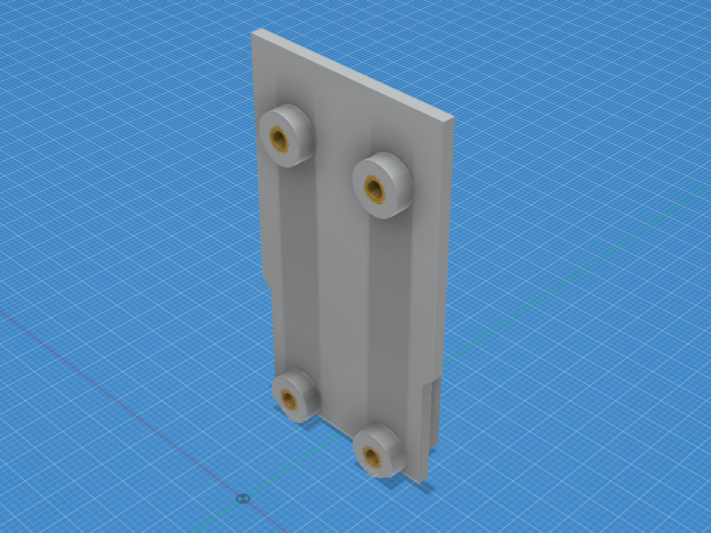 Fitted: each insert flush with the post face.</td>
</tr></table>

3. **Heat-set inserts in the sleeve:** turn the sleeve upside down and press one M2.5 x 4 mm insert (B0DPQK6RJZ) into each of the 4 holes (3.6 mm, 5 mm deep) in the flared base.

<table><tr>
<td>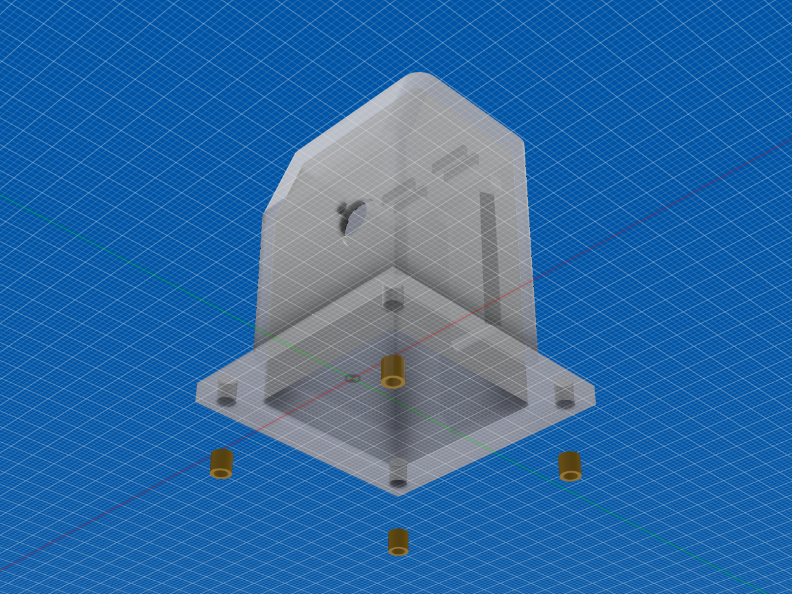 Before: the sleeve seen from below, 4 inserts under the 4 corner holes.</td>
<td>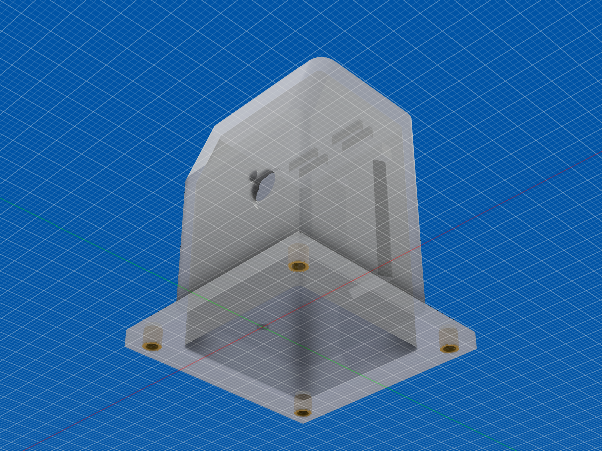 Fitted: inserts flush with the underside of the base.</td>
</tr></table>

4. **Clip pads (optional):** glue a pad to each inner face of the clip hook.
5. **Vent:** stick the ePTFE vent patch (B0F45VY7KK, cut to a 6-10 mm disc) over the 3.0 mm hole in the foot cap, on the inside (top) face.

<table><tr>
<td>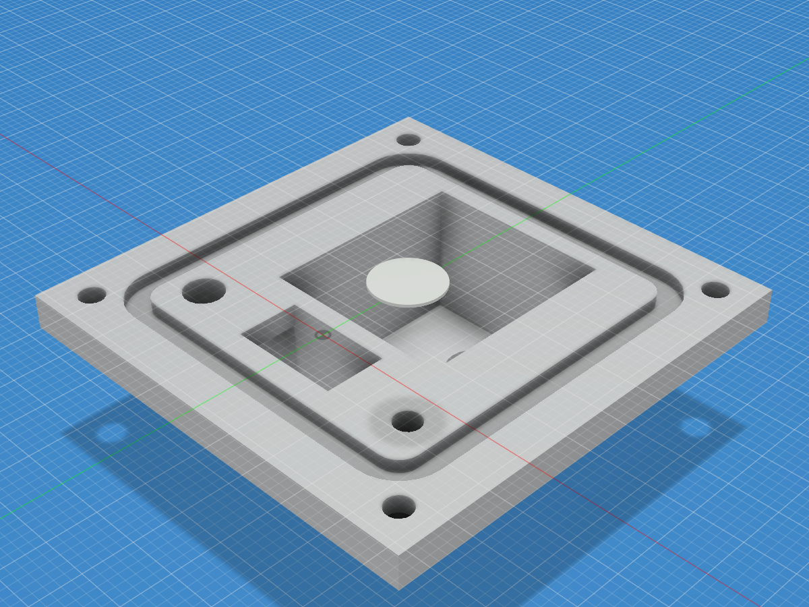 Before: the vent patch (light disc) above the 3.0 mm hole, which is next to the cap's front-right corner.</td>
<td>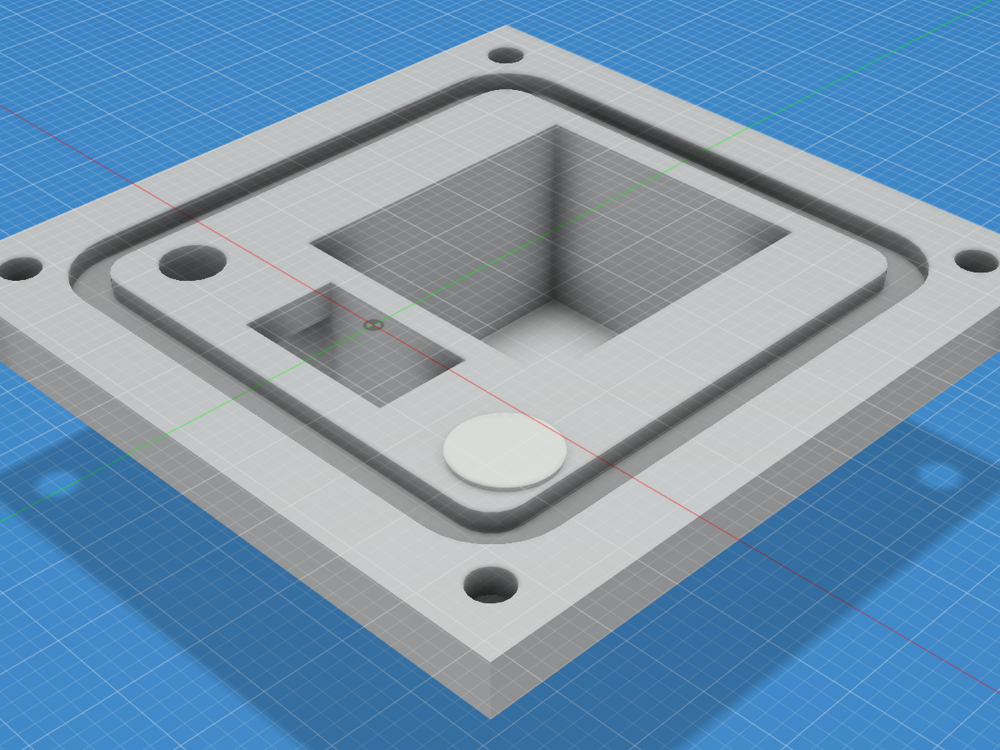 Fitted: the patch covers the hole on the top face.</td>
</tr></table>

6. Try the key and the light pipe in their holes in the sleeve. They should slide freely. Sand them if they're tight.

## 3. Build the cartridge
**Step 1. Sled** (build_01_sled_inserts.png). The sled stands upright with its posts facing you and its narrow end down. The narrow end is the USB end. The four gold inserts are already in the posts. The thin wall at the left (a 1.5 mm rib) is the silica pack slot; leave it alone.

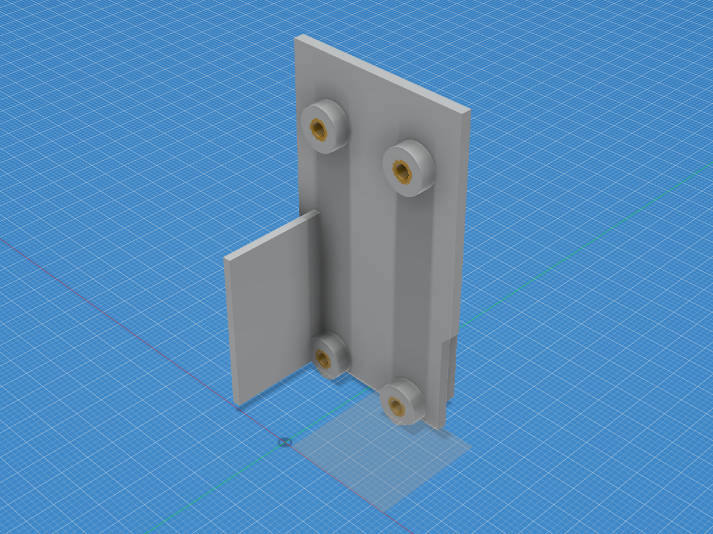

**Step 2. sens1 onto the sled** (build_02_sens1_on_sled.png). Put sens1 on the 4 posts, components facing you (away from the sled), with the SMA connector J1 at the bottom. The holes in sens1 line up with the inserts. Don't fasten it yet.

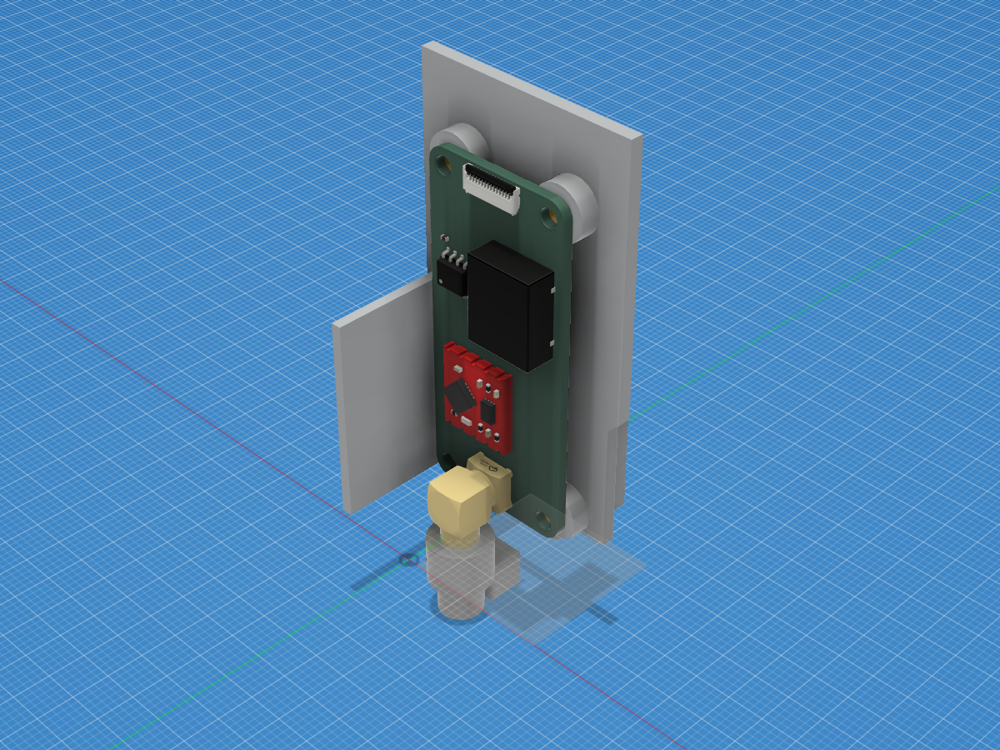

**Step 3. FFC into sens1.** Plug one end of the 30 mm FFC into CN1 at the top of sens1. Do it now, because CN1 is hard to reach once the main board is on.

**Step 4. Standoffs** (build_03_spacers.png is the same picture as the "fitted" one below). Take the four 8 mm nylon standoffs from the kit (B0B5M1M822). Put the threaded (male, 6 mm) end of each one through a sens1 mounting hole and screw it into the insert in the sled post behind it, finger-tight plus a gentle nip with a 4.7 mm spanner or pliers (nylon strips easily). This clamps sens1 to the sled. Then screw a 6 mm standoff onto the top (female end) of each 8 mm one, again finger-tight. Each stack stands 14 mm tall on sens1 with the female thread of the 6 mm standoff facing up. Hex flats are 4.7 mm; turn each hex so a flat faces the nearest component if you can.

<table><tr>
<td>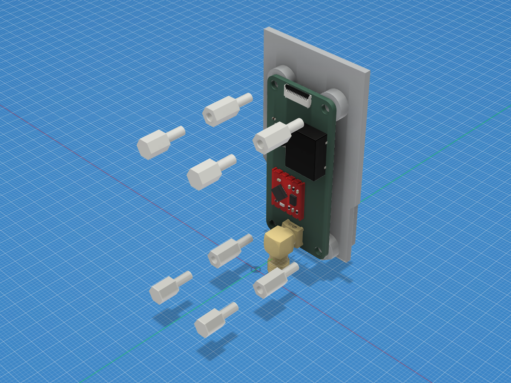 Before: the four 8 mm standoffs (nearer sens1, thread end towards the board) and the four 6 mm standoffs (further out), in line with the 4 mounting holes.</td>
<td>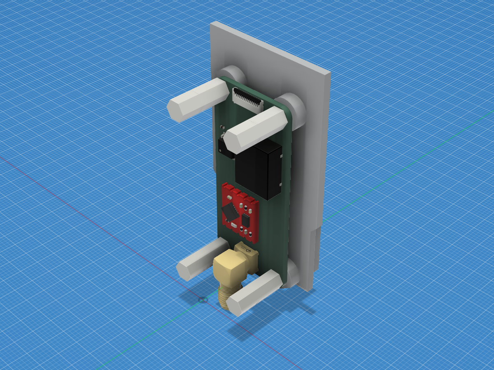 Fitted: 8 mm standoffs through sens1 into the sled inserts, 6 mm standoffs on top (the thin line is the joint).</td>
</tr></table>

**Step 5. Main board** (build_04_main_board.png). Plug the other end of the FFC into the main board's CN1. Then fold the main board over onto the standoffs, components facing out, with USB-C at the bottom. Put a short nylon M2.5 x 6 pan head screw from the kit (B0B5M1M822) through each of the main board's 4 mounting holes into the top of the 6 mm standoff and tighten gently. The board sits on the four standoff tops; sens1 is already held by the standoffs, so the long screws of the first draft are no longer used.

<table><tr>
<td>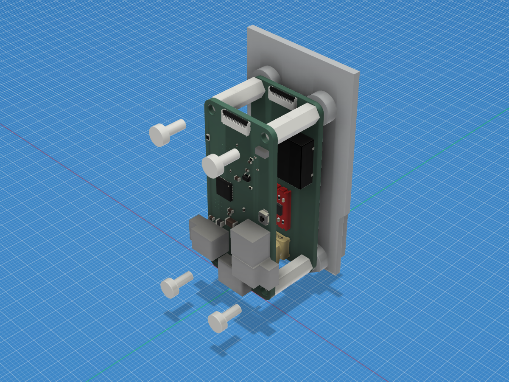 Before: 4 white nylon screws (M2.5 x 6, from the kit) in line with the main board's holes and the standoff tops.</td>
<td> Fitted: heads on the main board, shanks in the standoffs.</td>
</tr></table>

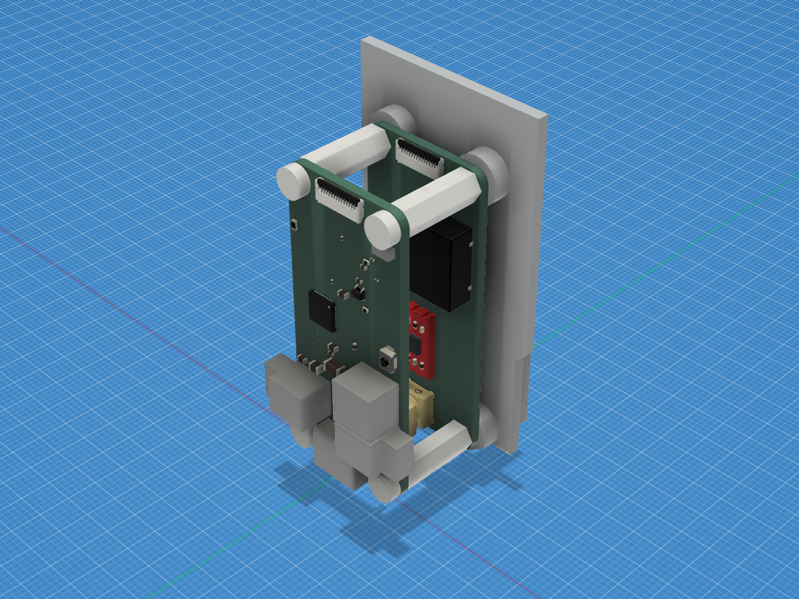

**Step 6. Check the FFC** (build_05_ffc_side.png, side view from the antenna side; the pale block between the boards is the silica slot rib). The FFC should make a smooth U-turn above the top edge of the boards without kinking. It has about 1 mm of room under the roof.

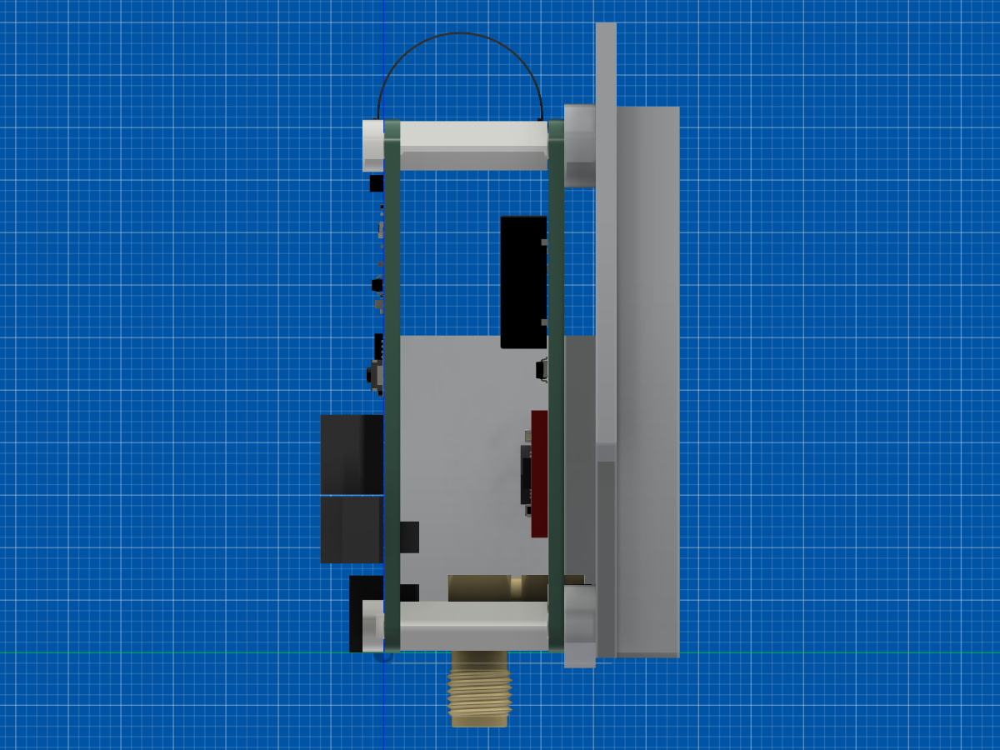

**Step 7. Battery** (build_06_battery.png, view from the back). Turn the cartridge round. Wrap the battery in thin foam and slide it between the two rails on the back of the sled, lead end down, until it sits on the ledges. Route the lead round the side to the battery JST (U4) on the main board, but don't plug it in yet. The silica pack does not go here any more; it goes in at step 10.

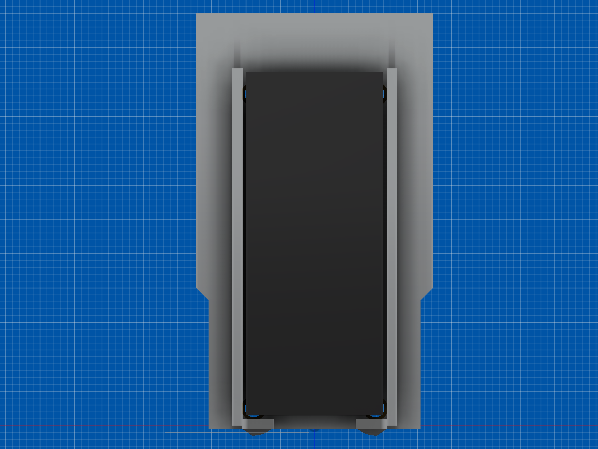

**Step 8. Pigtail.** Screw the right-angle SMA plug of the pigtail onto sens1 J1 at the bottom of the cartridge. Hand-tight is enough.

## 4. Key and light pipe into the sleeve
**Step 9** (build_07_key_pipe_position.png shows where they end up against the board). Hold the sleeve with its open bottom up. From the inside, push the key into the 7.4 mm hole on the front wall, cap first, so the flange sits in the counterbore. Push the light pipe into the 2.7 mm hole beside it, outer end first, with the notch in the key's flange round it. Nothing holds them yet, so keep the sleeve front-down until the cartridge is in.

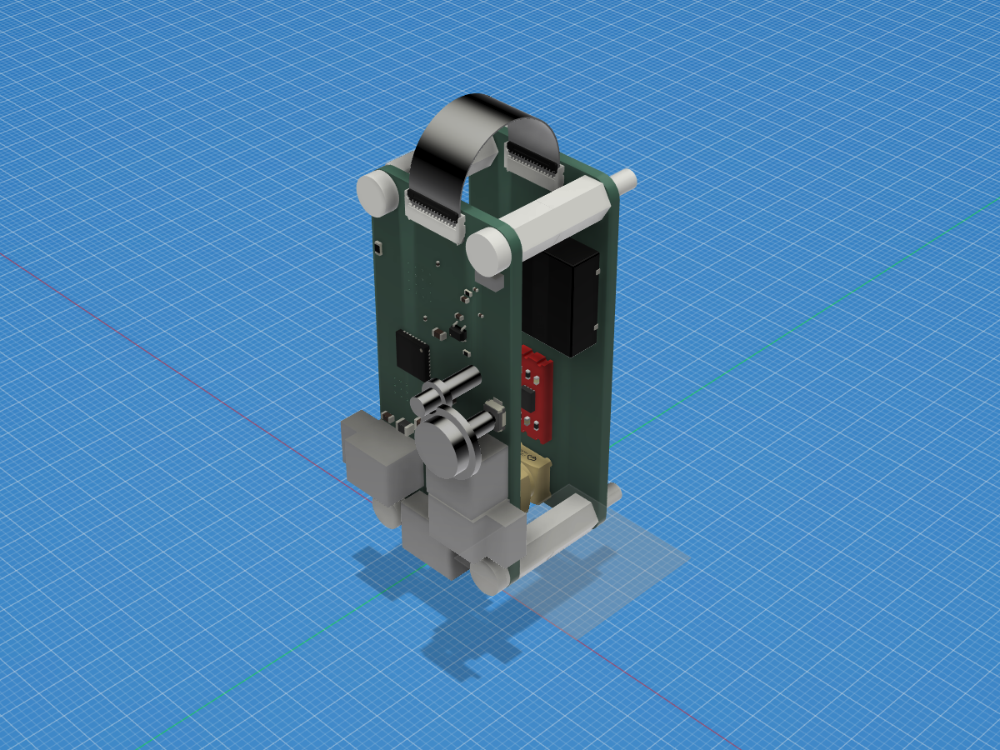

## 5. Close the enclosure
**Step 10. Cartridge into the sleeve** (step3_cartridge_in_sleeve.png, seen from below, the 4 gold plinth inserts visible in the corners and the pale blue silica pack beside the boards). Keep the sleeve upside down. Lower the cartridge in, top end (FFC loop) first, main board towards the front wall (the key side). The top of the sled drops into the slot between the ribs on the inside of the roof. Once it's down, the board holds the key and light pipe in place: the key plunger sits 0.2 mm off SW1.

**Silica pack (do this now, before the cap).** With the sleeve still upside down and the cartridge in, the slot between the sled rib and the sleeve's left wall (the side away from the key and the antenna) is open towards the cap end. Push one 1 g silica pack (B0GSRKXHFT) into it, flat against the wall, so that it lies along the wall for about 30 mm from the open end; the slot has no stop, the pack is held by friction between the wall and the rib, and once the cap is on and the unit stands upright the pack rests on the cap floor. The pack is flexible, so it only has to fit the 3.95 mm gap between the wall and the rib. Keep its front edge back from the front of the channel: the battery JST plug and its wires are there (0.5 mm clearance in the model) and the vent hole in the cap is just in front of it (0.9 mm).

<table><tr>
<td>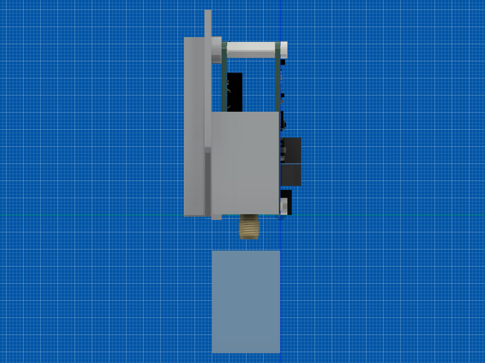 Before (side view from the left, sled plate on the left, boards on the right): the pale blue pack waits below the cartridge, in line with its slot. The grey block in front of the boards is the sled rib.</td>
<td>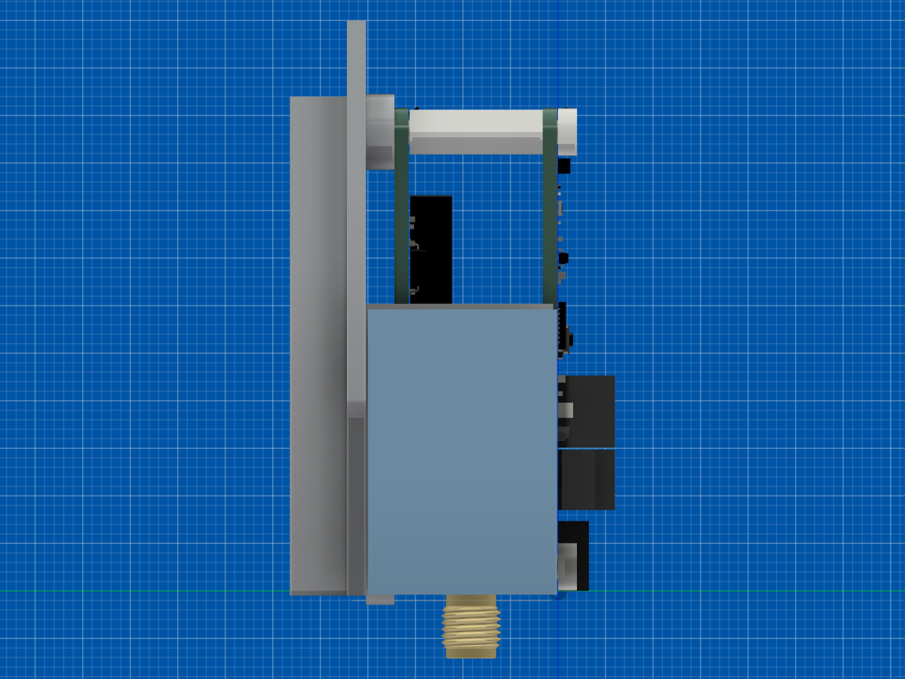 Fitted: the pack lies in the slot beside the boards, in front of the sled plate, from the cap end up to about 30 mm.</td>
</tr></table>

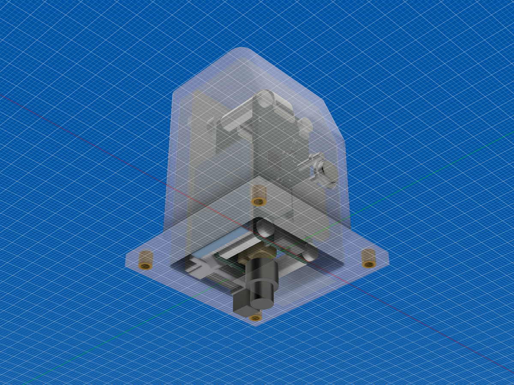

**Step 11. Foot cap** (build_08_pigtail_bulkhead_cap.png, sleeve hidden).
- Push the SMA bulkhead jack up through the 6.5 mm hole in the heel floor and tighten its nut. Screw the free end of the pigtail onto it.
- Pass the solar panel cable in through the 4.5 mm hole in the toe (front-left) and plug it into the solar JST (U5).
- Plug in the battery (U4). **Battery first, before the solar panel or USB** (rule printed on the board: BATT FIRST).
- Lay the o-ring cord in the cap groove.
- Put the cap onto the sleeve's open end, heel (box) under the SMA end, USB tunnel lined up with the USB-C connector. Fit the 4 M2.5 x 6 stainless socket head screws (B0GCSRG1WD) through the cap into the plinth inserts and tighten them in a cross pattern, a little at a time, so the o-ring compresses evenly (step4_footcap_on.png). The counterbores are 2.7 mm deep and the screw head is 2.5 mm tall, so the heads sit 0.2 mm below the cap's underside. Each screw reaches 4 mm into its 4 mm insert (full insert length) and its tip ends 0.7 mm past the insert in the 5 mm deep hole.

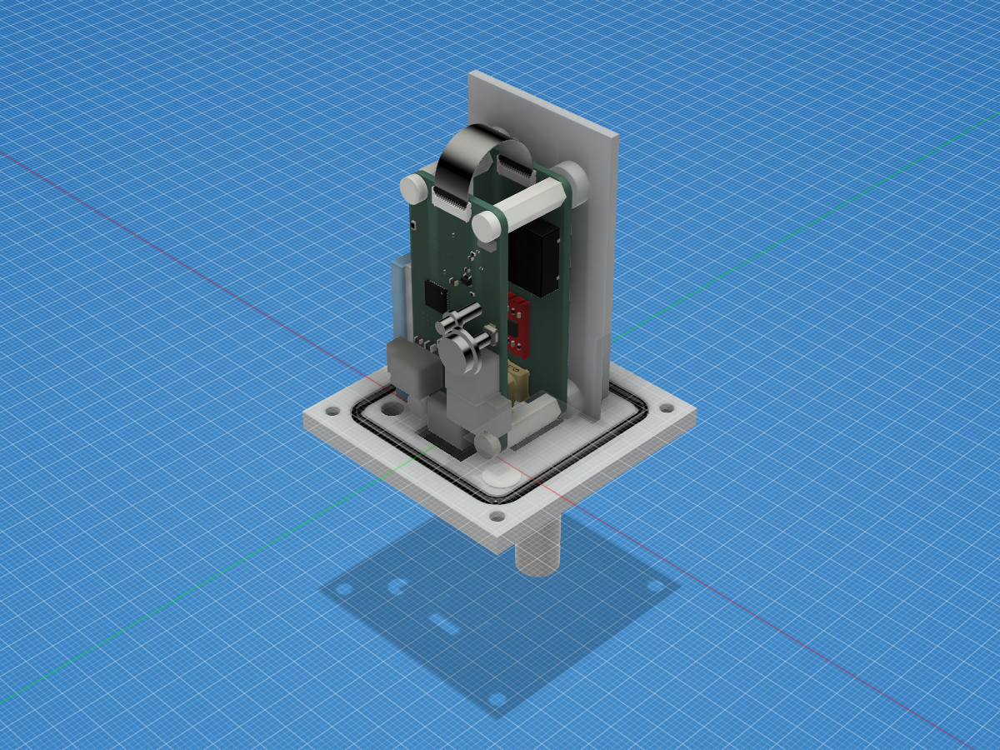 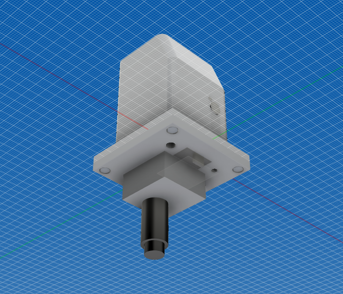

O-ring (B00QVB0ZG6, 2 mm silicone cord, glued into a loop):

<table><tr>
<td>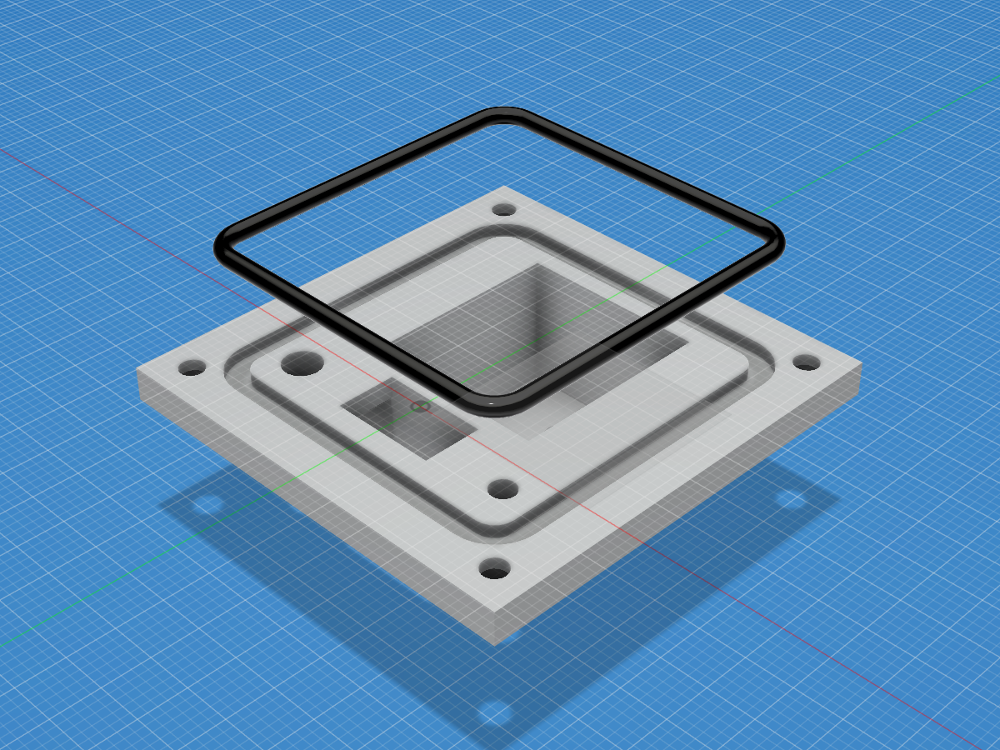 Before: the black loop above the cap's groove.</td>
<td>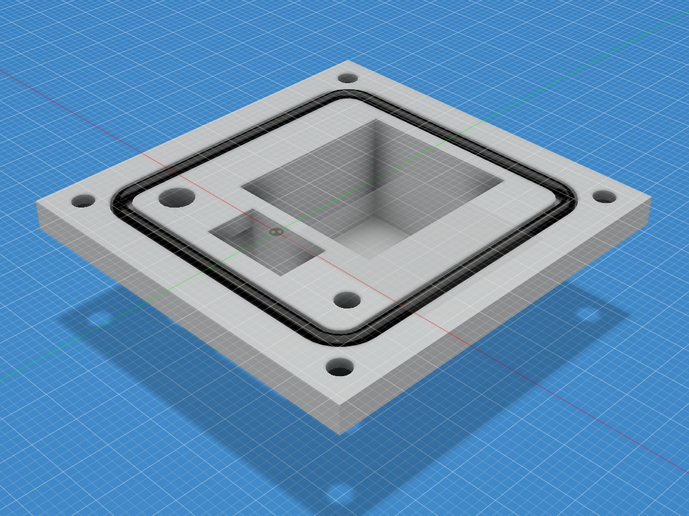 Fitted: the cord sits in the groove and stands about 0.5 mm proud of the cap face. The sleeve squeezes it flat.</td>
</tr></table>

Foot-cap screws (B0GCSRG1WD, M2.5 x 6, 4 off), seen from below:

<table><tr>
<td>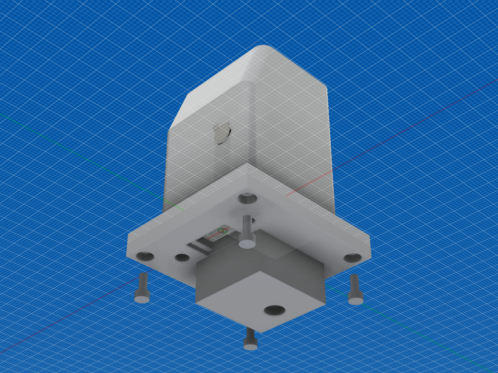 Before: 4 steel screws below the cap, one under each corner hole, aimed at the gold plinth inserts.</td>
<td>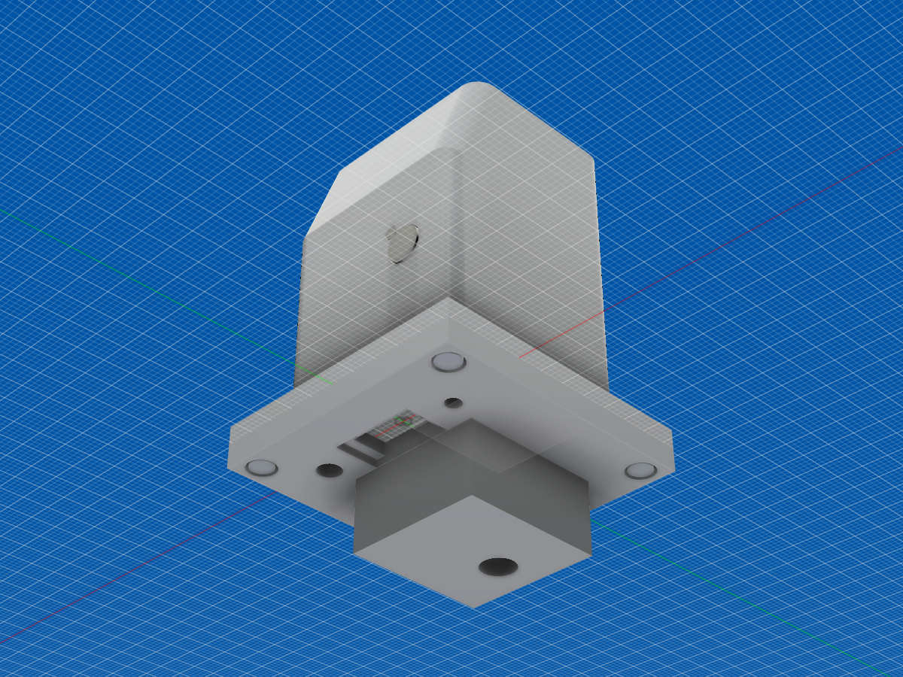 Fitted: heads in the counterbores, 0.2 mm below the cap's underside, tips in the inserts.</td>
</tr></table>

**Step 12. Bung and boot (optional fit check).** Press the USB bung into the tunnel recess under the cap. Slide the SMA boot over the bulkhead under the heel.

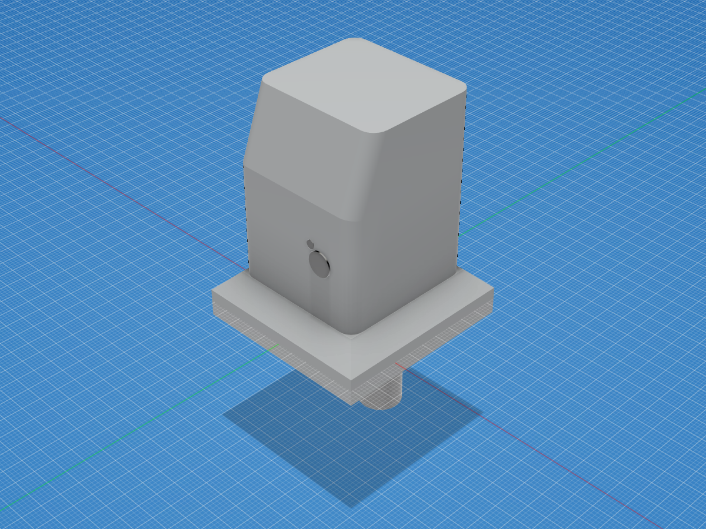

## 6. Mounting
**Step 13. Rim clip onto the cleat** (step5_clip_side.png, step5_clip_section.png, build_11_complete.png). The sleeve has a cleat high on its back wall: a 24 mm wide bar, 3 mm proud, whose underside slopes down and away from the wall at 45 deg. The clip has a matching pocket with a 45 deg lip and a cheek on each side. The node hangs by its cleat on the clip's lip; the slope pulls the node's back against the clip, so it can't slide down or tip off, and the cheeks stop it moving sideways. Nothing has to pass the flared base.

1. Hang the clip on the tank rim first (step 14), pocket facing out from the glass. Or, on the bench, hold the clip in one hand and the node in the other.
2. Hold the node upright with its back about 3 mm in front of the clip and its cleat a few millimetres above the clip's pocket, centred between the two cheeks.
3. Move the node back until its back wall is against the clip, then let it drop about 3 mm. The cleat slides down into the pocket and seats on the lip. On the bench you can instead hold the node and push the clip up onto the cleat from below, flat against the back wall.
4. Check: the cleat sits between the cheeks with a little sideways play (about 0.35 mm each side), the node's back is against the clip's lower plate, and the node does not come off when you push it down.

To take the node off: lift it about 3 mm, pull its back about 3 mm away from the clip, and lower it clear.

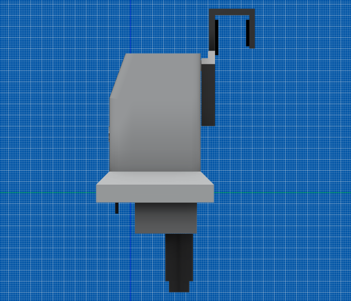 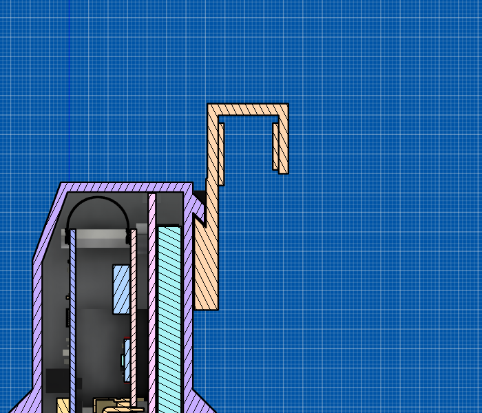

*Left: side view (the clip's cheek hides the cleat). Right: cut through the middle; the small wedge at the top of the sleeve's back wall is the cleat, sitting in the clip's pocket on the 45 deg lip.*

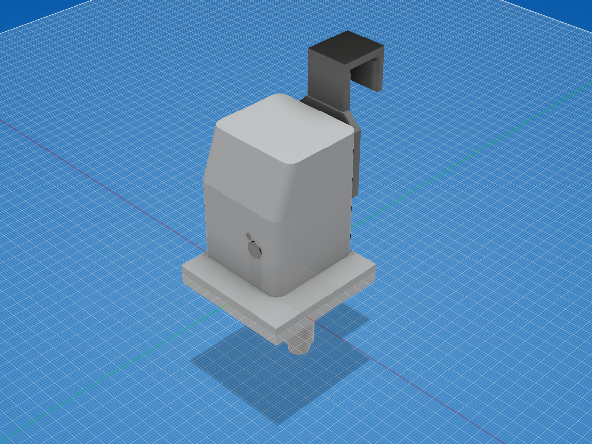

**Step 14.** Hang the clip over the tank rim with the back of the node against the glass. Put the leaf card with the solar panel where it gets light, and route its cable down to the node.

## Taking it apart
Lift the node off the clip (step 13). Undo the 4 cap screws and lower the cap. Take the silica pack out of its slot (it will want drying or replacing). Unplug solar and battery, unscrew the pigtail from the bulkhead, and slide the cartridge out downwards. To separate the boards, remove the 4 short screws from the main board, then unscrew the 6 mm standoffs; the 8 mm standoffs can then be unscrewed from the sled (this frees sens1).
